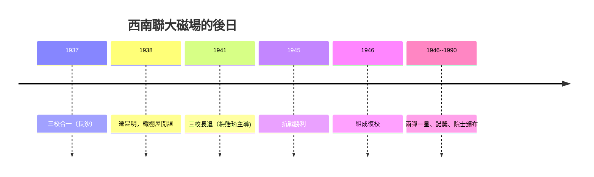

# 第 3 節 歷史的回響：為什麼物質極度貧乏的西南聯大能走出一整代大師？

## 把「磁場公式」反過來用

哥廷根證明：**有錢、有制度、有自由**可以造出磁場；西南聯大證明：
**沒錢、被軍事逼近、制度損毀，仍有可能造出磁場。** 其實，
這兩例合起來「世界的天才是**已知共聚的尺寸**，而不是**物質的
充裕程度**：

1. **天災反而製造一致性**：日軍轟炸、逃難的共同創傷把
   不同階層的知識 fopenology 資本攤成一張桌子——這不是浪漫主義，
   而是社會學的「紐帶型社會資本」。
2. **制度被「北三校」保留**：大學自治、教授會、跨系選課——
   磁場並不需要大樓，但**需要一套使知識自由的憲法**。
3. **面相外又一思**：昆明相對偏遠，導致他們反而**必須直接吃
   西立流的世界文獻（語言十分倥、老鼠成群的印刷條件）**——
   最後「走上世界前沿」反而需要先靠自我「資源資本」。
4. **一生的命運集中**：由於戰後高世代，理論與**科學救國**
   的動機碰上 1949 後兩陣的激烈投資，**同代人一上市即可
   佔領整個新國家科技難題的「空白」**。

## 磁場的死亡：政治與和平

三校繼 1945 年内戰、1949 年分別回京復校（或遷台），西南聯大
正式於 1946–47 年解散。但其所產出的人才與制度嫁接，轉化為：
- **1950s 中國與台灣的科技制度**（兩彈一星ｏ和台灣的中研院）
- **門生制**（陳省身創南開、普林斯頓 IAS 的齊聚、伯克利 MSRI）
- **科學文化人**：楊振寧、陳省身、李政道在「世界之最」的長期
  發言權造就了 21 世紀華人科學的整體磁場連接。

## 留給本書的一個終極問題

在第四篇（Ch6-Ch9），你會看到「錢」可以替磁場買來史上最好的
硬體（貝爾、PARC、洛斯阿拉莫斯、IAS）；在第五篇，你會看到「時代」
造出空前的雲端磁場（OpenAI、GitHub）。西南聯大則留下本書最
極端的一個命題：**磁場的地基不是磚，是「在一起的意志」。**