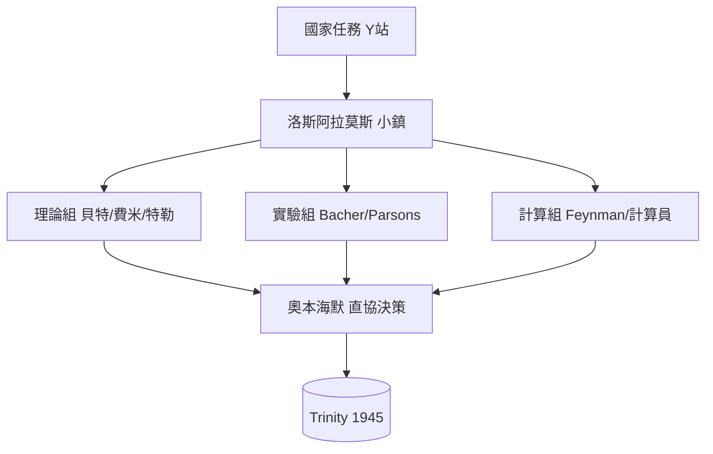

# 第 1 節 荒漠中的神祕小鎮：奧本海默如何管理這群世界上最難馴服的超級大腦？

## 一處被憑空創造的城市

1942–43，曼哈頓計畫把理論中心「Y 站」設在新墨西哥荒漠的洛斯阿拉莫斯——原址只是一所男童校，無路、無郵政。兩年後，此地聚集近六千人：諾獎級物理學家、頂尖化學家、金屬工程師、計算員與其家眷。整座小鎮以**鐵絲網＋郵件審查＋代號**運行：家庭住址不公開、信件經列寧格（倫敦外）的檢查站、每一位成員只「知道需要知道的」（Need-to-Know）。

## 奧本海默：把「磁場管理」發明為一項技藝

奧本海默不是工程經理，他是**一個能讓最難馴服的天才彼此聽見的人**。方法上：

- **問題導向的工作小組**：不做官僚式部門，而以「一個待解問題一組人」組織（內爆組、中子組、計算組……），各組直接向他報告——這是日後矽谷「扁平化＋問題小組」的雛形；
- **每日例會 + 茶室黑板**：所有人（包括 Nobel 得主與 20 歲新生）同室爭論；會議記錄當日發至各組；
- **以個人信用打通制度**：他為被審查、分居、薪資不公的成員各各打通 ——很多人的參與動機並非「愛國」，而是「**奧比叫我去**」；
- **對不馴者的「物理化馴法」**：他為特勒安排「氫彈預研」以安置其不滿——**把麻煩變成研究問題**。

## 一個磁場「必須保密」的悖論

科學的燃料是公開；洛斯阿拉莫斯的燃料是封閉。奧本海默的解法是**內部極度公開、外部極度封閉**——在小鎮內，任何理論、失敗與資料完全共享。80 年後，這正是開源社群的治理邏輯（見 Ch14）。