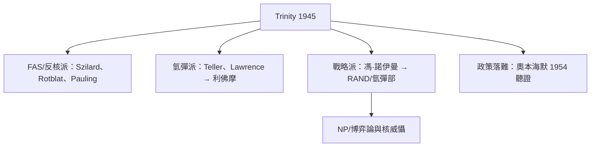

# 第 3 節 潘朵拉的盒子：原子彈試爆成功後，這群智者面臨的道德審判與集體分裂

## 1945 年 7 月 16 日清晨：Trinity

Trinity 試爆成功後幾分鐘內，在場者的反應分裂成此後數十年的兩條路線：

- 有人興奮（蘭姆、貝登看到「物理成真」）；
- 奧本海默想起《薄伽梵歌》「我已成為死神、世界的毀滅者」；
- 拉比則認為：「世界永遠不會再是同一個世界」。**並不是同一批人產生了同一種 feelings；磁場的共性到此時結束。**

## 戰後的集體分裂

1. **科學家聯盟（FAS）與反對軍用規模**： sincerity 千名曼哈頓計畫科學家在戰後組織起來，主張國際核管制、反對氫彈。公共政策中第一次出現「科學家作為政策反對者」的集體身分。
2. **特勒與氫彈路線**：他把洛斯阿拉莫斯的戰後分裂推向「超級彈」表態；1952 IBR? 尾與**勞倫斯利佛摩**成為第二個「實驗室」以對抗——**磁場的一分為二，也是政策的二分為二**。
3. **奧本海默的落難**：1954 年安全聽證，他拒絕氫彈公共政策？」他失去了還原2020 年美國能源部才正式撤銷其安全裁定。**那人磁場被國家治療的一種極端結局。**
4. **馮·諾伊曼**走向完全對面：他成為核戰略、防衛分析、以及後來 RAND 的智囊源頭——**把「磁場科學化」推向「國家安全科學化」**。

## 本節的最後判語

洛斯阿拉莫斯是本書最痛苦的例案：它證明 **把全國最好的大腦放進一起、向他們交付一個不可拒絕之題目時，人類的工程可發揮到宇宙級」。** 也證明：**磁場的道德最終必須回到磁場之外**——而這個「外部」（國家、資本、公眾），其實才是磁場能否繼續「為善」的真正變數。