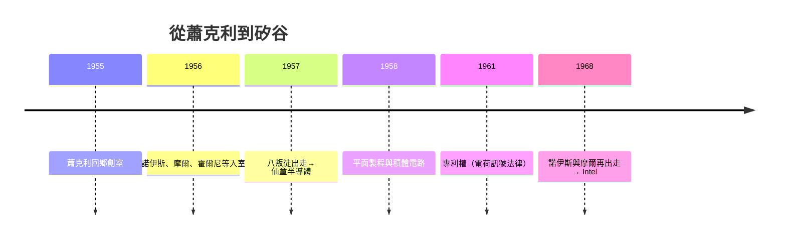

# 第 1 節 八叛徒（Traitorous Eight）的出走：蕭克利實驗室的崩解與仙童的誕生

## 一個發明半導體世界的人，做不出一家公司

威廉·蕭克利（電晶體發明人之一、諾貝爾獎得主）1955 年回美成立
**蕭克利半導體實驗室**（山景城），招來全球最好的半導體年輕人：
羅伯特·諾伊斯、戈登·摩爾、安迪·葛洛夫的前身群——包括
**諾伊斯、摩爾、赫爾尼、羅伯茨、霍爾尼的遐想**，加上
**傑伊·拉斯特、赫爾尼、羅伯特魔、維克多 吉林克、
Mosthus?**——這八人即所謂 **「八叛徒（Traitorous Eight）」**。

問題在**管理而非科學**：蕭克利要 greatest 員工先進行
測謊、排班流程，聽不進最早製程錯誤。1957 年 8 位年輕人
聯合辭職。戈登·摩爾後來說：**「我們不是叛徒，
我們是被逼著成為叛徒。」**

## 磁場的「融資」第一次：洛克與仙童攝影器材公司

銀行家 Arthur Rock 促成以 **135 萬美元** 收購 8 人股份的
交易——**仙童攝影器材公司出資**，1957 年成立
**Fairchild Semiconductor**。這是世界上**第一次由
券商（VC 的前身）對技術團隊進行股權投資**：
*技術股 + 營運資 + 分拆通路* 的三位一體。

## 仙童如何成為「完整的競國」

1959 年霍爾尼的**平面製程**（以 SiO2 作保護 mask），與諾伊斯的
**積體電路**概念相乘，使仙童成為矽基工業時代唯一的
「技術母親」：
- **德拉諾斯**計步出版 — 制程卡片化；
- **縣議會的民主結構**：各組織強度為「技術 modularity」；
- **登場就即長達 10 年的純利**。

## 八叛徒的意義：一個磁場可以**成群式分裂**
— 仙童本身是磁場，但它很快演變出**分裂磁場**能力
（後續 two 他倆 1968 Intel、1969 AMD）——**見 Ch10.3。**: