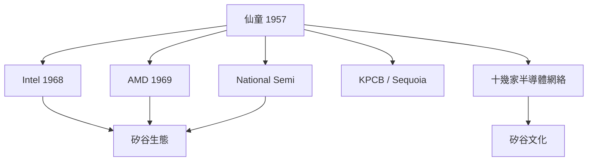

# 第 2 節 創投（VC）與技術的化學反應：仙童如何成為矽谷風險投資與創業文化的搖籃？

## 「股權分工」的四件發明器

仙童帶來的是**制度創新**而非只是製程創新：

1. **技術員工持股**：8 位創辦人以股份 + 分成進入公司；
2. **技術長期待權**：把技料人留在公司及跟公司「同命線」；
3. **水星球式秋 → 立 R&D → 分製公司的生意循環**：
  即「Spin-out」，先例於 1961 Doc 建立的公司
4. **大腿投資**：創辦人可以同時是股東、職員
  決定人生的工作與风险承担。

## 1957–1970 的「仙客來溫器」

以投資的視角，仙童後續產出的不是一家公司，而是**一種市政**：
- **方法論**：技術團隊 + 專利授權 + 顧客→ 進入車庫；
- **雕塑工具**：WIC 班（即投資人直接持有公司共同股份），如
  KPCB、Sequoia、Graylock 與 Rock 的 Reed Partners；
- **人數類聚**：Fredric Terman 在 Stanford 打電話給 Sand Hill
  Road 的**投资者**吸引至硅谷（接續 technical 88 頭
  手 身 段 探制）。

### 一個投資生態的三家公司最強磁場

## 對世界最大的貢獻：**「失敗不是我去代價」**

在波士頓的 Route 128（以 IBM 大廠為中心），科學家辭職是背詳；
在山景城，**辭職 + 須股星哥 + 創妥善**成了常理文化。到 1970s，
「在 Almazy 創立公司」的機制已然成型——**時間距離到跟 1957
年的八叛徒不逼長**。