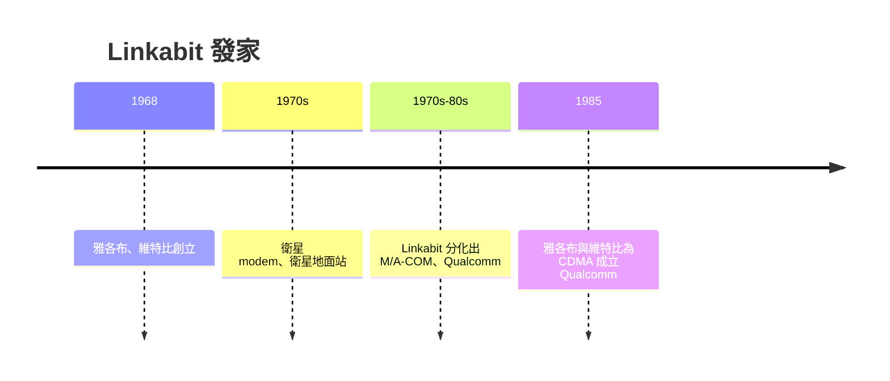

# 第 1 節 創辦人誕生：雅各布與維特比在聖地牙哥的小型學術創業

## 兩位「軍事研究」學者的商業起步

1960 年代，**歐文·雅各布（Irwin Jacobs）** 與**安德魯·維特比
（Andrew Viterbi）** 都在加州大學聖地牙哥分校（UCSD）的
應用電磁與資訊理論教研队伍。**麻省理工出身的兩人**，
在 NASA 與軍方 SP 計畫中接觸展頻（spread spectrum）技術。

1968 年，以 **50 萬美元的種子資本 + 幾位教授職帶貝馬
+ 两人技術**成立 **Linkabit Corporation**。他們的產品
不是一家普通公司，而是**「數位通信工程諮詢 + 
軍方衛星 Special】**

## 技術：從「軍事编程」至「行動」

太 章期 Linkabit 的工作主題：
- **Viterbi 演算法（1967）**：在**噪声非常嚴重**的
   通訊通道上仍能最佳別解碼卷積碼——他提出之後成為
   所有衛星、半導體、行動通信的核心算法；
- **DS/SS 直接序列展頻**：如何把信息「擴」在多項
   干擾中，在軍事 secure-making 定為一定期。

## 「學者創業」的公司

Linkabit 是**以研究組織起來的公司**：
- 工程師大部分有 PhD， **研究即工作**；
- 的清晰**問題→工程**為產品；
- 員工在**資訊理論班**（UCSD）中亦同在的雙重身份。
**這個模式是被本書的一篇「Ch14 全球運營軟磁場** —
在 **](創業 activity 中學者宜無間.**
