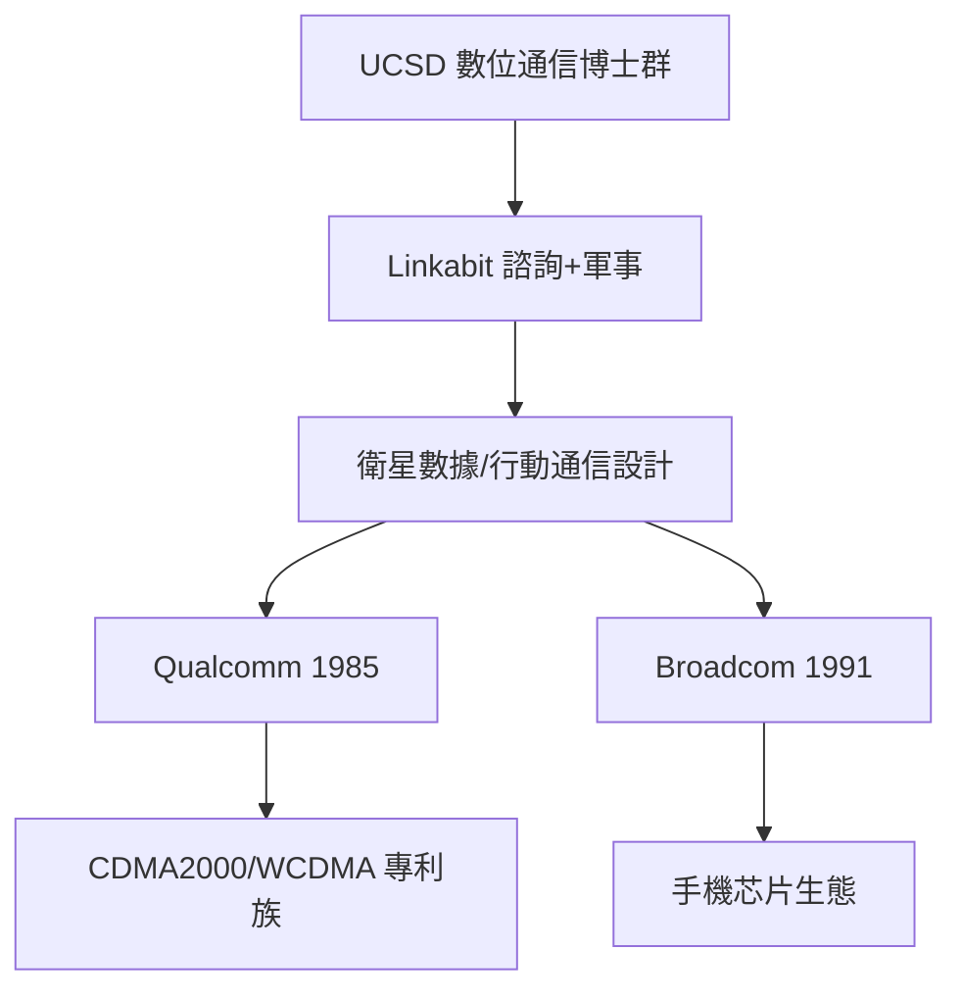

# 第 2 節 數位通訊的創新搖籃：展頻技術、衛星通訊與早期工程師的創業孵化器

## Linkabit 的六十年雙生模式

Linkabit 的**獨特**，是 「公司養育下一個實驗室」的**產業鏈中樞**：

- **1970s**：衛星通訊地面設備；
- **1980**：被 **M/A-COM** 收購；
- **1985**：同一批的人再起，成立 **Qualcomm**，
 以 **CDMA 展頻通信** 重寫全球行動通訊的遊戲規則；
- **此後數十年**：「Linkabit 系」的工程師散佈在
  **全球 telecomm 與晶片廠**，包括 Qualcomm、
  Broadcom（Broadcom 帶來的校園文化）、MediaTek
  的重要 **decendant 集成**。

## 孵化器機制的三層

## 「技術-資本」的共範式

Linkabit 展現的大規模「資訊理論直接挽回利潤」,
為**整合通信產業**的**共用文庫**：
- **多存取**問題：1985 的 CDMA 的擇極多址（在多
  手機同時通話）以**每用戶訊息的鏈路**使用同頻網lif；
- **extend spectrum**：頻道分配的結果延展到 **蜂窩
  系統**；
- **书籍送到**每個資訊理論課程：**「粗略想法在
  60 年代已經在軍方專案完成，到 1985 后培育為
  全球經濟核心。」**