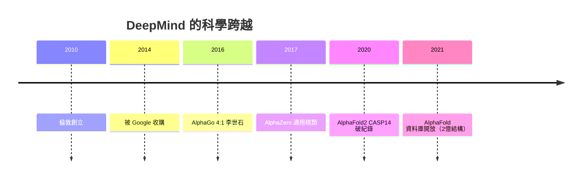

# 第 2 節 倫敦的 DeepMind：哈薩比斯團隊從 AlphaGo 到 AlphaFold 的跨領域科學突破

## 一家「以科學為目的」的公司

2010 年 Demis Hassabis 在倫敦創立 **DeepMind**，初衷是
「以神經科學 + 遊戲 + 強化學習**最終解決智能」**；
2014 被 Google 以約 5 億美元收購——**繼多倫多磁場之後，
新的「收購一間磁場」模式**。

## 兩大科學跳板

- **AlphaGo（2016）**：以深度神經網路+蒙特卡洛樹搜尋+
  自我對弈，在首爾 4:1 擊敗李世石——**五感型「直覺」
  首次被機器證明可得**，並推動圍棋界「新開局」；
- **AlphaFold（2020–）**：以幾何結構的注意力網路，
  把**蛋白質折疊問題**從數十年難題變成公開資料庫——
  「**AI for Science**」自此確立為科學磁場的第四種
  工作方式。

## 倫敦磁場的制度特徵

- **「研究員—科學家—工程師」的橫評結構**：以科學為共同語言；
- **長期性問題挑選**：能同意「先五年打磨一個模型」；
- **關鍵**：**小團隊也能有大資源**（跟 Google 的結合）。

DeepMind 因此成為**本書「企業磁場」的最後一章**，
並且是**在「算力即資源」的時代中，如何重新發明
純科學機構**——見下一節 OpenAI。