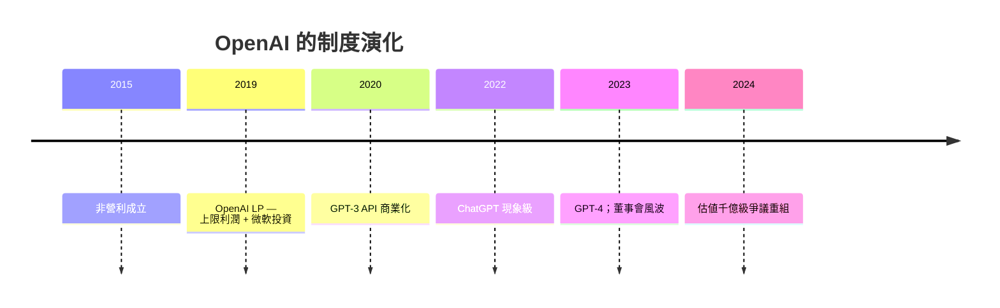

# 第 3 節 舊金山 OpenAI：從非營利開源研究室走向 AGI 巔峰的權力、資本與信念博弈

## 一種「用慈善資金進行軍備競賽」的奇怪制度

2015 年，Sam Altman、Elon Musk、Greg Brockman、Ilya Sutskever
等人在舊金山成立 **OpenAI**：一非營利、以「開放+安全+AGI」
為目標的研究院。門檻前的承諾是 **10 億美元捐款**——
以非營利的殼承擔一場與 DeepMind 競逐的科研。

## 從非營利走向「金錢的不可避免」

- **2019 OAI LP**（capped-profit）是磁場歷史上**最折衷的制度
  創作**：資本必須進場，又追求出資上限（回報的倍數封頂）；
- **微軟**：於 10 億美元起投資，然後把 OpenAI 的模型
  銷進全球企業產品，**把 Azure 變成算力市場壟斷的一半**；
- **ChatGPT（2022-11）**：兩個月破億用戶，**LLM 磁場**
  全世界哄同時起步。

## 新磁場的「人材流」結構

OpenAI 證明**筆—**磁場可以**以「模型權重」作為行動單**，
到 2024 年，前員（Anthropic 的 Dario/ Dan Morin 等
DeepMind 同意，Character.AI 的 Noam Shazeer 等）
以**創辦下一家**的格局：
- **Anthropic**：安全優先章的對手；
- **xAI**：馬斯克第二次出場；
- **Mistral（巴黎）、DeepSeek（杭州）**：知識與
  「模型文化」更多方向磁場化。

**Ch13 總結：Transformer 一篇論文 + 大算力 + 資本，
鑄成 2020s 的全球 AI 磁場**；可它带来了**制度再定義**
（資本、財務、治理），比論文的技術含量更為驚人——
這是本書「制度×磁場」的新一頁。