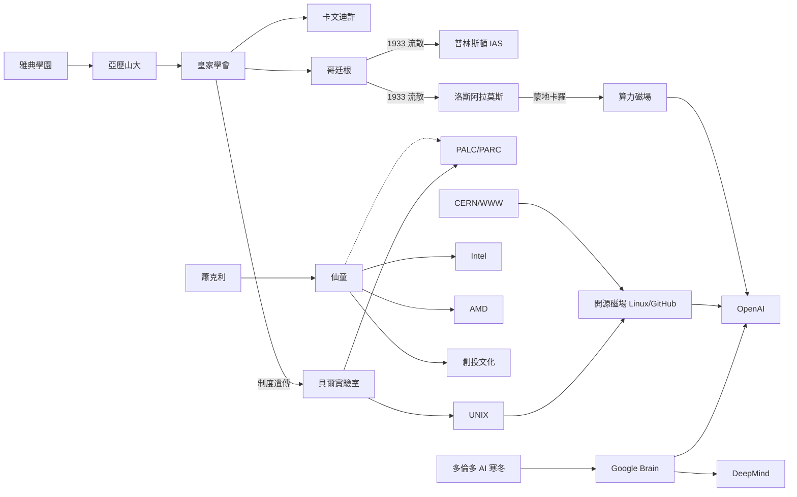

# 《智者匯集之處：人類歷史上最偉大思想磁場的興衰與傳奇》

> 天才總是成群而來。本書以十四個知識磁場，追索兩千五百年來
> 人類智慧群聚的技術、經濟、制度、文化與政治。

---

## 目錄

* 前言
    * [0.0-前言：天才為何成群而來](00.0-前言：天才為何成群而來.md)

### 第一篇：古代哲學與近代實驗科學的破曉

* 第1章-雅典學園與亞歷山大圖書館：古地中海的知識航母
    * [1.1-柏拉圖學園：橄欖樹下的哲學對話與幾何禁區](01.1-柏拉圖學園：橄欖樹下的哲學對話與幾何禁區.md)
    * [1.2-亞歷山大圖書館：人類歷史上第一座匯聚全人類文獻的知識熔爐](01.2-亞歷山大圖書館：人類歷史上第一座匯聚全人類文獻的知識熔爐.md)
    * [1.3-希臘、埃及與東方智慧的碰撞：古地中海世界的多元學術網絡](01.3-希臘、埃及與東方智慧的碰撞：古地中海世界的多元學術網絡.md)
* 第2章-倫敦皇家學會：實驗科學與「不聽信任何人的話」
    * [2.1-Nullius in verba：皇家學會如何用科學實驗挑戰古老權威](02.1-Nullius in verba：皇家學會如何用科學實驗挑戰古老權威.md)
    * [2.2-跨越國界的共和國信件：歐洲啟蒙時代的知識通信網](02.2-跨越國界的共和國信件：歐洲啟蒙時代的知識通信網.md)
    * [2.3-牛頓的倫敦朋友圈：鑄幣廠、咖啡館與近代科學權力的中心](02.3-牛頓的倫敦朋友圈：鑄幣廠、咖啡館與近代科學權力的中心.md)

### 第二篇：近代物理聖殿與戰火中的奇蹟

* 第3章-劍橋大學卡文迪許實驗室：產出三十多位諾貝爾獎得主的物理聖殿
    * [3.1-1874年的創立：麥克斯韋與第一代卡文迪許教授](03.1-1874年的創立：麥克斯韋與第一代卡文迪許教授.md)
    * [3.2-從電子、中子到雙螺旋：卡文迪許如何連續引領基礎革命](03.2-從電子、中子到雙螺旋：卡文迪許如何連續引領基礎革命.md)
    * [3.3-盧瑟福的鱷魚實驗室：充滿幽默、直覺與強大凝聚力的領導藝術](03.3-盧瑟福的鱷魚實驗室：充滿幽默與直覺的團隊領導藝術.md)
* 第4章-德國哥廷根大學：世界數學與量子物理的絕對首都
    * [4.1-克萊因與希爾伯特：把德國小鎮打造成全球數學家的麥加](04.1-克萊因與希爾伯特：把德國小鎮打造成全球數學家的麥加.md)
    * [4.2-矩陣力學與量子狂熱：波恩、海森堡與哥廷根的物理學風暴](04.2-矩陣力學與量子狂熱：波恩、海森堡與哥廷根的物理學風暴.md)
    * [4.3-納粹崛起與天才的流散：哥廷根神話的破滅與全球學術版圖的重洗](04.3-納粹崛起與天才的流散：哥廷根神話的破滅與全球學術版圖的重洗.md)
* 第5章-國立西南聯合大學：物質極度匱乏下的華夏學術神話
    * [5.1-鐵血與書桌的交織：戰火中遷徙至昆明的鐵棚屋大營](05.1-鐵血與書桌的交織：戰火中遷徙至昆明的鐵棚屋大營.md)
    * [5.2-陳省身、吳有訓與華羅庚：開在空襲警報聲中的數學與物理之花](05.2-陳省身、吳有訓與華羅庚：開在空襲警報聲中的數學與物理之花.md)
    * [5.3-歷史的回響：為什麼物質極度貧乏的西南聯大能走出一整代大師](05.3-歷史的回響：為什麼物質極度貧乏的西南聯大能走出一整代大師.md)

### 第三篇：極限組織、曼哈頓計畫與企業研發烏托邦

* 第6章-普林斯頓高等研究院（IAS）：純粹思想的世外桃源
    * [6.1-拒絕授課的豪華陣容：愛因斯坦、馮諾伊曼與哥德爾的避難所](06.1-拒絕授課的豪華陣容：愛因斯坦、馮諾伊曼與哥德爾的避難所.md)
    * [6.2-絕對自由的學術庇護所：天才不再為經費與論文煩惱](06.2-絕對自由的學術庇護所：天才不再為經費與論文煩惱.md)
    * [6.3-普林斯頓與曼哈頓計畫：IAS 如何悄悄介入二戰的歷史走向](06.3-普林斯頓與曼哈頓計畫：IAS 如何悄悄介入二戰的歷史走向.md)
* 第7章-洛斯阿拉莫斯實驗室：「Y 計劃」的物理學怪才大隊
    * [7.1-荒漠中的神秘小鎮：奧本海默如何管理世界上最難馴服的超級大腦](07.1-荒漠中的神秘小鎮：奧本海默如何管理這群世界上最難馴服的超級大腦.md)
    * [7.2-理論與工程的殘酷碰撞：當諾獎得主走進工廠與爆破現場](07.2-理論與工程的殘酷碰撞：當諾獎得主走進工廠與爆破現場.md)
    * [7.3-潘朵拉的盒子：試爆成功後，智者的道德審判與集體分裂](07.3-潘朵拉的盒子：試爆成功後，智者的道德審判與集體分裂.md)
* 第8章-貝爾實驗室（Bell Labs）：發明未來半個世紀的企業烏托邦
    * [8.1-聖杯三部曲：電晶體、資訊理論與UNIX的誕生](08.1-聖杯三部曲：電晶體、資訊理論與UNIX的誕生.md)
    * [8.2-自由探索與商業利潤的平衡：莫頓規範在企業內的實踐](08.2-自由探索與商業利潤的平衡：莫頓規範在企業內的實踐.md)
    * [8.3-壟斷巨頭的黃昏：為什麼貝爾最終走向解體](08.3-壟斷巨頭的黃昏：為什麼貝爾最終走向解體.md)
* 第9章-施樂帕羅奧圖研究中心（Xerox PARC）：發明了未來卻錯失帝國的矽谷聖地
    * [9.1-矽谷山麓的烏托邦：將GUI、乙太網路與物件導向集於一室](09.1-矽谷山麓的烏托邦：將GUI、乙太網路與物件導向集於一室.md)
    * [9.2-未來已經到來只是分配不均：賈伯斯參訪PARC與蘋果的誕生](09.2-未來已經到來只是分配不均：賈伯斯參訪PARC與蘋果的誕生.md)
    * [9.3-企業官僚的盲目：為什麼最偉大的發明室產出了顛覆世界的主意，母公司卻毫不知情](09.3-企業官僚的盲目：為什麼最偉大的發明室產出了顛覆世界的主意母公司卻毫不知情.md)

### 第四篇：矽谷母體與無線通訊的黃埔軍校

* 第10章-仙童半導體（Fairchild Semiconductor）：衍生出半導體帝國的「矽谷母體」
    * [10.1-八叛徒的出走：蕭克利實驗室的崩解與仙童的誕生](10.1-八叛徒的出走：蕭克利實驗室的崩解與仙童的誕生.md)
    * [10.2-創投與技術的化學反應：仙童如何成為矽谷風險投資與創業文化的搖籃](10.2-創投與技術的化學反應：仙童如何成為矽谷風險投資與創業文化的搖籃.md)
    * [10.3-仙童的孩子們：英特爾、AMD與數十家矽谷巨頭的血脈源頭](10.3-仙童的孩子們：英特爾、AMD與數十家矽谷巨頭的血脈源頭.md)
* 第11章-Linkabit：聖地牙哥的無線通訊黃埔軍校與高通之母
    * [11.1-創辦人的誕生：雅各布與維特比在聖地牙哥的小型學術創業](11.1-創辦人的誕生：雅各布與維特比在聖地牙哥的小型學術創業.md)
    * [11.2-數位通訊的創新搖籃：展頻技術、衛星通訊與早期工程師孵化器](11.2-數位通訊的創新搖籃：展頻技術衛星通訊與早期工程師的創業孵化器.md)
    * [11.3-從Linkabit到高通：一家公司如何改寫全球行動通訊CDMA的歷史](11.3-從Linkabit到高通：一家公司如何改寫全球行動通訊CDMA的歷史.md)

### 第五篇：深度學習冬夜、AI 巨獸與全球分散式智慧

* 第12章-多倫多大學神經網路小組：深度學習三巨頭的寒冬守候
    * [12.1-逆主流而行的孤獨者：辛頓在符號學派天下中堅守聯結主義](12.1-逆主流而行的孤獨者：辛頓在符號學派天下中堅守聯結主義.md)
    * [12.2-寒冬中的火種：Hinton、Bengio與LeCun在孤立無援中推動反向傳播](12.2-寒冬中的火種：Hinton、Bengio與LeCun在孤立無援中推動反向傳播.md)
    * [12.3-2012年ImageNet的破局：多倫多大學實驗室一舉點燃全球深度學習狂潮](12.3-2012年ImageNet的破局：多倫多大學實驗室如何一舉點燃全球現代深度學習狂潮.md)
* 第13章-Google Brain、DeepMind 與 OpenAI：當代 AI 革命的算力神殿
    * [13.1-Google Brain與Transformer：八巨頭的基礎設施革命](13.1-Google Brain與Transformer：Attention Is All You Need背後八巨頭的基礎設施革命.md)
    * [13.2-倫敦的DeepMind：從AlphaGo到AlphaFold的跨領域科學突破](13.2-倫敦的DeepMind：哈薩比斯團隊從AlphaGo到AlphaFold的跨領域科學突破.md)
    * [13.3-舊金山OpenAI：權力、資本與信念的博弈](13.3-舊金山OpenAI：從非營利開源研究室走向AGI巔峰的權力資本與信念博弈.md)
* 第14章-歐洲核子研究組織（CERN）與開源社群：無邊界的全球智者網路
    * [14.1-CERN與萬維網：柏納斯-李在粒子加速器裏意外發明的WWW](14.1-CERN與萬維網：柏納斯-李在粒子加速器裏意外發明的WWW.md)
    * [14.2-Linux核心與GitHub：沒有實體牆壁的全球百萬工程師線上智者群落](14.2-Linux核心與GitHub：沒有實體牆壁的全球百萬工程師線上智者群落.md)
    * [14.3-AI時代：從實體機構到雲端Agent的磁場終極形態](14.3-AI時代：從實體機構到雲端Agent的磁場終極形態.md)

* 結語
    * [15.0-結語：從雅典橄欖樹到全球雲端神經網](15.0-結語：從雅典橄欖樹到全球雲端神經網.md)

---

## 閱讀說明

- 各節以 **標準 GitHub Markdown** 撰寫，內嵌 **mermaid** 圖表與 **LaTeX** 公式（GitHub 原生渲染）。
- 每一節均討論**歷史關聯與前因後果**：科技、經濟、制度、文化、政治、思想的互相驅動，
  並以「磁場」為概念主軸——問題密度 × 人才密度 × 制度自由 × 資源。

