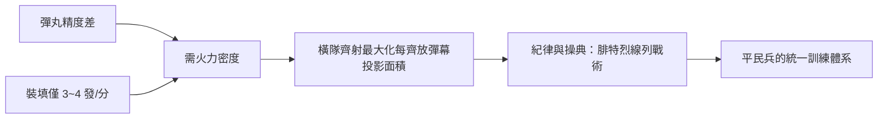

# 第 1 章 · 第 3 節 前裝滑膛槍的物理極限：為何要排隊齊射

## 一顆打不準的球

滑膛燧發槍（如英國 Brown Bess、法國 1777 式 Charleville）發射的是一顆約 17–19 mm 口徑的**鉛球**。彈丸要能快速裝填，其直徑必須**小於**膛徑——這個間隙稱為 **windage**。彈丸沿膛壁落下、落下、再落下，出膛後的路徑由它碰撞膛壁的隨機彈跳決定：像投籃不碰框的球，出弧線全憑運氣。

其結果是殘酷的統計學：實戰條件下，滑膛步槍的**有效接戰距離僅約 50–100 公尺**。腓特烈大帝時代的普魯士軍演與美國獨立戰爭的實測都顯示：對臥姿人形目標，百步之外命中個位數百分比是常態。Prussian 1780s 的演習數據（Scharnhorst 等人整理）推得，戰場上「每分鐘造成一名士兵傷亡需要消耗約數百發」完全符合此一散布水平——因此濃煙瀰漫的戰場上，指揮官必須以**齊射獲得機率密度**，用兩、三列的輪替射擊維持每分鐘的彈幕。

## 技術原理：windage 的幾何學

設彈丸半徑 $r$、膛徑 $R$（$r < R$），彈丸出膛前的隨機偏向角度量級約為

$$
\theta \approx \arctan\!\left(\frac{R-r}{L}\right)\times n
$$

其中 $L$ 為槍管長度、$n$ 為彈丸行程中碰撞膛壁的次數偏倚。$R-r$ 若達 1–2 mm（為了快速裝填不得不然），在 1 公尺的槍管上，僅一次側向接觸就能造成數角分的偏角；累積多次彈跳，百公尺處散布直徑可達人身高數倍。**線膛（rifling）**,讓彈丸旋轉穩定，正是消除此一隨機項的解藥——問題在於裝填。

## 線膛的困境：打得準，就裝不進

要讓彈丸咬住膛線，彈徑必須**大於**膛線的陰線部（groove diameter），也就是「塞得緊」。前裝式線膛槍因此需要錘子與開棒把彈丸一路敲進槍管——獵人與神射手可以忍受打一發裝填數十秒（德意志 Jäger 槍傳統），軍隊不行：排隊等死比裝填慢更荒謬。

美國獨立戰爭中的英國陸軍上校**派屈克·福格森（Patrick Ferguson）**做了一个精彩的嘗試：他設計的多螺紋後膛鉸接步槍（Ferguson rifle，1776 年小量生產、配屬其特遣隊在 Brandywine 等地實戰）可在立姿下每分鐘填 4–6 發，走的是「後膛」路線。但槍機螺紋易積硝易卡、生產精密反手螺紋成本高，福格森於 1780 年陣亡，計畫隨即終止——他的步槍總產量不過約百餘支。技術上正確，制度上太早。

## 線性戰術的經濟學

在這組物理限制下，十八世紀歐洲陸軍演化出一套冷酷的優解：

排隊不是愚蠢，而是**以陣形彌補散布**的最優策略，同時也是管理大規模平民部隊的制度工具——軍操、口令、刺刀，整套機器都是圍繞「滑膛前裝」這組物理常數構建的。打破它需要兩個條件同時成立：一個把點火從天氣手中奪回的化學發現，與一個讓彈丸「既鬆又緊」的形狀創意。

前者是福賽斯的雷汞，後者是米尼的彈——接下來的章節就是它們的故事。
