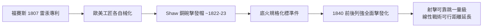

# 第 2 章 · 第 2 節 底火與擊發帽：把點火做成一枚小小的銅碗

## 從雷汞藥瓶到一頂小帽

福賽斯的雷汞鎖構造複雜：轉瓶、轉室、藥粉直接暴露，仍嫌「化學」而未「機械化」。要讓擊發點火成為軍隊標準，需要一次格式化：**把 detonator 從機構的一部分，變成可替換的標準零件**。這一步在 1820 年代完成，主角群是一群互相競爭的英美與歐陸發明家。

- **Joshua Shaw**（美國出生、居英國的畫家兼發明家）：一般被歸功為約 1822–1823 年間完成以銅碗盛雷汞、以擊錘擊打的**擊發帽（percussion cap）**構想，此後在英美專利訴訟與專利簿程序中纏訟多年（美國專利記錄在著名的專利大火之前後各章節均有爭議）， Shaw 至死仍在追索承認。無論法律歸屬如何，工業史承認：**銅碗化**是擊發技術能規格化的關鍵一步。
- 在歐陸，法國槍匠 **Clement Houiller** 等人對擊發機構應用於霰彈與獵槍的改良各有貢獻；
- 德意志的 **Dreyse** 在研發針發槍的過程中，自主發展了雷汞置於彈底紙殼中的布置（針發彈的初代形式）。
## 技術原理：小銅碗的能量公式

一枚擊發帽是一個直徑僅數公釐的軟銅碗，底部黏貼（壓入）雷汞混合藥（含雷汞、氯酸鉀、玻璃粉等，準比例各廠商不同）。擊錘落下，作用力經銅碗底面，將整個反應當場完成：

$$
E_{\text{impact}} = \frac{1}{2}mv^2 \quad \longrightarrow \quad \text{雷汞分解} \quad \longrightarrow \quad \text{高速燃焰由通火孔噴入主裝藥}
$$

與燧發相比：**lock time** 從可感的延遲縮為瞬時；「下雨即陣亡」變成「雨中照打」——風雨中啞火率大幅下降。更關鍵的是，槍手从此在點火的時間軸上**徹底解耦了裝填步驟**：倒火藥、塞彈丸、然後戴帽——每一步都簡化，全裝填時間雖未大減，但可靠性跳了一個數量級。

## 制度跟進：列強的擊發化（1840 年前後）

- **英國**：1836 年定型的 **Brunswick 步槍**（兩條膛線、配帶環帶的腰槽鉛彈、擊發式，為特選與部隊試驗採用的早期制式擊發槍）與大量老滑膛槍的擊發改造；
- **法國**：1830 年代起陸續將 Charleville 系滑膛槍改造為擊發式（如 1840 年前後的轉換型與新造 1842 式），1840 年前後完成陸軍的擊發化；
- **普魯士**：則選擇更激進的路—— 將整個點火系統與彈藥格式重構為後裝（見 03.1）。

擊發化看似只是「換個點火帽」，卻實質上把老燧發滑膛槍的戰鬥潛力徹底釋放，也讓歐洲各國的兵工廠體制（年產十萬支槍的規律生產線）全面起飛。但真正的革命，同樣發生在彈丸那端：下一節的米尼彈，將把滑膛前裝槍最後的尊嚴也拆掉。

---

**◎ 附註**：關於擊發帽發明的專利堂訟在美國、英國均極為兮長（涉及 1836 年美國專利局火災、多起複審與強收請願），學界至今對 Shaw 的歸功仍無一致結論；讀者應將「Shaw 首創擊發帽」視為英美通俗史的慣例說法，而非無爭議的史實。
