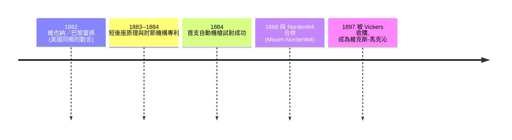

# 第 5 章 · 第 1 節 馬克沁的靈感：「只有一個方法可以發財」

## 出身農家的美國天才

希拉姆·史蒂文斯·馬克沁（Hiram Stevens Maxim，1840–1916）生於緬因州桑格維爾（Sangerville）的農家，童年在磨坊做學徒，憑自學掌握機械與電氣工程。他一生拿下的專利超過兩百七十餘件——從電燈泡碳絲、飛行器實驗（比萊特兄弟早二十餘年造出龐大的蒸汽飛行試驗台）到鼠藥與滾軋機。

1881 年，四十一歲的馬克沁移居倫敦，在哈頓花園（Hatton Garden）設立工坊，用電燈事業的資金養活自己的機械實驗。

## 「歐洲人總是在互相殘殺——就去發明一種讓他們殺得更快的機器吧」

那個改變戰爭史的瞬間，馬克沁自己曾在《我的生命》講座與 1909 年回憶中反覆敘述。1882 年，他在維也納（另一版本是巴黎萬國博覽會期間）遇到一位旅美的美國同胞。兩人站在街頭，這位同鄉聽馬克沁抱怨電燈專利訴訟的麻煩後，說出了那句被後世無數引用的話：

> 「**別管你的化學與電學了。去搞一種能讓這些歐洲人互相殘殺得更快的東西吧——你看著，只要他們殺得夠快，他們就會乖乖付錢。**」

馬克沁自己的一段回述是這樣的：那位美國人說，「希拉姆，如果你想要發大財，只有一個方法。求得殺人的專利——這些**歐洲人隨時都在想方設法彼此屠殺**，只要你的東西能讓他們殺得更快，他們就會全搶著向你買。」

這段話是否有一定的戲劇潤飾，史家偶有存疑；但它的記載確鑿出自馬克沁本人之口，而且與其後三年的所作所為完全吻合。這句話的深層含義是十九世紀末的**軍火經濟學真相**：歐洲的均勢外交、帝國擴張與民族主義，形成了一台永不下班的買家機器；誰能把「火力密度」工程化，誰就能像米達斯一樣點石成金。馬克沁的靈感從一開始就不是愛國主義或戰術洞察，而是**資本邏輯**。

## 1884：第一支真正的自動武器

馬克沁一反前人（如 Akley、Hotchkiss、Gatling 手搖槍）的思維：他不再讓射手提供動力，而是讓**武器自身後座的能量**完成重新裝填。1884 年，第一支以槍管短後座驅動的自動機槍在倫敦試射成功；它用黑火藥 .577/450 彈，以每分鐘約 600 發的速度連續傾瀉。

英國貴族與記者蜂擁至哈頓花園，仿佛去觀看魔術。馬克沁深知宣傳的力量——他不只賣槍，更是**賣一場表演**：客人扣一次板機，看見一整面牆倒塌、一整棵樹碎裂，訂單就簽了。

## 授權帝國與資本結局

馬克沁的商業策略同樣精彩：他向歐洲各國政府**同時出售槍與專利授權**——德國以 MG08 的形式不看家生產、俄國製作 PM1910、英國自己合併成 Vickers。他還把歐洲的「接受阿拉伯與中國行省」的全權代理權賣給出價最高者，成就了十九世紀末軍工合夥模式的雛形。

1897 年，維克斯父子（Vickers & Sons）收購馬克沁軍械公司，更名 Vickers, Sons & Maxim；1904 年徹底改為 Vickers Ltd。馬克沁本人於1899 年歸化英籍，1901 年受封爵士，1916 年以 76 歲在倫敦卒世——距離索姆河會戰（在那裡，他的機器屠戮了整整一代英國青年）不到四個月。

那個維也納街頭的勸告，成真得如此徹底。

**參考**：Hiram Maxim, *My Life* (1915)；John Ellis, *The Social History of the Machine Gun*。
