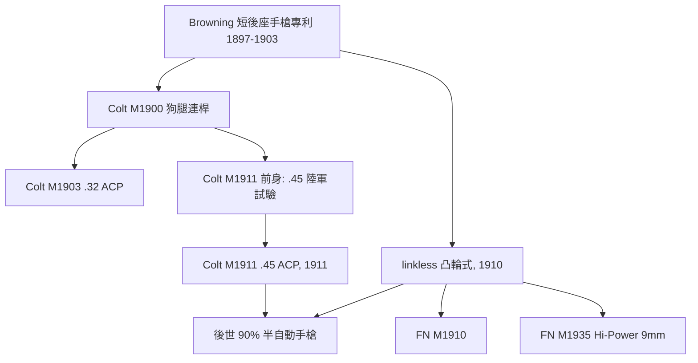

# 第 6 章 · 第 1 節 白朗寧傾斜槍管：半自動手槍的兩種血統

## 猶他州磨坊裡的天才

約翰·摩西·白朗寧（John Moses Browning，1855–1926）生於猶他州奧格登（Ogden），父親喬納森是摩門教移民、槍匠出身。約翰在父親的工坊裡長大，自行打鐵、車削、銼磨，13 歲便在槍後試射自製的槍。1880 年代，他與兄弟在 Ogden 經營著一座水力驅動的磨坊兼槍械工坊——**沒有機密實驗室，只有水輪、皮帶車床與一位天才**。

1883 年，溫徹斯特的副總裁兼公司專利代理人 T. G. Bennett 試射了白朗寧做的單發步槍，驚為天物，派人飛奔奧格登。最終，溫徹斯特公司由專利代理人泰爾吉曼·班奈特（T. G. Bennett）出面交涉，其總裁溫菲爾德·斯科特·希利爾（Winfield Scott Hillyer）經手，以**八千美元**買下白朗寧 1884 年的一批專利，此後持續買進其槍械專利；他與溫徹斯特及多家廠商的專利授權交易總數逾四十四項——包括 1897 年霰彈槍、1900 年代一系列設計。資本第一次系統性地「外包」給一個人。那座磨坊水輪上的皮帶，實質成為溫徹斯特的研發部。

## 短後座＋傾斜槍管：手槍動力學的第二定理

白朗寧的偉大突破，是把馬克沁的「短後座」思想移植到手槍。手槍沒有槍托吸收後座，彈藥又強——**槍機必須鎖住槍管**。白朗寧的兩代解法：

1. **狗腿閉鎖（link / swinging link，1900–1902）**：槍管以一根搖臂連桿（形似狗後腿的搖臂，故俗稱「dog leg」）連接槍框。後座時槍管連桿一起後移，隨後連桿下拉，槍管傾斜下降、脫離閉鎖，套筒繼續後退。Colt M1900、M1903（.32 ACP）、Colt M1911 前身皆屬此系。
2. **無連桿（linkless / cam，1910 前後設計）**：把搖臂換成槍管/套筒上的**凸輪斜槽**（後世稱「狗腿式」或「falling barrel」）；槍管直接沿斜面下滑。結構更簡、零件更少、可靠性更高——這是 FN M1910、M1935 與今日 SIG、Browning Hi-Power 等的手法。

1897 年他取得基本專利；1900 年柯特（Colt）買下其美國民用手槍專利並推出 M1900；1905 年，美國陸軍要求 .45 口徑，白朗寧與柯特合作，最終捐出 M1911——**後世上九成的半自動手槍都體現了「槍管短後座＋某種形式的傾斜閉鎖」**：這不只是一件專利，而是手槍動力學的第二定理（第一定理是自動循環本身）。

## 系譜圖

## 白朗寧的其他遺產

- **Auto-5（1898 / 1900）**：世界第一款大規模生產的半自動霰彈槍，長行程後座＋倉內摩擦環——用「槍自己動」的哲學統一了使單兵火力在拉栓間隙之外延續；
- **.45 ACP 彈（1904–05）**：無半緣、低彈速、重彈頭，為可靠性與停止力優化的彈藥設計；
- **1917/1897 溫徹斯特霰彈槍**：美軍塹壕「trench gun」；
- **雷明頓 Model 870 之前的泵動與半自動霰彈槍機構**，多可直接溯源至白朗寧。

1926 年 11 月，白朗寧在比利時赫斯塔（Herstal）的 FN 工坊裡心臟病發去世——**倒在最後一支設計（FN Hi-Power）的工作檯上**。他一生獲逾一百二十項專利，**一個人的專利檔案，幾乎等於一小半的二十世紀輕兵器史**。

**參考**：John M. Browning, *Browning Auto-5 Handbook*；Robert W. T. Gunby, *Browings*；Garry James 等,《Gun Digest》相關條目。
