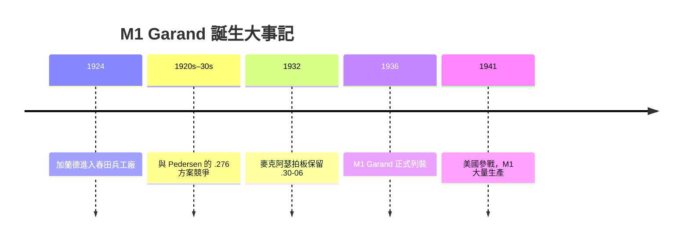

# 第 7 章 · 第 1 節 M1 加蘭德與漏夾：叮噹聲中的二戰

## 一聲「叮」，全世界最著名的金屬聲

在美國陸軍的口述歷史裡，有一種聲音比任何軍歌都響亮：M1 加蘭德步槍打完第八發子彈時，空的**漏夾（en-bloc clip）**被拋出、撞在槍機導軌上的「**叮——**」一聲。老兵回憶它、畫家描繪它、好萊塢放大它。但這聲響背後，是一場持續二十年的設計鬥爭——關於美國步槍該用什麼口徑、什麼裝彈方式，以及一個移民工程師如何為美國軍隊鑄造火力革命。

## 加蘭德：從加拿大到春田

John Cantius Garand（1888–1974）生於加拿大魁北克的聖雷米，八歲隨家人移居美國康乃狄克。他沒有受過正式工程教育，卻在紡織機械廠練出一手工藝，1920 年代進入**美國國家標準局**，1924 年調入**春田兵工廠（Springfield Armory）**，此後三十年把人生全部押在「美國第一支制式半自動步槍」上。

軍械局的核心難題不是機構，而是**彈藥與裝彈方式的選擇**。加蘭德最初設計採用托喀列夫式（Pedersen 式）理念的**斜托彈倉**方案，但最終定型的結構是一個頗具爭議的折衷：



## 漏夾：優雅而尷尬的折衷

M1 使用 **8 發整體漏夾**：子彈連同鋼夾一起被壓入彈倉，最後一發擊發後，空夾被氣體活塞推桿向外「啪」地拋出。這就是那聲「叮」的來源。

工程上，漏夾有硬傷：

- **無法「補射」**：彈倉內剩 3 發時，你必須先打完、或用手壓住漏夾手動排空，才能重新裝滿——沖鋒的步兵因此發明「**隨手丟一發**」製造假「叮」聲的戰術。
- 對手利用：德軍與日軍老兵的回憶錄中，確有聽到「叮」聲起身反擊的記載；美軍官方研究（含戰後陸軍調查）則多半認為戰場噪音下此聲可忽略。

歷史學界至今仍在爭論這聲音是真戰術弱點還是傳說，但**它逼出了美軍獨有的速射訓練文化**：打空、換夾、再打，一氣呵成。

## Pedersen 與 .276：被麥克阿瑟否決的未來

同時代最強的競爭者是 John D. Pedersen 的 **Pedersen 步槍**，採用延遲後座（retarded blowback）機構，搭配他專門設計的 **.276 Pedersen（7×51mm）** 中威力彈——輕、後座小、半自動更可控。1930 年代初，陸軍試驗委員會一度傾向 Pedersen 系統。

決定性一幕發生在 1932 年：時任陸軍參謀長的**道格拉斯·麥克阿瑟將軍**以行政命令否決換用 .276，堅持新步槍必須沿用庫存數以億計的 **.30-06（7.62×63mm）** 子彈——純粹的後勤經濟學擊敗了彈道學理想。此裁決不僅決定 M1 的口徑，了美國步槍「重彈、全威力」的半世紀路線，直到 1957 年 T44/M14 仍被困在 .30-06 改型的 7.62×51 NATO 框架中。

```text
 Pedersen .276 中彈理想  ──┐
                           ├──→  1932 麥克阿瑟裁決 ──→  M1 Garand (.30-06)
 美軍 .30-06 後勤庫存   ──┘
```

## 半自動革命的意義

M1 於 **1936 年列裝**，是**全球第一支成為大國陸軍制式主力的半自動步槍**——比德國 G43 早 7 年、比蘇聯 SVT-40 的全面換裝更徹底。二戰美國步槍手平均單位火力密度因此遠超德、日的栓動步兵。艾森豪稱它為「贏得戰爭的偉大武器」，巴頓說它是「**有史以來最出色的作戰工具**」。

技術上，M1 的**短行程氣活塞 + 回轉式槍機**結構，直接啟發了日後 M14 與一系列西方軍用步槍；而它證明的經濟—制度邏輯（子彈庫存 > 彈道理想、兵工廠工程師 > 私人企業天賦），則成為整個 20 世紀軍備史的註腳。

> 一聲「叮」，是民主兵工廠的字型簽名：機械可靠、火力密集、後勤保守，而勝利屬於把這三者焊在一起的設計者。
