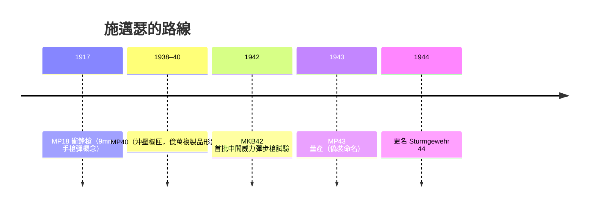

# 第 7 章 · 第 2 節 施邁瑟與 StG44：突擊步槍的誕生

## 從衝鋒槍之父到突擊步槍之父

雨果·施邁瑟（Hugo Schmeisser, 1884–1953）是德國槍械史上被低估的名字。1917 年，他在貝格曼（Bergmann）公司的設計室裡完成 **MP18**——全球第一支真正列裝的**衝鋒槍**，發射 9×19mm 手槍彈，專為一戰塹壕近戰而生。MP18 打開了一個新的武器類別：**發射手槍彈、可以自動、用於 100 公尺內清壕的「衝鋒」武器**。這個概念——「為典型交戰距離重新定義彈藥」——終將在他 60 歲時結出 StG44 的果實。



## 中間型威力彈：真正的革命在子彈

StG44 的核心不是機構，而是彈藥概念。1930 年代德國軍械界已認識到：7.92×57mm 全威力彈在 600 公尺以上的殺傷力，遠超過步兵實際交戰（多數在 300 公尺內）。配有衝鋒槍的士兵守短程，但步枪手在中等距離火力嚴重不足。

解法是 **7.92×33mm Kurz（kurz = 短）**：將 7.92mm 彈頭裝入截短的彈殼，初速約 640 m/s——後座可承受、全自動可控、有效射程仍達 400 公尺。這是**中間型威力彈（intermediate cartridge）**概念第一次在工業強國被全面制度化的機會。

## 希特勒、更名與真實的歷史

流行敘事說「希特勒下令停止 StG44，德國人偷偷改名矇混過關」。史實更微妙：

1. 希特勒確實**一度要求中止**該計畫，偏好衝鋒槍與現有步槍的擴產；軍械局（Waffenamt）讓生產以「MP43」這類**衝鋒槍命名**繼續，也算是機構慣性與局部冒險的混合。
2. 轉折來自**前線報告**：東線與諾曼第部隊的實戰報告證明 MP43 在中距離交火中壓倒蘇軍波波沙與莫辛步槍手的組合，1944 年希特勒親自批准並**親自命名為 Sturmgewehr（突擊步槍）**——宣傳語言與武器類別在此合一。

「突擊步槍」從此成為全球軍械詞彙：**可選射、中間威力彈、300–400 公尺**。這個三分法定義，至今未變。

## 影響 AK-47：概念的而非結構的血統

蘇聯設計師**卡拉什尼科夫**多次公開承認受 StG44 啟發——但啟發的是**彈藥與任務概念**。蘇聯早在戰時就逆向研究德國 Kurz 彈，並發展自己的 **M1943 7.62×39mm**；StG44 證明了「整支步兵可以肩射全自動的中威力彈武器」的可行性。至於結構：StG44 是傾斜 locking、長行程活塞式設計，與 AK 的迴轉槍機、長活塞**並非直接抄襲**；AK 的鬆公差與沖壓折疊機匣哲學另有自身工業淵源。

```text
 MP18 (1917, 9mm 手槍彈) ─┐
                          ├─→ 「依射程重配彈藥」的理念鏈
 7.92×33 Kurz (1942)    ─┤
                          ├─→ StG44 ──(概念啟發)──→ AK / M1943 7.62×39
 M1943 彈 (蘇聯, 1943)  ─┘
```

## 戰爭末日的先見之明

StG44 總產量約 40–45 萬支，未能扭轉德國戰敗——但作為**密集火力對抗人力劣勢**的工業答案，它提出了 20 世紀下半葉步兵武器的中心問題：使用 1980 年代前，全世界突擊步槍的設計邏輯，幾乎都是 StG44 的後代，無論它們的生產者承認與否。

施邁瑟戰後被蘇聯帶往伊熱夫斯克協助武器研製，1953 年於艾爾福特去世。他晚年記錄的流派影響，正與另一位在病床上畫藍圖的蘇聯中士交錯——那是下一節的開端。
