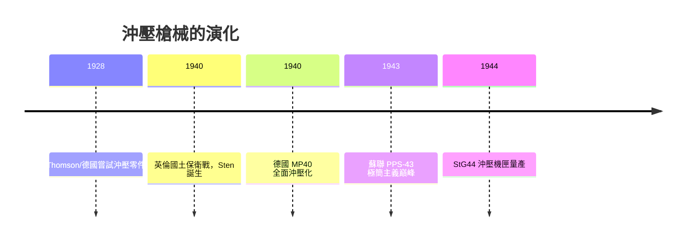

# 第 7 章 · 第 3 節 鋼板沖壓革命：當槍變成洗衣機零件

## 從雕刻到沖壓：製造範式的斷裂

傳統槍械的靈魂是**銑削**：從一整塊鍛鋼上，由熟練技師一刀一刀雕出機匣。這種工藝生產的是「精緻的工具」——但每支槍需要幾十到上百個機工小時。二戰爆發時，所有交戰國面臨同一個殘酷數學題：**熟練技工全部被徵召上戰場，工廠裡剩下的是婦女、少年與沒摸過銑床的農夫**。

答案來自汽車工業早已成熟的技術：**鋼板沖壓（sheet-metal stamping）**。把薄鋼板壓成型、折彎、點焊——不需要雕工，只需要模具和沖床。



## Sten：極簡主義的英國答卷

1940 年敦克爾克之後，英國本土只剩步槍。在生死壓力下，設計師 Shepherd 與 Turpin 交出了 **Sten 冲鋒槍**——沖壓鋼管機匣、側插彈匣、甚至有一個版本是為傘兵可拆成零件塞進手提箱。原地以**約 5–9 美元**的成本量產數百萬支（MP40 估算約數十美元），它醜、它故障多、它的彈匣在伏擊中會卡住——**但它能在自行車工廠裡由女工生產**。這是武器史的關鍵換位：**可製造性壓倒了精緻度**。

## MP40 與 PPS-43：兩種戰爭經濟學

德國 **MP40** 沿襲 MP38 開創的沖壓機匣路線，把機匣、槍管座、摺疊托都改成鋼件沖壓加電弧焊——它成為「德國工科學」的象徵，但德國的鋼材與電力在 1943 年後日益緊缺，沖壓工藝恰好緩解了對大型鍛件與大型機床的依賴。

蘇聯的 **PPS-43**（Sudayev 設計）是極簡主義的巔峰：**全槍零點沖壓、僅數小時機工時間**，用烏拉爾和列寧格勒（被圍城中）的小工廠能量產。蘇聯工程師會說：PPS-43 是「戰時經濟學寫成的槍」。

## 形狀被工藝決定：方盒機匣的美學

沖壓不能彎出複雜的三維曲面，於是槍械的機匣變成**方盒、直壁、還有鉚釘與焊縫**。這不是美學選擇，而是工藝限制：

```text
 銑削機匣：任意曲面、昂貴、緩慢、技工依賴
   ↓
 沖壓機匣：折彎鋼板 + 點焊 + 沖鉚 —— 快 10 倍、成本低 5–10 倍
   ↓
 對設計的形塑：
   方盒形機匣、大型固柄不可摺疊、活塞外露、
   退殼口下方採用點焊支架、整體武器「工業長相」
```

這個形狀的印記後來明顯留在 StG44、AK 的 Type 3 銑削機匣到 Type 4 沖壓機匣，再到現代 ArmaLite 派的鋁合金「大盒機匣」上——**當你看到一根方盒步槍，你其實看到了沖床的痕跡**。

## 制度面：國家工程學的誕生

沖壓革命不只是技術，也是**制度的轉變**：

- **兵工廠 → 工業聯盟**：Sten 的生產分散到英國各家從未做過武器的小廠；蘇聯沖壓設計直接與拖拉機廠共享沖床設施。
- **女性勞動力**：沖壓工序大幅降低技術門檻，讓「蘿西鉚釘手」（Rosie the Riveter）成為戰時工業的象徵。
- **標準化**：模具一旦完工，任何一家廠抄同一沖壓件幾乎一致——**filtre 式零件互換性**首次在成本可控的水準上達成。

當戰後武器設計師回頭看，會發現整場戰爭中真正的勝者不是某一型槍，而是一種**製造哲學**：窮人、婦女與小廠，都能造武器。這個哲學的承繼者，正是那支將覆蓋 20 世紀下半葉的槍——**卡拉什尼科夫的工作，起點正是蘇聯版的沖壓與鬆公差思想**。
