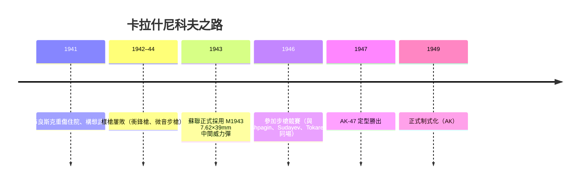

# 第 8 章 · 第 1 節 卡拉什尼科夫的病床藍圖：AK-47 的誕生

## 一名中士、一輛坦克、一次重傷

1941 年秋，**布良斯克戰役**中，蘇軍第 24 坦克師的 T-34 車長——24 歲的中士米哈伊爾·卡拉什尼科夫（Mikhail Kalashnikov, 1919–2013）——被德軍炮火擊中，肩部重傷，傷情嚴重到被送回後方醫院療養半年。這位戰前只是鐵路技術員、在坦克裡自學機械的老兵，在病床上反覆咀嚼同一個問題：

> 為什麼德國人每個班都帶著 MP38/40 衝鋒槍，而我的蘇軍步兵只有莫辛納干單發步槍？

「**傷兵中士在床上畫出 AK**」——這個敘事後來被蘇聯官方宣傳放大成傳說，也成為網路時代的迷因。史實上，卡拉什尼科夫在醫院確實完成了第一支衝鋒槍的草圖與部分機構構想（1942 年獲准回後方工場製作樣槍），但完整的 AK 是其後五年多次失敗與迭代的產物——**病床藍圖是起點，不是完成的設計**。

## M1943 中間威力彈：概念先於槍

蘇聯的彈藥改革早於 AK。1943 年，蘇聯在研究德國 7.92×33 Kurz 與美國 .30 卡賓彈的基礎上，由 Elizarov 與 Semin 定案 **7.62×39mm M1943**——初速約 715 m/s，重彈頭、低膛壓、可控連發。這是蘇聯最高軍事思想的直接產物：未來戰爭是**機動戰+火力密度**，一個步兵班需要「**人人都能肩射的全自動武器**」。缺的不是槍，是配得上這颗彈的機構——卡拉什尼科夫的任務由此被規定下來。

## 1946 競賽：巨人環伺的生存戰

1946–47 年的軍事試驗是一場明星賽：**Shpagin**（PPSh-41 之父）、**Tokarev**（SVT-40 之父）、**Sudayev**（PPS-43 之父、亦是卡拉什尼科夫私交中最敬重的）都提交了方案。卡拉什尼科夫本人在 memoir 中承認，他借鑑了多位前輩的機構思想——西方普遍認為其中包含 Sudayev 的自動機方案、Garand 的迴轉槍機概念、以及德國 StG44 的**任務定位思想**（彈藥概念，而非機械抄襲）。

1947 年，他的方案在泥沙、冰雪、塵埃、泥漿試驗中勝出，代號 **АК-47（Avtomat Kalashnikova）**；1949 年正式制式化。

## 一代人的集體產物

卡拉什尼科夫晚年反覆強調一個史學上也站得住的觀點：**AK 是蘇聯整體工程系統的產物**——M1943 彈是 Elizarov 的、工業沖壓路線是軍械部的、等他調槍他也利用了整個戰時沖壓經驗。他行之有效的技巧包是：

- **長行程大活塞**（Learn from Simonov & Tokarev）
- **鬆公差**（蘇聯中士能拆、蘇聯農夫能修）
- **沖壓思維**（繼承 PPS-43 與 StG44 的工業路線）

這三件事加起來，就是後世所稱的「**克拉什尼科夫設計哲學**」，也是第 8.2 節要展開的機械世界。

> 一名中士在病床上畫的不是一支槍，而是一個問題：**如果蘇聯士兵大多是農夫出身，那麼武器應該像什麼？**——答案是：像鐵鎚。
