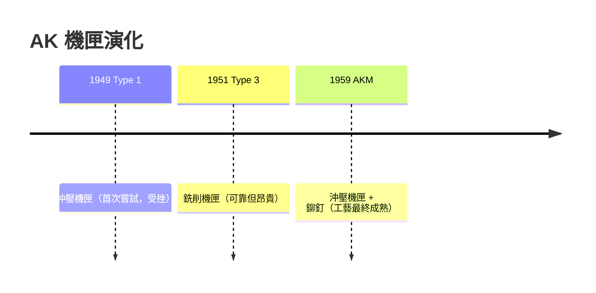

# 第 8 章 · 第 2 節 AK 的長行程活塞：鬆公差的機械哲學

## 長行程大活塞：簡單即強大

AK-47 的自動方式是**長行程活塞（long-stroke gas piston）**：導氣管位於槍管中段上方，活塞與**槍機框（bolt carrier）連成一體**，火藥氣體推動整個活塞—槍機框組件一起後座約十公分，途中帶動槍機旋轉開鎖、抽殼、拋殼，直到行程終點。

與之相對，西方精緻路線常選**短行程活塞**（如 SKS、後來的 SCAR：活塞只輕推槍機框）或 FG42/AR-18 式結構。長行程的代價是**活動質量大、重心的前後擺動大**，連發時瞄具晃動明顯；但其回報是**機構粗壯、零件數少、每一處摩擦都能被大動能衝破**。AK 的觀點是寧可散布稍大，也不要卡。

## 迴轉槍機與「大旋轉」細節

AK 的槍機僅用**兩個閉鎖凸耳（2 lugs）**，與槍機框內壁的螺旋槽配合完成旋轉閉鎖。細節中最有卡拉什尼科夫性格的不是機構本身，而是**包著它的公差**：槍機框在機匣內的橫向活動間隙被刻意放大，槍機的旋轉被安排在拋殼口上方一個寬大的空間裡完成。後果立刻顯而易見：

- **泥沙、冰雪、彈殼碎片乃至木屑**卡進機匣時，AK 的活動間隙把它們「**三者選一：碾碎、推走、或被壓實但照樣運動**」。
- 同樣的泥在 M16 直噴式槍機的環形溝槽中，往往就是停機。

```text
 AK 設計方程（意識形態層面）：
   可靠性 = 粗壯零件 + 大間隙 + 大動能 + 最少摩擦面
   精度   ← 捨得（連發散布稍大，士兵仍可首發命中）
```

## 鬆公差：對蘇聯士兵的制度性體恤

卡拉什尼科夫自述的設計哲學是「**一個士兵、甚至一個孩子，都能夠拆解它**」。在蘇聯兵役制度的考古學中，這不是比喻：義務役士兵受教育程度低、中士級軍官訓練短、部隊無暇精緻保養。AK 把「士兵素質不夠」作為**設計輸入條件**——用機械的笨重補償人力的不足。這是武器設計史上少數把**社會條件**寫進工程參數的方案。

## 沖壓的往復：從 Type 3 到 AKM

AK-47 初期（Type 1, 1949）就打算採用沖壓機匣，但蘇聯當時的沖壓鋼質量不穩、故障率高，被迫退回 **Type 3 銑削機匣**（1951–54）。設計的終點回到沖壓是在 **1959 年的 AKM（Type 4）**：鋼板沖壓機匣、**大型固定托與鉚釘**加固、斜口防跳器，重量減輕約 1 公斤，量產成本急降。這一「銑削—沖壓」的往返，恰好重演了第 7.3 節整個蘇聯工業學習「如何把槍造成像洗衣機零件那樣便宜」的過程。



## 對比 M16：兩種文明模型的對照

美國 **M16** 採**直噴式（direct impingement）**：火藥氣體經導氣管直接吹進槍機推槍機框——輕、精準、結構巧，但**氣體直接把殘渣吹進槍機與槍膛內部**，需要清潔。AK 用活塞到底終止污物前進，機匣粗大到足以容納半匙沙。

兩者的分歧，表面是工程，深層是**軍事文化的分歧**：美國相信**精緻的射手與勤保養的班級**；蘇聯相信**粗壯的武器、龐大的兵員、有限的訓練**。AK 長行程活塞與 M16 直噴之爭，實質上是兩國社會結構在機械上的投影——而這一對照，將在第 8.3 節的地緣版圖上全面拉開。
