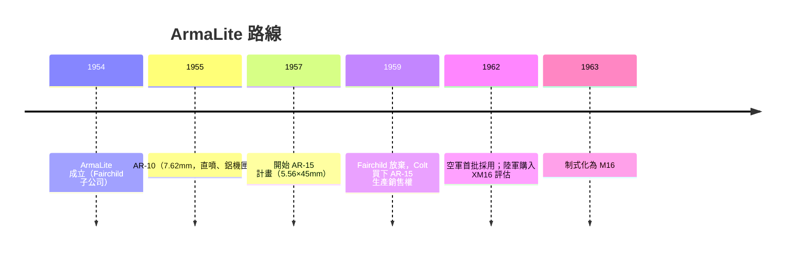

# 第 9 章 · 第 1 節 斯通納的航太思維：AR-15 如何從飛機工廠誕生

## 航太工程師闖進了槍械界

尤金·斯通納（Eugene Stoner, 1922–1997）不是傳統槍匠，而是**航太機械工程師**——二戰在海軍陸戰隊服役，戰後在飛機制造業工作，1954 年受聘於加州的 **ArmaLite**——飛機引擎巨頭 **Fairchild Engine and Airplane Corporation** 內部成立的**武器研發子公司**。這個出身決定了 AR 平台的整個基因：

> 機匣用鋁合金鍛造，槍托與護木用玻璃纖維與塑料——不是趕時髦，而是**飛機工程師看到整塊鋼會計算重量**。

## 直噴式氣體系統：不要活塞的取火術

ArmaLite 的第一個重大成果是 **AR-10（1955）**，競爭 7.62mm 全威力步槍。它的心臟是**直噴式（Direct Impingement）氣體系統**：火藥氣體從槍管導氣孔經一根不銹鋼導氣管，**直接吹進槍機框中空的圓柱腔**，把槍機框向後推、帶動兩凸耳旋轉槍機開鎖。

優點非常工程：

- **無活塞**：活動件的質量沿一條直線同步布局，往復件輕，理論精度高；
- **上、下機匣分體**，可快速更換——模組化思想在 1950 年代前無人敢想；
- **直線化布局**：抵肩、槍管、彈匣中線與抵肩幾乎等高，全自動的上跳大幅降低（越戰戰場報告顯示 M16 連發可控性遠勝 M14）。

缺點也同時埋下：**火藥殘渣直接被吹入槍機與槍膛**——沒有活塞擋污，需要定期清潔。這一點，是十年後越戰危機的種子。

## AR-10 落敗，AR-15 誕生

AR-10 最終輸給陸軍傳統兵工系統擁護的 T44（後為 **M14**），敗因不在工程而在**體制**：春田兵工廠與陸軍兵器部支持自己人。但斯通納（與 ArmaLite 合夥人 George Sullivan、Dorothy & Mel Johnson 背景的團隊）看到了陸軍作戰研究（Operations Research）的結論：**多數步兵交火發生在 300 公尺內**。於是**小型彈 + 輕步槍**有明確理論基礎。

新彈的誕生是工程外交的成果：ArmaLite 團隊在陸軍彈道研究所協助下，把 **.222 Remington** 彈殼加長成 **.223 Remington（5.56×45mm）**。斯通納把 AR-10 直噴結構整體縮小，配上鋁合金鍛造機匣、直線抵肩、塑料護木——**AR-15** 全槍約 **3.1 kg**，比 M14（約 4.5 kg）輕三分之一。同一背囊空間，士兵可以多帶近倍彈量。

## 誰把它推進軍隊：遊說與管理科學

Fairchild 在 1958–59 年決定退出武器業務，**Colt 以約 450 萬美元 + 每支 1 美元版稅**買下 AR-15 的生產與銷售權。但若僅靠一般業務手段，AR-15 可能永遠停在民用市場。轉機是**兩股政治力量**：

1. **空軍參謀長柯蒂斯·李梅上將**：1950 年代他就親自試射過 AR-15，驚訝於它的輕與可控，最終讓空軍在 1962 年首批採用（約 8,500 支），突破陸軍兵器局的封鎖。
2. **麥克納瑪拉的系統分析派**：國防部長 Robert S. McNamara 的 cost-effectiveness 學派把 AR-15 視為理想標本——**更輕的槍 = 更少的運輸噸位 = 更高的班級火力**，完全合乎他的管理科學。陸軍兵器部反對 AR-15 的報告，在國防部直屬分析員的再計算前屢屢敗退。

1962 年底，麥克納瑪拉超越陸軍兵器局、直接下令採購 **85,000 支 XM16E1**；1963 年，M16 制式化。步槍史的決策權，就此從春田兵工廠轉移到華盛頓的分析師辦公室。

## 「現代步槍」的兩層宣言

「AR」原義即 **ArmaLite Rifle**——公司自家的命名，最後卻被當成「**Ammunition Research / Automatic Rifle**」的民間誤讀。但這個誤讀暗藏真義：AR-15/AR-10 的確是**第一代真正「現代」的軍用步槍**：

- 材料：鋁 + 塑料（航太ɾ材料學）
- 動力：直噴（液壓/氣動思維）
- 結構：模組化、上下機匣、銷釘拆除
- 生產：鋁鍛機匣可大量 CNC 銑削

斯通納的槍與卡拉什尼科夫的槍，構成冷戰武器的雙極：**鬆公差農具** vs **精密現代主義**。而 M16 在越南戰場上的第一輪災難，即將揭示——**優良機械需要優良的制度配套**。
