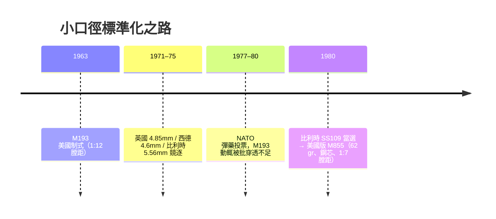

# 第 9 章 · 第 2 節 小口徑高速彈：5.56mm 的傷彈學革命

## 從 .223 到制式彈

5.56×45mm 的故事從槍廠實驗室開始：ArmaLite 為 AR-15 取 **.222 Remington** 彈殼加長，命名 **.223 Remington**；M16 於 **1963 年制式化**，其彈定名 **M193**——55 格令（grain）彈頭、初速約 **3,250 ft/s（約 990 m/s）**、膛線節距 1:12。「小口徑 + 高速」自此成為冷戰後半葉步兵彈藥的總路線：蘇聯在 1974 年以 **5.45×39mm（AK-74）**跟進，冷戰兩大陣營在彈藥哲學上正式同步。

## 傷彈學的遠祖：湯普森—拉加爾試驗

早在 1904 年，美國陸軍約翰·湯普森（John T. Thompson，後來的湯普森衝鋒槍之父）與路易斯·拉加爾（Louis LaGarde）少校在獲准於古巴 Cadiz 屍場與活體動物上進行的 **Thompson-LaGarde 試驗**，首次以系統方法比較口徑與停止力。兩人合著的報告支持 .45 口徑的重質大彈，其結論主導了美國步槍彈半個世紀——而 1960 年代的 .223 方案，正是要推翻這份遺產中「**大就是停止力**」的直覺。

## 翻滾與空腔：高速彈頭的物理

關鍵不在動能而在**失穩**：

$$
\rho_{\text{組織}} \approx 1000\ \mathrm{kg/m^3} \;\gg\; \rho_{\text{空氣}} \approx 1.2\ \mathrm{kg/m^3}
\;\Rightarrow\; \text{陀螺穩定性正比於 } 1/\rho \;\Rightarrow\; \text{彈頭入體後迅速翻滾（yaw）}
$$

細長的 M193 彈頭在空氣中以 1:12 膛距勉強穩定，進入人體後約在 10–15 公分處翻轉 90°，甚至破裂成左右兩截；創道由 5.7mm 拉成數公分的**瞬時空腔（temporary cavity）**。越戰外科醫師的戰地報告中，出現了前所未見的長骨粉碎、臟器大片撕裂——遠超 5.56mm 這個「小」字給人的直覺。

## Schwartz 與 Fackler：兩段報告、一場爭論

1970 年代初，陸軍輕武器系統辦公室的彈道工作（常被引述為 **Schwartz 報告**一脈的研究）整理了 M193 與敵方 7.62 彈的傷道對比，確認翻滾/破裂效應真實存在，並量化其對**速度門檻**的依賴——速度低於約 2,500 ft/s 後效應大減。1980 年代，陸軍創傷彈道學家 **Martin Fackler** 上校則以明火實驗（皮下彈道膠塊）糾正雙方 extremes：瞬時空腔**在彈性組織中常無害**，殺傷主要由彈頭**直接切割與碎裂**造成。這場辯論確立了現代傷彈學框架：**效果 = 彈頭結構 × 撞擊速度 × 命中組織**，而非籠統的「小口徑神話」或「大口徑神話」。

## NATO 的角力與 1980 年二度標準化

小口徑革命也在聯盟政治裡打了二十年：

歐洲盟邦嫌 M193 太輕、遠距穿透不足；英國索性自研 4.85mm；最後荷蘭籍 NATO HQ 的表決中，**FN 的 SS109**（62 格令、鋼芯前端複合結構）勝出，1980 年定為 NATO 標準。美國換用 M855，槍管節距改 1:7——這次連膛線也是彈藥外交的產物。

## 法律的灰線

1899 年海牙宣言禁止「易展開變形」的軟尖/空尖彈，但**翻滾與碎裂是全金屬被甲彈高速失穩的物理結果**，不屬「人為使之易碎」——多數國家因此認定 5.56 類彈合法，爭論則轉向「是否造成不必要痛苦」的個案評估。傷彈學自此不再是純技術：它同時是**戰場醫療、條約談判與公眾輿論**的交會點。

> M193 證明了：改變戰爭形態的最小單位，可以是一顆 55 grain 的金屬——只要它跑得夠快。
