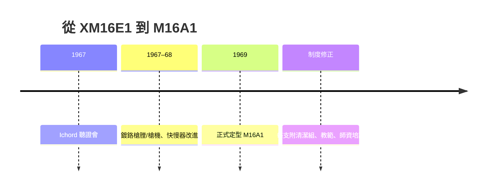

# 第 9 章 · 第 3 節 M16 的越戰危機：當精良武器遇上失靈的制度

## 「免保養」的謊言

1963 年制式化的 M16 帶著三重承諾進入越南：**更輕、更遠、火力更密**。但第一批大量配發野戰部隊的 XM16E1/M16，很快被叢林裡的士兵用一句粗話評價——「**不是武器，是卡彈機**」。

造成這場危機的，並非斯通納的設計在天性上失敗，而是**制度的五連錯**：

1. **清潔組缺配**：初批 M16 曾被宣稱「**免保養、免清潔**」——國防部與 Colt 基於「**自潤滑鎂/鋁機匣、直噴無殘渣**」的初期評估，甚至未假定需要清潔。首批槍隨附的清潔組與槍管刷被大量**未隨槍配發**。
2. **無鍍鉻膛線**：M14 與 M60 的膛與槍機都有鍍鉻防腐蝕；早期 M16 為省成本**槍膛與槍機未鍍鉻**，在越南溼熱環境中生鏽、積碳。
3. **火藥改變**：陸軍把杜邦的**IMR 管狀火藥**改為 Olin 的**WC846 球形火藥**（原本是 7.62 彈藥的用料），燃速更高、**膛壓上升**、殘渣量大增——直接灌進**直噴系統的槍機腔**。
4. **膛線節距**：1:12 為 55 gr 彈頭設計，穩定性極限;戰場換用的 1:9 與後來 1:7 都是為更高初速與更重彈頭而調整。
5. **直噴系統的本性**：沒有活塞擋污，槍機腔如同**每次射擊都被吹進一撮殘渣**。

## 泥沼情境：有 AK 就是要打

在同一叢林、同一雨季、同一泥中，AK 照樣響、M16 卡。這不是 AK 更先進，而是**AK 的鬆公差哲學**天然容錯，而**AR 平台的精密公差**將「**是否清潔**」變成了**生死變數**。士兵自嘲：要先把彈匣浸水、用安全針清膛、用根湯匙挖泥——「**在越南，你最需要的裝備是一把牙刷**」。

## Ichord 聽證會：國會介入

1967 年 5 月，眾議院軍事事務委員會特別小組在主席 **Richard Ichord**（密蘇里州）主持下，就 M16 故障問題舉行聽證會。聽證會公開的證據鏈條，勾勒出**10 個管理失靈點**——Colt 的過度承諾、陸軍兵器部的「免保養」宣導文書、後勤體系未配清潔組、火藥換料未等野戰試評估、鏡膛測試資料被誤讀……這是**美國國會第一次對現役制式武器進行系統性調查**，也是美軍後勤制度的轉折。

函證結論不是換槍，而是**修制度**：

## M16A1：制度性的重生

修正後的 **M16A1（1969）**加了：

- **鍍鉻槍膛與鍍鉻槍機**：防腐蝕、易清潔；
- **槍機輔助推桿（forward assist）**：卡住時可手動推槍機上膛；
- **槍機開放擋塊**：空倉掛機；
- **30 發彈匣、塑料彈匣**等改良；
- 每支配**每兵一份清潔組**與**官方教範**；教範中明寫「**M16 需要保養**」。

## 教訓：槍不是一個物件，而是一個系統

M16 危機最深的教訓，不是「直噴系統不可靠」（M16A1 之後數十年成為全球使用量最大的步槍系統），而是三條**管理教條**：

1. **沒有「免保養」的武器**——只有「容忍度更高的武器」；
2. **武器=槍+彈+訓練+後勤**，任何一項缺失都會「**放大為戰場失敗**」；
3. **國會層級的系統調查**制度後來成為美國軍備的管理樣板。

當士兵結束越戰回家，桌上寫著的結論是：**AR 平台沒有錯——錯的是把理想武器交付到一個沒有配套的戰場**。而這份教訓，也將在後來每一支自動步槍（M4、HK416、FN SCAR）上，成為被反覆檢視的底層邏輯。

> 一支槍在實驗室是工程學，在兵工廠是量產學，在國會聽證會是**管理學**。
