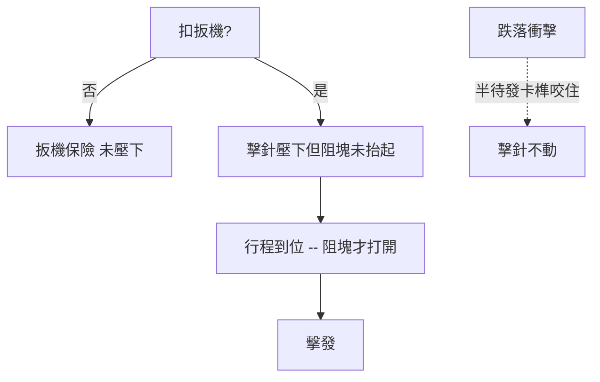

# 第 10 章 · 第 2 節 Safe Action 扳機：安全邏輯的組織變革

## 三重被動保險的機械哲學

Glock 17 使用的「Safe Action」系統，本質上是把傳統手動保險的**人身判斷**，替換成三道**被動的自動保險**（passive safeties），除非扣壓扳機，否則槍械處於安全狀態：

1. **扳機保險（Trigger Safety）**：扳機中央的小型槓桿。只要手指以正確姿勢扣壓，扳桿先被壓下才能扣動扳機本體；側向或意外接觸無法使扳機後移。
2. **擊針保險／阻塊（Firing Pin Block）**：鋼塊擋住在膛內待發的擊針（striker）鳥嘴，僅當扳機被扣至一定行程時，由連桿抬起讓擊針通路打開。此機構於 1988 年加入量產型，取代早期的按鈕式保險。
3. **跌落保險（Drop Safety）**：擊針在靜止狀態僅半待發，由卡榫咬住；即使跌落衝撞，擊針也不到位。

三道保險**全部串聯在扳機行程上**，隨著放手復位自動恢復。沒有拇指保險栓、沒有折角式 decocker——訓練流程被壓縮到一句話：「扳機不扣就安全。」

## 概念血統：striker-fired 的普及

嚴格說，Glock 並非首創擊針擊發或半待發扳機——H&K P7、Walther P99 等皆有相關基因。Glock 的功績是把它**制度化**：以單一、一致、全程等重的扳機手感（約 2.5 公斤），取代傳統雙動（DAO/DA-SA）「第一發重、後續輕」的雙重手感。

對執法因果鏈而言，這是訓練成本的重構：警察拔槍即可按壓擊發，不必在危急的半秒內思考「保險開了沒」「這槍是單動還是雙動」。傳統派批評者則指出其反面：**缺乏全時外部保險意味著安全完全繫於扳機手指的紀律**——扣壓扳機的食指一失誤，三道保險全數失效。這場「striker vs. hammer、無保險 vs. 有保險」的論戰貫穿了整個 1990 到 2010 年代，其本質並非工程對錯，而是**「機械保險」與「操作保險」肩上各放置多少風險**的制度選擇。

## 關於 Glock 的司法迷思

需要明確一個基於史實的界線：Glock 因「無外露擊錘＆無馬克（Hammer）」而無法從彈殼/擊痕中辨識的說法，在法庭科學上**並不成立**——Glock 擊針同樣會在底火留痕，如今仍是常規的鑑識物證。因此在本文中不採用任何「 Glock 槍無鑑識痕跡」的虛構情節。想要認識 Glock 在法證面的真實議題，應聚焦於其扳機機構在事故性走火案件中的角色——歷年確有涉及其扣壓行為認定的訴訟與專家證詞之爭，但這些官司的焦點是**操作者的責任與訓練**，而非「機械完全不可辨識」。

## 主義之爭：一句話的訓練學

Safe Action 的深遠影響在於它改變了**「誰來為安全負責」的答案**：

| 保險哲學 | 責任主體 | 代表 |
|---|---|---|
| 手動保險（1911、貝瑞塔 92） | 操作者的手指與訓練 | 傳統軍式手槍 |
| 機械重型 DAO | 更重的扳機行程本身 | S&W 執法型左輪/DAO |
| Safe Action | 扳機與操作的「同時性」 | Glock 及其模仿者 |

今天，SIG P320、Walther PPQ、Canik、CZ P-10 等可歸結為 Glock 哲學的直系子孫。若說傳統手槍把授權權限放在「槍匠」手中，Safe Action 則把它交給了**「使用者的日常習慣」**——這也是為何 Glock 不只是兵器工程的成功，同時還是一場**使用文化上的革命**。
