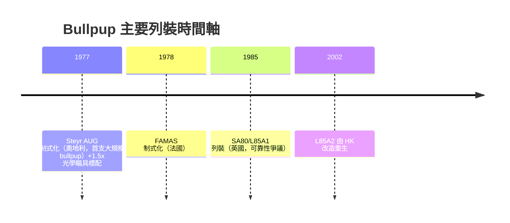

# 第 11 章 · 第 1 節 犢牛式結構：把槍管裝進肩膀裡

## 核心幾何：槍機與彈匣後置

傳統步槍的形狀由火藥時代遺傳而來：扳機組在前，擊發機構居中，槍管再往前伸。Bullpup（犢牛式）的翻轉極端簡單——**把槍機、供彈具全部塞進槍托之中，槍管幾乎與射手肩部齊平**。於是：

- 全長縮短約 25%，**槍管長度不減**，彈道性能不打折；
- 城市、載具、傘降空間中攜行性大增；
- 5.56×45mm 的 20 吋槍管級初速，被裝進一支比原來卡賓槍還短的容器裡。

代價也同樣幾何：**拋殼窗緊貼射手臉頰**，左手射手會被彈殼糊臉；**瞄具基線被迫抬高**（光學鏡必須越過彈匣–機匣的高點）；**重心後移**，握持手感與傳統步槍完全不同。

## Steyr AUG（1977）：第一支大規模列裝的 Bullpup

1977 年，奧地利陸軍制式化 Steyr AUG（Armee Universal Gewehr），這是世界軍史上**第一支大量服役的犢牛式突擊步槍**，使用 5.56×45mm、長行程活塞、半透明雙排供彈匣。AUG 的另一項革命常被忽略：**1.5 倍望遠式光學瞄具作為標準件出廠**——這代表奧地利軍隊接受了一個前衛命題：「每位步兵都是精確射手」。AUG 的瞄具不是加購配件，而是槍的身分證。澳洲、紐西蘭等國隨之多批採購，AUG 證明了 bullpup 不是概念玩具。

## FAMAS 與 SA80：太早太晚的跟進者

- **法國 FAMAS（1978 制式化）**：以「F1」無彈匣版的特殊 25 發彈匣起步，後改用 STANAG 標準；法國維持 bullpup 路線直至 2010 年代被 HK 416F 取代。
- **英國 SA80（1985 列裝）**：L85A1 的可靠性災難（彈匣、拋殼、卡殼問題成堆）差點毀掉整個 bullpup 路線的信譽。2000 年代初，英國把約 20 萬支送進德國 H&K（當時隸屬英國 BAE 集團）進行 L85A2 改造工程，才終於變成堪用武器。

## 幾何的詛咒與制度盲區

| 利 | 弊 |
|---|---|
| 同槍管長，全長更短 | 左右手不對稱（拋殼定向） |
| 城市戰、載具內機動性 | 瞄具基線高、駁殼貼腮位置改變 |
| 全槍緊湊、質量集中 | 重心偏後，仍在「扳機位」與「機匣位」之間拉扯 |

拋殼向題尤其具有黑幽默：它不是工程無解，而是**軍隊制度不願付「對稱拋殼機構」的研發帳**。直到 FN F2000、IWI Tavor 等晚輩才真正給出前置拋殼／可調拋殼的成熟方案。

## 命運的弔詭

Bullpup 的設計目的是「槍管不縮、全長縮」，但當 **M4 卡賓槍與短槍管彈道補償**在西方軍隊普及後，bullpup 的物理優勢失去了急迫性；而其缺點（換彈匣速度、瞄線高、左手射手問題）卻同樣擺在更深層的換裝帳上。今天，bullpup 路線在澳洲、以色列、法國（已轉 HK 416F）、英國（L85A3 局部延用）等國仍保留現役身影，但整體新生產已被模組化傳統布局（HK416、SCAR）逆轉。

**AUG 教了我們一件事：革命常顯示在指標上，但存活取決於制度能否消化革命的全部代價。**
