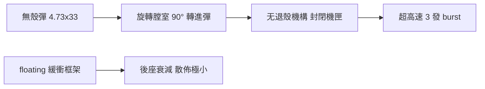

# 第 11 章 · 第 2 節 G11 無殼彈：工程完美與制度現實的失戀

## 一條走了三十年的路

1960 年代末，西德啟動對「無殼彈」（caseless ammunition）的研究，核心動機只有一件事：**把金屬彈殼的重量與體積刪掉**。彈殼佔步槍彈全系統約三分之一重量，且需要經過退殼、拋殼、退彈殼孔的多餘動作。若發射藥本身能成形彈體、直接被送進膛室，理論上：

- 單兵攜彈量提升近一倍（或同彈量負重減半）；
- 機匣不再需要退殼機構、拋殼窗，可以做模組化封閉；
- 連射節奏可以達到物理極限。

H&K（Heckler & Koch）與火藥巨頭 **Dynamit Nobel** 分工：前者造槍，後者煉藥。目標彈種定為 **4.73×33mm**——以高速小口徑路線展開的戰術立面。

## 機械突破：旋轉膛室與浮動緩衝

G11 的機構美學在 20 世紀步槍中近乎孤例：

1. **旋轉撞針匣（Rotary Breech）**：彈膛呈圓柱狀，轉 90 度對準槍管進彈、再轉 90 度對準擊發方向，圓柱上的方形彈槽解決了無殼彈「無緣抓鉤」的定位問題，還兼任氣密閉環。
2. **浮動槍身／緩衝系統（Floating Bouncing Mechanism）**：整個槍管+膛室+擊發組懸浮在可滑移的框架上，射擊時後座衝擊沿軸向衰減；著名的 **3 連發 burst 高射速（上 2000 rpm）** 設計，讓第三發在射手肩膀感應到第一發後座前就已離膛，把點射散佈壓縮到一根直線。

## 致命化學難題：cook-off（自燃）

然而無殼彈的本質難題不在機械，在**熱化學**。沒有金屬殼吸熱與攜熱，彈藥本體直接暴露在連射後的膛壁高溫裡——膛內餘彈可能在高溫下**自燃（cook-off）**。Dynamit Nobel 開發了外覆隔熱層的壓實發射藥、配合膛室散熱設計，原型槍確實一輪一輪通過測試，但**可靠性邊際永遠比傳統彈薄**：廣泛溫域、彈藥受潮、長時間自動射擊後，無殼系統的性能「雙誤差」會同步放大。至 1980 年代末，德國聯邦國防與北約夥伴對 G11 的態度持續在「讚嘆」與「不安」之間擺盪——讚嘆其工程驚豔、不安其供應端單點依賴（全世界僅 Dynamit Nobel 能生產此藥柱）。

## 1990：歷史提前掐斷實驗

史書的殘酷在於它不看技術成熟度表。**1990 年兩德統一**，冷戰結束的軍費懸崖襲來：統合東西兩德軍隊的德意志聯邦國防軍，面對的是預算收縮與大量蘇系庫存裝備的整併問題——**G11 計劃在 1990 年被砍除**，僅留下少量原型槍與彈藥樣本成為博物館展品。它既不是被敵軍擊敗，也不是被對手標案擊敗，而是被**會計**擊敗。

## 教訓：工程完美 ≠ 制度可行

G11 的失敗是所有技術史中最值得一讀的教科書式案例，因為它揭示了輕武器領域的一條鐵律：

> **當一項技術的優勢需要整個供應鏈（彈藥工業、維修體系、戰術條令、單兵訓練）同時重寫，而其風險仍集中的時候，它就不只是工程問題，而是一場政治經濟問題。**

三十年後的今天，我們看 NGSW 計劃（第 12 章），會發現歷史的回音：同樣是彈藥革命、同樣超出「只是把槍變得更準」的範疇。差別在於，21 世紀的美國軍隊**付得起**那張帳——而 1990 年的德國付不起。
