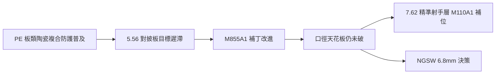

# 第 12 章 · 第 1 節 穿透力危機：當步兵彈撞上防彈牆

## 保護的軍備競賽

冷戰後，個人防護裝備的進步速度出人意料：以**碳化硼／碳化矽陶瓷複合板 + 超高分子量聚乙烯（UHMWPE）背板**組成的插板系統（美軍 SAPI / ESAPI 系、NIJ Level IV 級），能在交戰距離上攔截 7.62mm 穿甲彈。新一代士兵（美國 SAPI 類、**俄羅斯 6B43（Ratnik 系）**、**中國 OTV 型護甲**）的普及，讓「一線步兵人人都掛著陶瓷板」從特種部隊配置變成主戰部隊常態。

這對小口徑高速路線（5.56×45mm，M855/SS109）是一場悄然發生的**效能倒置**：初速與能量數據雖仍在紙面上閃亮，但對披板目標的**有效必要穿透量**已不再吻合戰場需要的穿透表現。

## M855A1：對 Level IV 的田野修補

2010 年前後，美國陸軍推出 **M855A1 EPR（Enhanced Performance Round）**：以銅質穿甲芯取代舊鉛芯，改善對硬質障礙（玻璃、鋼板、插板類）的穿透穩定性，並解決含鉛彈的環保限制。但作為 5.56×45mm 的改進彈，M855A1 是**在既有口徑框架內的補丁**——它改善了遲滯，並未逆轉天花板。

## 制度上的三層應對

面對防護升級，西方軍隊的應變分三層，每一層都有其制度性原因：

1. **精準射手層補位**：M110A1（7.62×51mm 系）進入班級火力結構——用更大的口徑繞過小口徑的能量限制，但重量與彈藥消耗大增。
2. **彈藥性能補丁**：如 M855A1、新型抑制器系統搭配，擠壓既有 5.56 的剩餘潛力。
3. **新一代口徑**：承認 5.56 的設計前提早已不符現代防護局勢，需要全新彈道——即第 12.2 節的 6.8mm 路線。

## 敘事的本質：不是槍被淘汰，而是前提被掏空

5.56×45mm 於 1960 年代制式化時的設計假設是：**非披甲、無防護、散兵線交戰**的叢林步兵。半世紀後的戰場卻是**披板常態化的支撐點防衛**。傳統 5.56 的問題不是「不夠準」或「不夠遠」，而是其**能量效能契約**（同重量彈藥下的穿甲表現）已到期。

這正是技術史上每次「口徑論戰」的深層結構：5.45 對 5.56、6.5 Creedmoor 對 7.62、6.8 對 5.56——**表面是彈道學之爭，底層是防護科技與後勤成本的博弈**。

| 因素 | 對輕彈的壓力方向 |
|---|---|
| 陶瓷/PE 插板普及 | ↑ 需要更高穿甲能量密度 |
| 都市化、障礙物穿越需求 | ↑ 需要更高通牆能力 |
| 後勤重量與負重上限 | ↓ 壓制大口徑純粹化 |
| 藥室壓力的冶金瓶頸 | → 需要新材料（複合金屬彈殼） |

## 小結

到 2010 年代中後期，美國陸軍內部的共識逐漸浮出水面：**M4 + M249 家族不改變口徑與材質，就無法穿透現代防護的既有水準**。這份「天花板的焦慮」將催生一場自 5.56 問世以來規模最大的步槍彈重啟計劃——下一節的 NGSW。
