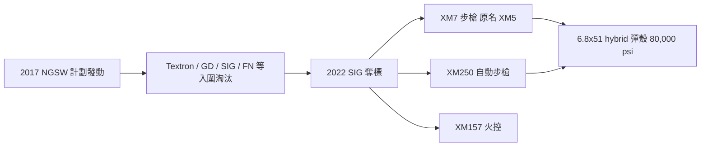

# 第 12 章 · 第 2 節 NGSW 與 6.8mm：半世紀後的口徑重啟

## 政策的源頭

2017 年前後，美國陸軍把先前分散在小口徑動能（Next-Generation**Squad Weapon**，承接 LSAT / cased telescoped 彈藥研究）的計劃收攏為**NGSW**（Next Generation Squad Weapon）計劃，同時競標兩件武器：**步槍**（取代部分 M4/M4A1）與**自動步槍／班用機槍**（補位部分 M249）。核心技術底線在於彈藥：一款彈藥必須提供顯著超越 5.56 的**穿甲與能量密度**，而非僅僅是口徑數字改寫。

## 競標生態

各家廠商投入了結構各異的候選方案（Textron 的埋殼彈 cased telescoped、General Dynamics、LoneStar Future Weapons 等），最終**2022 年美國陸軍宣布由 SIG Sauer 奪標**，其方案為：

- **6.8×51mm**（SIG 命名 .277 Fury）——**複合金屬彈殼（hybrid case）**：彈殼頭部以不鏽鋼製，底部以黃銅包合，可承受遠超黃銅殼極限的膛壓（約 **80,000 psi** 級），同樣彈重下把能量密度拉高；
- **SIG Spear** 系步槍與自動步槍，配合 **XM157 火控系統**（Vortex／Sheltered Wings 提供），整合雷射測距、彈道解算與環境感測。

## 命名的波折

入列時，步槍型號被命名為 **XM5**——與 FN 公司裁員歷史裡的 M5 商標相衝突，2024 年美國陸軍和 Colt 有相關商標爭執，**後改名為 XM7**。這個看似行政瑣事的改動，其實典型地展示了現代軍工的**制度磨擦成本**：命名空間本身就是戰場。

## 科技驅動鏈

$$
\text{能量穿透力} \propto E_{\text{muzzle}} = \frac{1}{2}mv^2 \quad \Rightarrow\quad
\text{在彈重（後勤)限制下 → 只能走高膛壓路線}
$$

複合金屬彈殼的本質，是為了在同尺碼彈藥下飲用「高壓空間」：**改材質→改膛壓上限→改槍管節奏與膛室→改槍械整体面貌**。

## 政治經濟：G11 的重演與反向

讀者會立刻想起 11.2 節的 G11 無殼彈。兩者同樣是「彈藥材質革命」的大工程，也同樣發生在**強烈的預算與組織阻力**情境下；不同處在於：

1. **供應鏈**：SIG 是具國際規模的廠商（與 Textron 等軍工承包商聯動），當時已建立起的多基地生產與民用市場渠道，能承接 6.8×51 的長期供應風險。G11 問世時，全球只有 Dynamit Nobel 一家能生產此種發射藥柱。
2. **戰場論證**：NGSW 的防彈穿透論證在 12.1 節呈現的是**2010–2020 的實際戰例與護甲迭代**，屬於實戰推理；G11 的論證則多是理論上的「未來戰場」設想。
3. **美國的預算體量**：能負擔跨採購週期的彈藥單價上漲，德國在 1990 年不能。

## 未來的餘波

截至今天，XM7/XM250 的採購仍屬於**部分換裝**——步兵班／精確射手／特定職位先行，且其彈藥成本與重量問題、抑制器高壓下的壽命問題都在持續被檢視。但其意義已經確立：**輕武器史進入了一個「彈藥材質驅動槍械重設計」的新曲線**，就像 1898 年的無煙火藥、1903 年的彈帽設計與 1960 年代的小口徑高速路線一樣——每一條新曲線都以「口徑的天下」重編一次。
