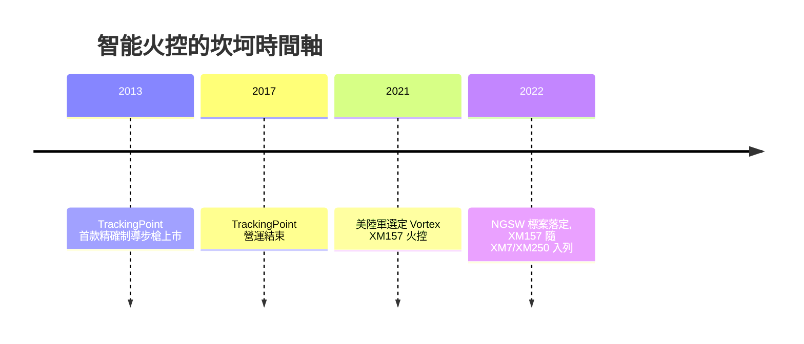

# 第 12 章 · 第 3 節 智慧火控：從「光學輔助」到「計算輔助射擊」

## XM157：把彈道學裝進瞄具

NGSW 競標中，**SIG Spear 的勝出不只由槍與彈促成，也由火控**。美陸軍選定的 **XM157** 由 **Vortex Optics（母公司 Sheltered Wings）** 研製，是一具整合了**雷射測距儀、彈道解算計算機、環境感測（溫度、氣壓、風向）、慣性感知**的智能瞄具：射手瞄準的同時，系統計算彈道落下與風偏，**將瞄點直接呈現在鏡片分劃上**。

這不僅是「更準的望遠鏡」。其本質是——**把原本屬於狙擊手腦中的數學（風速修正、距離衰減、環境係數），交給一枚實時運算的固態計算機**，然後讓結果以瞄準點的形態回饋給普通步兵。

## 先行者：TrackingPoint（2013–2017）

在軍用 XM157 之前，消費市場已出現「precision-guided firearm」（精確制導步槍）概念的先驅——德州新創 **TrackingPoint**（2013 年推出產品）。它以整合測距、影片追蹤與「標記–鎖定」扳機（**扳機僅在瞄點進入彈道解算視窗時才釋放**）的系統，驚豔了業界並被媒體廣泛報導。但其商業之路注定提早收場：槍械消費市場的價格承受線、維修服務瓶頸、以及標籤性「槍枝智能化」帶來的政治關注，最終在 **2017 年前後公司宣告停業**，其部分資產技術由買家收購。TrackingPoint 是技術史教科書式的 **「過早的正確答案」**——它證明了概念可行，但錯估了消費市場的成熟時機。

## 計算輔助射擊：誰負責準確？

XM157 讓我們直面一條歷史上從未出現過的倫理边界：**當槍械比射手更擅長校正彈道時，「射擊精度」的功勞與責任歸誰？**

- **軍事面**：距離判定錯誤曾是城市戰中誤擊平民的常見因子；雷射測距 + 彈道解算能大幅縮小此誤差，是一種**減少附帶傷害的工具**——同時也降低了開槍的心理門檻。
- **消費面**：若準確技術可民用化，誰該被允許購買？美國 ATF 對此類系統的定性（屬於光學還是「槍械部分」）在 2010 年代仍在演化。
- **國際法面**：這類系統仍是「人在回路」決策（扣扳機者仍是射手），尚未觸及「自主武器」的定義邊界——但它是靠近那條線的第一步。

| 階段 | 準確度來源 | 代表 |
|---|---|---|
| 光學輔助 | 玻璃放大 + 分劃 | ACOG、紅點 |
| 感測輔助 | 測距 + 環境輸入給人腦 | 彈道計算器、風計 |
| **計算輔助** | **演算法即時給出瞄點** | XM157、TrackingPoint |

## 結語：步兵成為「人在回路的射手」

輕武器技術史的推理不小心在 2020 年代遭遇一場**範式錯位**：過去的槍械革新，是「槍幫射手更省力」；智能火控則讓**射手所在的決策回路被計算機吞進了一半**。人類史上第一次，扣扳機的人在瞄具上看見的，不只是「目標在哪裡」，而是「**系統認為你可以命中**」——而這句話，也將成為下一場輕武器倫理辯論的起點。
