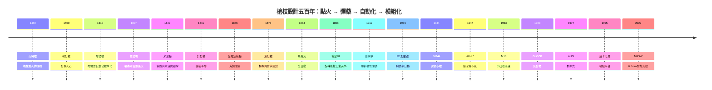

# 《槍枝設計者的故事：從黑火藥燧發、米尼彈線膛、自動閉鎖到卡拉什尼柯夫與現代模組化槍族》

> 一本專為輕兵器工程師、軍事歷史愛好者、機械結構專家與全球工業文明觀察者設計的專題目錄。
> 槍枝設計者在狹小的金屬空間與數毫秒的時間內，精確掌控數萬 psi 的燃氣高壓、劇烈熱膨脹與高頻衝擊——這是人類現代機械工程與材料科學最早的試金石。

## 前言

**[前言：毫秒間的物理極限——槍枝設計者如何用鋼鐵與火藥雕刻機械自動化的骨架](00.0-前言.md)**

### 五百年的設計主軸

---

## **【目錄】**

### 第一篇：黑火藥時代與機械擊發的破曉（15 世紀 – 19 世紀初）

* 第1章-從火繩到燧發：點火機構的機械演進
    * [1.1-火繩槍與輪發槍](01.1-火繩槍與輪發槍.md)
    * [1.2-布爾吉瓦與燧發槍](01.2-布爾吉瓦與燧發槍.md)
    * [1.3-前裝滑膛槍的物理極限](01.3-前裝滑膛槍的物理極限.md)
* 第2章-亞歷山大·福賽斯與擊發帽革命
    * [2.1-福賽斯與雷汞](02.1-福賽斯與雷汞.md)
    * [2.2-底火與擊發帽](02.2-底火與擊發帽.md)
    * [2.3-米尼彈與線膛](02.3-米尼彈與線膛.md)

### 第二篇：定裝彈藥、後裝革命與連發槍械的爆發（19 世紀中 – 19 世紀末）

* 第3章-約翰·德萊賽與金屬定裝彈：後裝線膛槍的降維打擊
    * [3.1-德萊賽針發槍](03.1-德萊賽針發槍.md)
    * [3.2-金屬定裝彈](03.2-金屬定裝彈.md)
    * [3.3-克尼格雷茨戰役](03.3-克尼格雷茨戰役.md)
* 第4章-亨利、溫徹斯特與槓桿式連發槍
    * [4.1-亨利步槍](04.1-亨利步槍.md)
    * [4.2-溫徹斯特1873](04.2-溫徹斯特1873.md)
    * [4.3-毛瑟與旋轉後拉槍機](04.3-毛瑟與旋轉後拉槍機.md)

### 第三篇：自動槍械降臨、無煙火藥與二次大戰死鬥（19 世紀末 – 20 世紀中）

* 第5章-海勒姆·馬克沁與第一支全自動機槍
    * [5.1-馬克沁的靈感](05.1-馬克沁的靈感.md)
    * [5.2-馬克沁機槍的機構](05.2-馬克沁機槍的機構.md)
    * [5.3-水冷套筒與彈鏈](05.3-水冷套筒與彈鏈.md)
* 第6章-約翰·摩西·白朗寧：定義現代槍械結構的造物主
    * [6.1-白朗寧傾斜槍管](06.1-白朗寧傾斜槍管.md)
    * [6.2-M1911與M2](06.2-M1911與M2.md)
    * [6.3-BAR與氣動傳動](06.3-BAR與氣動傳動.md)
* 第7章-施邁瑟、加蘭德與突擊步槍的誕生
    * [7.1-M1加蘭德與漏夾](07.1-M1加蘭德與漏夾.md)
    * [7.2-施邁瑟與StG44](07.2-施邁瑟與StG44.md)
    * [7.3-鋼板沖壓革命](07.3-鋼板沖壓革命.md)

### 第四篇：冷戰對決、小口徑狂潮與經典槍族（1950 年代 – 1980 年代）

* 第8章-卡拉什尼柯夫與 AK-47：不死的步槍之王
    * [8.1-卡拉什尼科夫的病床藍圖](08.1-卡拉什尼科夫的病床藍圖.md)
    * [8.2-AK的長行程活塞](08.2-AK的長行程活塞.md)
    * [8.3-AK槍族與地緣政治](08.3-AK槍族與地緣政治.md)
* 第9章-斯通納與 M16 / AR-15：小口徑高速彈革命
    * [9.1-斯通納的航太思維](09.1-斯通納的航太思維.md)
    * [9.2-小口徑高速彈](09.2-小口徑高速彈.md)
    * [9.3-M16的越戰危機](09.3-M16的越戰危機.md)
* 第10章-格洛克與 GLOCK 手槍：聚合物槍身革命
    * [10.1-格洛克的跨界突擊](10.1-格洛克的跨界突擊.md)
    * [10.2-SafeAction扳機](10.2-SafeAction扳機.md)
    * [10.3-聚合物與模組化](10.3-聚合物與模組化.md)

### 第五篇：犢牛式、皮卡汀尼與次世代個人武器（1990 年代 – 至今）

* 第11章-無殼彈、犢牛式結構與皮卡汀尼導軌
    * [11.1-犢牛式結構](11.1-犢牛式結構.md)
    * [11.2-G11無殼彈](11.2-G11無殼彈.md)
    * [11.3-皮卡汀尼導軌](11.3-皮卡汀尼導軌.md)
* 第12章-6.8mm 中口徑與次世代班組武器（NGSW）新紀元
    * [12.1-穿透力危機](12.1-穿透力危機.md)
    * [12.2-NGSW與6.8mm](12.2-NGSW與6.8mm.md)
    * [12.3-智慧火控](12.3-智慧火控.md)

### 結語

**機械動力的微型極限——槍枝設計者作為金屬、氣體與物理規律的永恆交鋒者**

---

## 💡 本目錄亮點

1. **完整穿透槍枝設計五百年歷史**：火繩／燧發 → 擊發帽與米尼彈 → 後裝定裝彈與旋轉後拉槍機 → 馬克沁連發機槍與白朗寧閉鎖 → 二戰 StG 44 → 冷戰雙雄 AK-47 與 M16 → 聚合物 GLOCK → 次世代 6.8mm NGSW 與智慧火控。

2. **深度解構槍枝四大核心工程機制**：

| 機制 | 演進路徑 | 對應章節 |
|---|---|---|
| **點火與彈藥（Ignition & Cartridge）** | 火繩/燧石 → 雷汞底火 → 黃銅定裝彈 → 小口徑高速彈 → 6.8mm 高壓複合彈 | 1, 2, 3, 9, 12 |
| **閉鎖與解鎖（Locking Mechanism）** | 旋轉後拉、肘節式、槍管傾斜、槍機旋轉閉鎖 | 4, 5, 6, 8 |
| **自動循環傳動（Operating Systems）** | 槍管短後座、長/短行程活塞、直噴式氣體系統 | 5, 6, 8, 9 |
| **材料與工藝（Materials & Manufacturing）** | 鍛鐵切削 → 金屬銑削 → 鋼板沖壓 → 聚合物注塑與航太鋁合金 | 7, 9, 10 |

3. **結構嚴謹**：全書 12 章，每章 3 個深度小節，嚴格遵循年代軸。

4. **史實紀律**：所有故事——從馬克沁「讓歐洲人自己屠殺自己」的靈感、卡拉什尼柯夫的病床藍圖、格洛克的窗簾桿工廠，到克尼格雷茨戰役、Somme 首日與 Ichord 聽證會——皆為真實事件，含歷史考辨與迷因辨偽。
