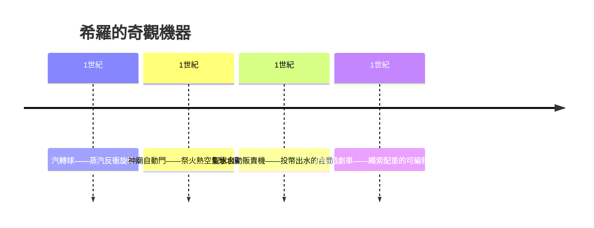
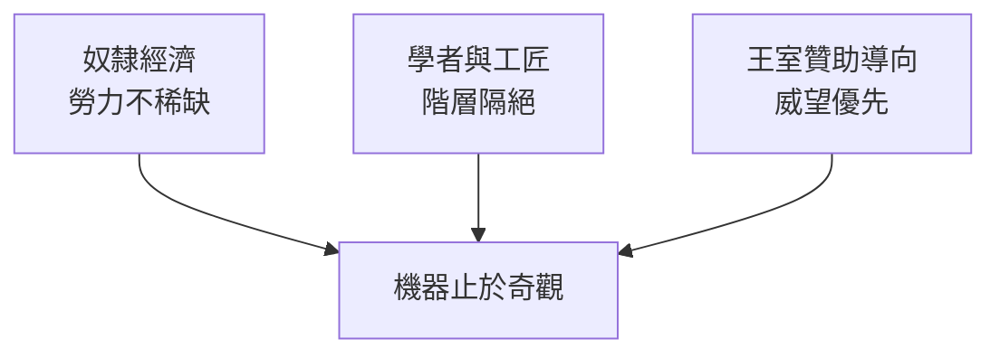

# 希羅與亞歷山大城：汽轉球與神廟自動門

## 地中海的智識首都

公元前 331 年，亞歷山大大帝在尼羅河三角洲建立亞歷山大城。他死後，其部將托勒密在此自立為王，開啟了近三百年的托勒密王朝。這個王朝做了一件影響深遠的事：把「贊助學術」當作國策。托勒密一世與二世建立 MUSEION（繆斯神殿，即 Museum，獻給九位繆斯的學者公社）與附屬的大圖書館，重金召來歐幾里得、埃拉托色尼、阿波羅尼奧斯等一流學者，給予酬俸與食宿。歐幾里得那句著名的回答「學問無王者之路」，正是對入城求教的托勒密一世所說。

這是歷史上第一個由國家供養的科研機構：學者不為市場做工，而為王室求知。圖書館一度藏書數十萬卷，甚至規定入港船隻所攜書籍須借抄存檔。國家資本的集中投入，使亞歷山大城成為希臘化時代的地中海智識首都。

公元 1 世紀，這座城市走出了一位承先啟後的人物——希羅（Hero of Alexandria，活躍於公元 1 世紀，一般推定為公元 10—70 年間）。他是 Museum 傳統的後繼者，在城中教授數學、力學與物理，留下《力學》（Mechanica）、《氣動學》（Pneumatica）、《自動機製作》（Automata）、《測量學》（Metrica）等著作。這些書令他成為古代記載最完整的一位「工程科學家」：他不只造機器，更以文字與圖解把機器寫成可以複製的知識。

## 汽轉球：被凍結的蒸汽機

《氣動學》中最著名的裝置，是汽轉球（Aeolipile）：一口密閉鍋釜加熱產生蒸汽，蒸汽經兩根空心立管進入一個懸空的球體，再從球面兩側彎曲的噴嘴切向噴出。依牛頓式的反衝原理，噴氣推動球體繞軸高速旋轉。

以今天的分類，這是史上最早將「蒸汽壓力轉化為連續迴轉運動」的裝置，被稱為蒸汽輪機或蒸汽機的思想雛形。但希羅的汽轉球只能表演：鍋小、壓低、功率微小、沒有可用的軸功輸出。希羅本人也沒有朝動力方向發展它——在他的用途清單裡，它屬於「奇觀」（thaumata），用來讓觀眾驚訝，例如把它裝在聖壇上，讓轉動的球「看起來像神意的顯現」。

## 神廟自動門：熱空氣的第一次工業應用

希羅在《氣動學》中詳細描述了一款神廟自動門：祭壇中央點火後，壇內空氣受熱膨脹，將下方密閉球形容器中的水沿虹吸管壓入一只掛桶；掛桶增重後下沉，以繩索和滑輪組拉轉廟門的樞軸，大門便在信眾眼前「自行」開啟；火熄後空氣冷縮，水倒流回原位，門又合上。祭司只需在頭晚埋好火種，翌日晨便可讓「神明親自開門」。

這在技術史上是一個意味深長的裝置：它把「空氣受熱膨脹」這一熱現象，轉化為水的位移，再轉為門的機械行程——熱、液、機三種能量形態的串接，正是十八世紀蒸汽動力鏈的預演。只是它把整條能量鏈全部用於製造宗教氣氛。

希羅同樣著名的是聖水自動販賣機：投下一枚硬幣，硬幣落入接盤壓下一根槓桿，閥門開啟放出定量聖水；硬幣滑落後槓桿復位，水流自動停住。這是「以貨幣信號驅動機械」的最早記錄之一，堪稱自動售票機與自動售貨機的共同祖先。《自動機製作》裡，他還描述了一種戲劇用四輪車：以配重驅動、用纏繞在鼓上的繩索長度與結扣位置決定轉向與停靠，能按預先「排好的走位」載著布景在舞台上移動——這就是「凸輪與繩鼓式可編程序列」的古代版本。

## 為什麼止步於神廟奇觀

希羅的機械清單令現代人扼腕：他手握蒸汽、熱氣、齒輪、虹吸與繩鼓編程，卻沒有孕育出工業革命。原因並非單純「才華不夠」，而是制度性的。

第一，奴隸制經濟不缺人力。希臘化世界的動力需求靠奴隸、牲畜與水力滿足，昂貴而精密的機器在成本上永遠贏不過廉價的臂膀。沒有勞動力稀缺，就沒有提高人均產出的動力；機器的角色只能是宗教節慶與宮廷炫技的道具。

第二，知識階層與工匠階層互不往來。希臘的「自由學問」卑微於動手，學者瞧不起匠人，匠人讀不懂幾何。希羅本人雖然身兼兩界，寫出了可以傳授的圖解文字，但整個制度沒有培養出一批「識字又動手」的工程師階層去把《氣動學》變成作坊產品。這些書籍以抄本形式流傳，更多被中世紀的僧侶當作博學古董收藏，而非操作手冊。

第三，需求側被鎖死。托勒密王室最大的動機是稅收與宗教威望，不是降低糧價或提高織機產量；缺乏一個以利潤為導向的城市工商階層去提出「更便宜、更快」的訂單。

奇觀機器是天才的火花，卻缺了燃料：市場、階層流動與「用機器換勞力」的經濟壓力。這一課，要到一千五百年後的文藝復興義大利與十八世紀英國，才會在另一種制度土壤裡重新點燃。而下一章我們將看到，同樣的機械天賦，在漢代中國的水輪上，以完全不同的路徑流轉。
