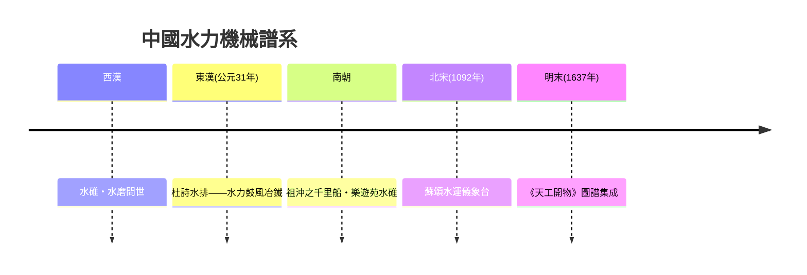
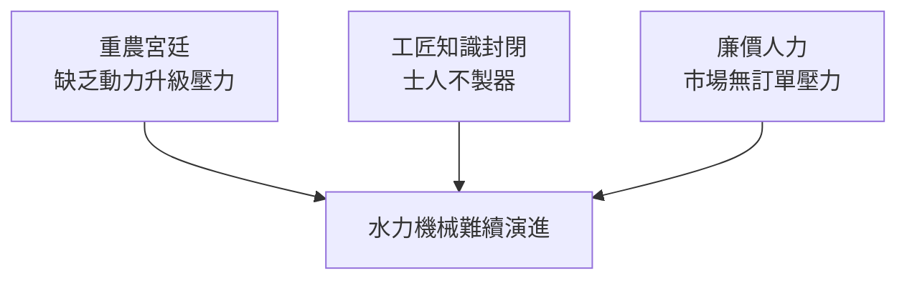

# 東方水力機械：水排與蘇頌水運儀象台

## 以水代人的譜系

當希臘化的奇觀機器在亞歷山大城的祭壇上轉動時，東亞大陸上的機械走的是另一條路：不是做給神看，而是直接接上生產。

中國古籍《史記》以降，歷代正史與筆記都有一條「以水代人」的記載傳統——水利機器被視為仁政的一部分，載入史冊是一種制度行為。其中的谱系大致是：

- 西漢已見水碓、水磨的記載（桓譚《新論》提到「役水而舂」的水碓，把人力踩碓換成水輪軸上的撥板，自動舂米）。
- 東漢建武年間（公元 31 年前後），南陽太守杜詩發明水排——以水輪帶動皮囊鼓風冶鐵。此前鼓風靠人力「人排」或馬力「馬排」，費力而風量不足；杜詩「造作水排，鑄為農器，用力少，見功多」，使冶鐵產量大增。這是中國史上第一次有文字明確記載「水力進入重工業」。
- 南朝祖沖之（429—500）不僅算出精確的圓周率，也造過「千里船」，試於新亭江上日行百餘里；又在樂遊苑造水碓水磨，武帝親自臨觀。
- 到明末，《天工開物》（宋應星，1637）以圖文並茂的方式系統記錄水碓、水磨、水車、水碓與筒車等水力機具，篇題〈乃粒〉〈乃服〉〈彰施〉……儼然一部「水力與手工業的百科全書」。這條自《史記》以來的書寫傳統，說明技術在中國不只是工匠私藏，而是可入官史的公共知識。

## 蘇頌與水運儀象台

北宋元祐年間（1086—1092 年），吏部尚書蘇頌奉詔主持建造了一座集天文觀測、演示與報時於一體的巨型機器——水運儀象台，立於汴京（今開封）。台高約十二米，寬約七米，分三層：上層露天平台設渾儀，中層密室置渾象（天球儀），下層為五層木閣報時裝置，按時辰刻以木人擊鼓、搖鈴、執牌出報。

其動力與控制的關鍵，在於一組以水驅動的擒縱系統——「天衡」與「天條」。平水壺保持恆定水位，水流恆量注入樞輪上的受水斗；斗滿時樞輪被往下壓，天條牽動天衡的槓桿機構釋放樞輪，讓其轉過一格，下一只斗再被擋住蓄水。如此一斗一格，將「連續的水流」切成「間歇的步進」，以近乎恆定的頻率驅動整座台的報時與渾儀同步旋轉。

以今日的眼光看，這正是「恆定水源 + 槓桿式擒縱器」構成的精確天文鐘結構，比歐洲的機械擒縱鐘晚了约兩個世紀，但以流量≈時間流速的方式把兩者結合，其受控精度與同步報時/觀測一體的設計，在世界鐘錶史上是極罕見的早期例子。蘇頌還為之撰成《新儀象法要》，附全機總圖與三層機構分圖——一份可以直接照圖複製的設計文件，是古代中國工程史上最完備的一份「圖紙論文」。

## 與歐洲擒縱的異同

歐洲鐘錶大約在 1300 年前後出現重錘—verge 擒縱（詳見下章），以配重為原動、以擒縱叉的振盪「切」時間；蘇頌的樞輪則以水流為原動、以天衡槓桿「切」步進。兩者的思想是一致的——「以一個小的、受控的間歇動作，校正一個大的連續動力」；差異在於原動與校準基準：歐洲選了重力與後來的擺，保持不斷「自我重新對時」；中國選了水恆流，受水溫、水質與蒸發影響，精度天花板較低。歐洲的擒縱線一路演化為遊絲擺輪錶，走進口袋與鐵路；中國的樞輪線在蘇頌去世後隨國家工程斷裂，水運儀象台被金人拆運北方後逐漸散失，其技術譜系未能延續。

## 為何沒有走向工業革命

中國的水力機械譜系龐大、應用也貼近生產——冶鐵、磨麵、灌溉、紡織——為何終未像英國那樣觸發工業革命？這正是李約瑟難題的核心之一。

一是動力供給端的制度差異。英國十七八世紀的煤田、煤礦排水與紡織需求，迫使工匠尋找「火力」與「馬力以外」的動力，蒸汽機是在具體的排水問題上被逼出來的；而帝制中國的朝廷以重農安民為綱，技術目標是糧食與河防，缺少一種「必須突破畜力水力上限」的緊迫經濟壓力。

二是工匠的地位與分割。中國工程師多為官吏所轄的匠戶，知識以「官把手藝」方式在衙署中封閉流轉；士子則以科舉進身為正途，視器械造作為奇技。蘇頌能親自動手、能圖解全機，是極其罕見的例外——《新儀象法要》的精確圖紙在中國知識階層缺少受眾，書成之後的工程傳承高度依賴官署個人，人去藝廢。

三是市場結構。中國龐大人口帶來的廉價人力，長期壓低了引入節勞機器的動機；缺乏一個以資本積累、利潤競逐為導向的城市工商階層，去把「更便宜」的重復訂單堆到作坊門口。

水排在宋以後仍繼續使用，水運儀象台的思維卻未能延續。這是一場天才的、以國家意志啟動的、卻缺少制度土壤的工程實驗。同樣的問題，在文藝復興的義大利與啟蒙時代的歐洲將以另一種方式得到答案——那裡恰好有一批識字、能畫圖、又能親自動手的工程師。
