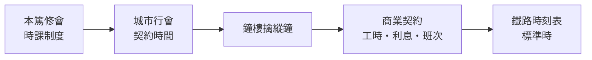

# 機械鐘錶的誕生：擒縱機構切割時間

## 漏壺與教堂的日常時刻

在中世紀早期的歐洲，一天的節奏不由齒輪定，而由兩件事決定：太陽與修院。希臘羅馬傳下來的漏壺（clepsydra，水鐘）與日晷只能指示日間的「流動時辰」；到了陰冷多雨、生活高度室內化的北方，它們的用處就更有限。真正把「時間」變成制度核心的是本篤修會：會規要求修士依「時課」（canonical hours）於固定時刻進行祈禱——晨禱、讚美經、午前經、午時經、晚禱、夜禱等六至八次，日間與夜間不間斷地裁切一天。修院的作息以水鐘、日晷與守夜人報喊來協調，這是歐洲史上第一次把一天切成等長段落、並由機構強制遵行的時間制度。

修院培養的不只是虔誠，也是一種紀律：固定的鐘聲喚人起床、安排勞動與讀書。 historian 學者劉易斯·芒福德後來說，現代工業時代的關鍵機器不是蒸汽機，而是鐘。這句話更精確地說，指的是能把時間切成等距步進的那個機構——擒縱器。

## 擒縱機構：把重力切成「嗒嗒」

約 1300 年前後，歐洲城市出現了史上最早的機械鐘——動力不是水，而是吊在高塔上的重錘。但重錘一放就跑到底，要讓它精準地放出能量，需要一種「節制的放行」機構：擒縱器（escapement）。

最初的方案是轉輪式擒縱（verge escapement）配冕形輪（crown wheel）：一個以受控速度由重錘驅動的齒冠輪，輪齒交替打在豎立的心軸（verge）上的兩片小葉（pallets）上。上齒撥一下，心軸轉受限；下齒再撥，心軸反向受限——每一次「卡住—放行」，齒輪就步進一格，同步帶動指針與報時錘。

$$ \text{連續的重力能量} \xrightarrow{\text{擒縱器}} \text{等距的時間步進} $$

這正是機械鐘的真理：它本身並不「製造」時間，而是把連續墜落的重力，切成可計數的「嗒嗒」。最早的鐘誤差以日甚至時辰計，但它已足夠把城市生活的前線城市化：行會鐘聲管理作坊工時，市政鐘聲管理市集開閉與城門啟閉。法國博韋、斯特拉斯堡、布拉格的天文鐘，義大利的城鐘（campanile），把「公共時間」變成城市自治的標誌——這是歷史學家雅克·勒高夫所謂「商人時間」取代「教會時間」的物質載體。

## 擺與日誤差的縮短

十七世紀，兩項突破把鐘從「一日誤差幾分鐘」壓到「日誤差秒級」。第一項是物理學家伽利略晚期觀察到擺的等時性，並提出以擺控制鐘的想法；第二項是荷蘭科學家惠更斯（Christiaan Huygens）在 1656 年將其付諸實做，造出史上第一座擺鐘，並在《擺鐘論》（Horologium Oscillatorium, 1673）裡以數學證明單擺週期規律：

$$T = 2\pi\sqrt{\frac{L}{g}}$$

只要擺長固定，週期就只依賴當地重力加速度，不受擺幅大小的細微差異影響。這是一個純粹理論被直接轉換為工程精度的例子：時間測量的第一次「物理化」。擺鐘的日誤差很快縮至秒級，使「一秒」這個概念第一次擁有可重測的機械基準。同年他還提出以廻轉彈簧（遊絲/發條）代替擺，使走時器件小型化——1675 年前後，遊絲擺輪腕錶首次出現，時間第一次可以被攜帶。惠更斯為遊絲申請了專利，並與英國科學家胡克爆發一段著名的發明權爭執，足見此技術的商業份量。

## 鐵路與標準時

工業革命之後，鐘錶的社會角色再次升級。十八世紀的航海經度問題靠精密懷錶（哈里森 H4 航海鐘）解決；十九世紀的鐵路則把時間推到極致：火車在同一條鐵軌上相向而行，兩座城市若各自沿用當地太陽時間，差幾分鐘就可能導致撞車。1884 年的華盛頓國際子午線會議確立格林威治本初子午線與全球時區，鐵路公司率先推行標準時（美國鐵路公司在 1883 年已率先劃定四大時區），時刻表成為契約與國家法制的一部分。

從修院的時課、城市行會的鐘聲，到鐵路的時刻表，機械鐘錶一步一步把「時間」從自然的節奏，改造為社會的交易準則。而這條路線上最關鍵的第一步，正是那位把連續重力切成等距步進的無名工匠——擒縱器的發明人，他的名字已不可考，但他的齒輪聲，至今仍在每一只機械錶裡走動。
