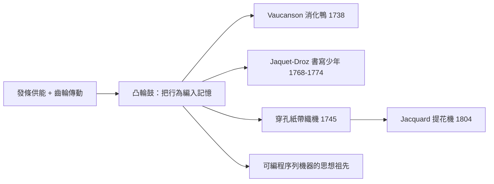

# 歐洲宮廷發條自動機：機械鳥與自動化邏輯萌芽

## 從鐘錶作坊裡長出的「機械生命」

十八世紀是自動機（automaton）的黃金時代。技術基礎來自兩條線的匯合：機械鐘錶的擒縱與齒輪系使「計時與傳动」成熟，發條（主彈簧）則讓動力可以儲存於機體內，機器不再依賴塔上的重錘，得以走進客廳與沙龍。於是在啟蒙時代的宮廷裡，出現了一批會寫字、會畫畫、會奏樂、會「消化」的傀儡。它們看似玩具，實為史上第一代「可編程序列的複雜機器」。

## Vaucanson 的消化鴨

1738 年，里昂出身的發明家雅克·德·沃康松（Jacques de Vaucanson，1709—1782）在巴黎展出一隻機械鴨，轟動全歐。牠會拍翅、理羽、喝水、啄食穀粒，最驚人的是能「消化」：吞下的食物在腹中分解，再排泄出來。實際上，腹內預藏了假的糊狀排泄物，「消化」只是一場精心設計的騙局——但這騙局本身展示了一種新能力：以凸輪與旋轉鼓構成的精密序列控制，把一連串複雜動作編進機體。伏爾泰曾戲稱沃康松堪與對抗普羅米修斯的人相提並論——機械師被時代視為「造生命」的神話重演者。

沃康松更實的貢獻在另一條線：1741 年他被任命為法王欽派的里昂絲織業巡查官，並於 1741-1745 年間為織機研發穿孔紙帶控制裝置，以打孔紙卷自動控制織紋——這正是後來 Jacquard 提花機的直接前身。一隻機械鴨與一根穿孔紙帶，指向同一件事：把複雜行為編入機械的記憶。

## Jaquet-Droz 父子：書寫少年

真正的「可編程」巔峰屬於瑞士鐘錶世家。皮埃爾·雅凱-德羅（Pierre Jaquet-Droz，1721—1790）與其子亨利-路易，並在讓-弗雷德里克·雷肖（Jean-Frédéric Leschot）協力下，於 1768—1774 年間完成三件名作：「書寫少年」（The Writer）、「畫家」（The Draftsman）與「音樂家」（The Musician）。

書寫少年是其中最驚人的一尊：跪坐的男孩執鵝毛筆蘸墨，能寫出任意字母組合、長達四十個字的句子。秘密在於一枚可拆換的凸輪鼓：每個字母的筆順被編碼為凸輪面上的凹凸輪廓，換鼓即換「程式」。以今天的語言，這是「以更換記憶體來更換程式」的物理實現——常被視為現代電腦「程式—記憶—輸出」架構的機械前史。畫家娃娃能繪出數種預設圖稿並為其上色；音樂家是一具能按鍵彈奏真實管風琴的少女像，指法由凸輪鼓驅動。

德累斯頓茨溫格宮一帶的宮廷收藏也呈現同樣的文化：薩克森選帝侯珍藏大量音樂鐘與自動人偶，沃康松本人則另造過吹笛手與鈴鼓奏者——以真正的風箱與簧片吹奏曲調，令當時的音樂家與哲人都大為震撼。巴黎、倫敦與德意志諸宮廷，成為機器表演的國際舞台。

## 文化經濟：誰在為機械生命買單

自動機的錢從哪裡來？第一是宮廷：君主與大公以「擁有最靈巧的機器」展演權力，沃康松因此獲得王室年金與官職。第二是票務經濟：Jaquet-Droz 家族把自動機攜往巴黎、倫敦與歐陸各地售票巡展，機器本身即是門票商品。第三是瑞士製錶業的品牌化：納沙泰爾地區的勒洛克（Le Locle）與拉紹德封作坊，把「會寫字的娃娃」當作最高階的形象廣告——機器的精密，就是鐘錶品質的證明，也讓瑞士靠出口精密機械奠定國際聲譽。

思想上的迴響同樣深遠。1770 年問世的「土耳其人」下棋傀儡（實為櫃中藏人操作）揭穿公眾對自動機的想像與幻滅；哲人則開始追問：凸輪上的「編碼行為」，是否預示機器也能思考？這個問題要等到二十世紀的圖靈才迎來正式答案，而它的思想祖先，正站在這些機械娃娃的凸輪鼓上。

## 尾聲：還在寫字的機器

Jaquet-Droz 三尊傀儡今藏於瑞士納沙泰爾市立藝術與歷史博物館（Neuchâtel），至今仍定期啟動展示，書寫少年仍能蘸墨寫字；沃康松的鴨子原件幾經戰火散失，僅傳構造圖與複製品，但穿孔紙帶所開出的路——從 Jacquard 到計算機打孔卡——已把他的名字刻進自動化的家譜。宮廷沙龍裡的奇觀，最後變成了工廠裡的程式；自動機這批「用機械預先編寫好的行為」，是人類第一次認真地問：機器的動作，可以被「寫」出來嗎？
