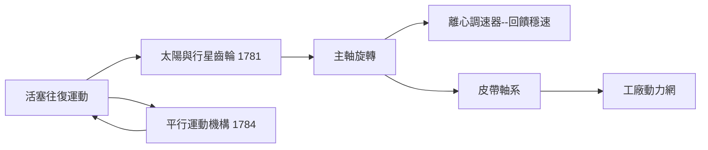

# 節標題：把直線變成圓——曲柄、平行運動與工廠的心臟

瓦特的獨立冷凝器解決了熱的浪費，但他的機器在很長一段時間裡仍然只會做一件事：上下推拉。活塞忠實地往復，搖樑笨重地擺動，把水從礦井裡拽出來。可是紡織廠要的是旋轉——紡錘要轉，織機要轉，飛輪要轉。要讓蒸汽機走出礦井、走進工廠，就必須把直線變成圓。這看似簡單的一步，卻卡住了整個工業十年。

最直接的答案是曲柄連桿：活塞桿透過連桿連到一根偏心的曲柄，往復運動便自然轉為旋轉，如同人的腳踩自行車踏板。早在 1780 年，諾丁漢的詹姆斯·皮卡德（James Pickard）就取得了曲柄連桿蒸汽機的專利。瓦特深知這是正解，卻被專利擋在門外。他不願侵犯他人權利，也不願付高昂的授權費，於是想出一個天才的替代品：**陽與行星齒輪**（sun and planet gear，1781）。讓活塞桿連在一個小行星齒輪上，行星齒輪繞著固定在主軸上的大太陽齒輪公轉——行星輪公轉一圈，太陽輪便反轉兩圈，往復運動就這樣被「行星的公轉」推成了主軸的旋轉。連桿都不需要了。博爾頓的賭性在此展露無遺：這個機構巧妙地繞開了曲柄專利的字面範圍，工程師的刁鑽與商人的精明在齒輪的嚙合聲中合為一體。直到 1794 年皮卡德專利到期，曲柄才重回正統，但太陽行星齒輪已名留青史。

然而曲柄連桿有它自己的麻煩：活塞桿與連桿相接處，若活塞桿在導軌上走得不夠直，側向的力便會把汽缸壁磨歪、把活塞環磨漏。瓦特追求的是汽缸內壁與活塞之間只容一枚薄薄六便士硬幣的縫隙——活塞的往復必須是完美的直線。但中點附近，他動過各種雜湊的方案，都不滿意。1784 年，他終於解出了這道幾何難題：**平行運動機構**（parallel motion linkage）。它由五根杆件與幾組鉸點組成，看似雜亂的連桿，卻有一個奇妙的性質——其中一點被約束著走出真正的直線，而這一點正是活塞桿的頂端；同時機構的另一側還帶動泵桿做相反的往復，一機兩用。瓦特對這個發明的得意，超過了獨立冷凝器——他晚年寫信給兒子說：「雖然我對冷凝器的事並不後悔，但若要說我一生的發明中最令我自豪的，還是平行運動。」這是一個儀器匠對「純粹幾何之美」的深情：冷凝器是 thermodynamics 的勝利，平行運動卻是幾何學的勝利。

有了旋轉，機器還要穩定。工廠主不能讓蒸汽機因煤質波動、負載起伏而忽快忽慢，紡出的紗便會粗細不均。瓦特借用了風磨上老磨坊主早已使用的離心擺的智慧，制成了**離心調速器**：一對重球由皮帶帶動旋轉，轉速升高時，離心力使重球張開、抬高，透過槓桿節流蒸汽閥門；轉速降低時重球垂下，閥門開大。轉速本身成為控制自身的訊號——這是工程史上第一套廣泛應用的自動回饋控制系統。同時代瓦特還發明了示蒸汽壓力的壓力計，讓看不見的蒸汽第一次可以被「讀數」。調速器之後，人類第一次把「監測—比較—修正」這個如今稱為回饋（feedback）的邏輯交給了機器自己；百年之後，馬克斯威爾為它寫下《論調速器》（1868），控制科學由此起跑。

直線運動的數學還有很長的後續。瓦特的機構其實走出的並非數學意義上精確的直線，而是一段極接近直線的弧——瓦特本人清楚這一點，他自嘲地說過：「我的直線是好得可以騙過上帝的直線。」真正的「精確直線機構」要等到 1864 年才由法國海軍軍官波塞利耶（Peaucellier）以七連桿反演機構嚴格證得，那已是瓦特死後二十五年。這段懸案說明一件事：十八世紀的工程師以直覺與試誤逼近數學，十九世紀的數學家再回頭為工程補上證明——工藝與理論互相追趕，正是技術進步的節奏。

當這一切機構在索霍工廠的車間裡合攏，蒸汽機終於成為一台通用的原動機：給它煤與水，它便吐出旋轉的功率，可以驅動任何軸、任何皮帶、任何機器。這是工業地理學的一場靜默革命。此前，英國的紡織廠被動力鎖死在河谷——水流的高度差決定工廠的位置，建廠就是選河；水枯的夏天機器停轉，工人被迫放假，谷物貴時工資成本又隨之浮動。旋轉蒸汽機解除了這道符咒。工廠從此可以建在煤邊、路邊、人邊：曼徹斯特、伯明翰、利茲這些人口稠密、運輸方便的城市，把河谷裡的偏僻小廠一個個吸空。紡織廠隨城市規模而擴張，動力供應集中而穩定，僱工容易、市場靠近——規模化第一次成為可能。蒸汽機是工廠的心臟，城市就是它的新軀體；煤塊在鍋爐裡的每一次燃燒，都在重新繪製英國的經濟地圖。

瓦特本人從未親手經營過一家紡織廠，但他造出了讓千萬紡織機開動的那顆心。歐文們、卡萊爾們日後津津樂道的「工廠紀律」「時間的暴政」，其節拍器正是這套齒輪與連桿——機器不僅改造了生產，也把直線與週期，重新寫進了人類的身體。
