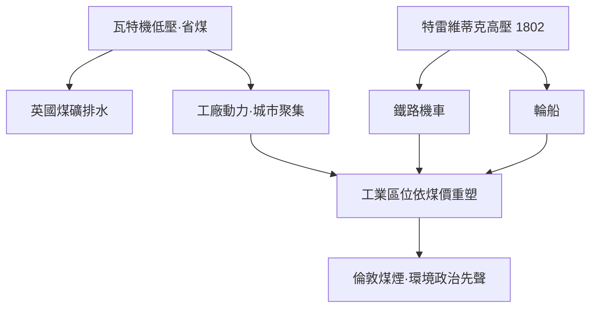

# 節標題：一匹馬的價格——馬力的定義與蒸汽機改寫地貌

博爾頓與瓦特的生意模式，在今天看來幾乎是一場金融實驗：他們不賣機器，而是安裝機器後，按它為客戶**省下的煤**抽取年金。這意味著合夥人必須向每一位吝嗇的礦主說服一個抽象問題——這台機器到底頂多少匹馬？當時一匹拉馬每天要吃掉飼料，要睡覺，要生病，還要換班；而機器只要煤與水。但要讓這筆帳算得清楚，就需要一個人人能懂、又對賣方有利的**單位**。

於是「馬力」（horsepower）誕生了。瓦特在推銷中需要一個對照基準，他採用的標準來自倫敦啤酒廠的實際觀察：那裡用馬匹拉動絞盤吊車，把煤桶與麥桶從酒窖提升上來。瓦特估算（一說參考了較早的工程師對拉馬功率的量測），一匹馬可使出約每分鐘 33,000 英尺磅的功率——即每分鐘把 33,000 磅重物提升一英尺。這個數字選得頗有商業智慧：它被認為把尋常馬匹的持續能力打得稍微偏低，如此一來，瓦特的機器標稱「十馬力」時，實際往往能頂替超過十匹馬，客戶發現引擎總是「有餘」，口碑便有了物理學的外衣。**單位從此不只是度量衡，而是行銷的武器**：一個行業若能定義自己的單位，就能定義買家的比較基準與心理預期。瓦特的馬力沿用至今（英語世界仍以 hp 標示引擎），而公制的「瓦特」（W、每秒一焦耳）則以他的名字紀念這場定義權之戰——1889 年，國際電工委員會把功率的單位獻給了這位早已去世的工程師。

有了單位，機器如虎添翼地在英國經濟的心臟地帶擴散。英國煤礦用它排水，康沃爾的錫銅礦則成為另一個試驗場：那裡煤貴礦深，礦主對效率錙銖必較，反而成為蒸汽機改良的競技場。康沃爾培養出一整個世代的「礦山工程師」，其中膽子最大的是特雷維蒂克（Richard Trevithick）——1771 年生於康沃爾礦區，父親是礦務總管，他身高近一米八七、摔角擒拿樣樣來得，鄉人稱他「巨人」。他不迷信瓦特的低壓教條：既然瓦特用真空做功不敢加壓，那為何不用高壓蒸汽直接推活塞，把冷凝器整個扔掉？1802 年他的高壓蒸汽機問世，體積小、功率大，且廢汽可以直接排入大氣——蒸汽機第一次小到能自己移動。同年他造出了可動式的噴煙怪獸，在礦區道路上自己跑動（比斯蒂文森早二十餘年）。高壓路線有爆炸的風險，瓦特到死都視之為魯莽，但正是這種賭性，把蒸汽機從固定不動的怪獸變成可以上路的機器。

法國則走了另一條路。巴黎的學術界——如卡諾父子與後代的薩迪·卡諾——以數學之眼打量蒸汽機；而蒸汽機在法國也確有據點，唯工程人才短缺、煤稀貴，機器的擴散遠不及英國。一個耐人尋味的對照是：法國人寫出了熱力學的理論（《論火的動力》，1824），英國人造出了實機的天下。理論與實踐分居海峽兩岸，要再等半世紀才真正匯流。

若說礦井排水是蒸汽機的搖籃，那麼**鐵路與輪船**便是它長出的雙腿。鐵路原是煤礦內部的運輸軌道，機車頭問世後，軌道便伸出礦區，向城市延伸；輪船則把蒸汽帶上大西洋。經濟地理的重塑有一根看不見的主軸：**煤價**。哪裡煤便宜，哪裡工廠的動力成本就低，哪裡就聚集煉鐵、紡織、機械。蘭開夏之所以成為紡織王國，不僅因潮濕氣候適合紡紗，更因身后煤田近在手邊。煤儲量決定了工業的骨架，鐵路與運河再決定它的血脈——煤要能便宜地流到鍋爐邊，工業區才能生長。此後百年的世界貿易地理，幾乎就是一張煤的運輸圖。

但煤也染黑了天空。倫敦自古就有煤煙，「大霧」與「豌豆湯」成為城市性格的一部分；機器時代來臨後，工業區排出的煙更濃。社會開始爭論：煙是文明的味道，還是殺人的毒物？1850 年代倫敦的「除煙協會」與國會多番的煙害立法，是人類第一次以公共政治的框架對待燃燒的副作用——那時人們擔心的是可見的煤灰與肺病；一個半世紀後，當「碳排放」成為全球議程，回望這段煤煙政治的起源，會發現人類學會為自己排放的氣體負責，其實始於維多利亞時代的倫敦街頭。

蒸汽機改寫地貌的另一筆，寫在海洋上。1807 年富爾頓的克萊蒙特號在哈德遜河上鳴笛，1838年「大西方號」靠蒸汽橫渡大西洋，帆船時代的航線圖被改寫——順風逆風不再是天意，時刻表才是命運。到十九世紀中葉，英國這個小島國憑藉煤與機器，成為「世界工廠」與航運霸主；蒸汽機點燃的每一縷黑煙，都在為不列顛和平（Pax Britannica）注入功率。馬力的定義，最終定義了帝國。

