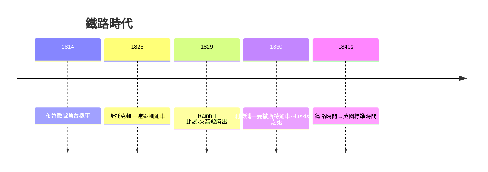

# 節標題：火箭號與利物浦——鐵路縮短了空間的時間

喬治·斯蒂芬森（George Stephenson，1781–1848）出身紐卡斯爾附近的煤礦家庭，父親是泵房司爐，家裡窮得他十七歲前目不識丁。這位樂天而勤懇的礦工，白天在煤井邊擺弄抽水引擎，晚上自掏學費進村校認字；十五歲起跟父親當司爐學徒，妻子因難產去世那年他才二十三歲，欠下的債他一文一文地還清。他從不羞恥自己的出身，一生以煤礦為傲，旁人尊他「鐵路之父」，他自稱不過是個把機器開得更好的機械工。就是這樣一個自學者，1814 年為基林沃思煤礦造出了他的第一台機車「布魯徹號」（Blücher，以打敗拿破崙的普魯士元帥命名），能在八分之一的坡道上拖起八節滿載煤車——從此礦區的馬匹拉運開始被機器取代。

斯蒂芬森的偉大不止於造機車，更在於他看懂了一個系統機器、軌道、坡度、爆炸風險、商業運作是一個整體。他主持因斯托克頓—達靈頓鐵路（1825），隨後接下最雄心勃勃的工程：利物浦—曼徹斯特鐵路。這條鐵路連接棉花港與紡織城，是第一條真正意義上「為蒸汽而設、為客貨共用而設」的幹線。為選定機車，公司於 1829 年 10 月在 Rainhill 舉行公開競賽**Rainhill 比試**（Rainhill Trials）：參賽機車需在一段來回的平直軌道上拖載合格重量，以規定時速行駛，並重複多趟以證可靠。

最終勝出的，是他與兒子羅伯特合設的紐卡斯爾廠的「火箭號」（Rocket）。火箭號的關鍵不在蠻力而在**鍋爐**：早年機車的鍋爐只有單根或數根粗煙管，受熱面積小，蒸汽供不上；火箭號改用二十五根細銅煙管穿過鍋爐，受熱面積驟增；再加上把廢汽噴入煙囪的排汽管（blast pipe，藉噴射氣流加強爐火抽力），鍋爐、汽缸與煙囪構成一個完整的呼吸系統；0-2-2 的配置則把機車重量集中在動輪與導輪上，兼顧牽引與安穩。火箭號以約十五英里的平均時速拖載合格重量完成全程，單段還曾衝到每小時近三十英里，在可靠性的較量上更勝一籌——其餘參賽機車一台熄火認輸，一台在競賽中爆管，一台因輪軸問題翻覆出軌。多管鍋爐的設計思想，此後成為全世界機車的通用心臟。

1830 年 9 月 15 日，利物浦—曼徹斯特鐵路盛大通車。首相威靈頓公爵蒞臨，八節列車載著七百餘名貴賓。但這一天以悲劇收場：列車在帕克賽德暫停時，貴賓們下車步行休息；曾任貿易大臣、剛重返政壇的**侯斯克遜議員**（William Huskisson）由於車間軌道太密，在越過對向軌道欲與威靈頓握手時，來不及躲開呼嘯而至的「火箭號」，被撞倒重傷，當晚不治。史上第一起鐵路身故事故，死者竟是鼓吹自由貿易的政治家，舉國震動。報紙與小冊子趁機哀嘆「機器吃人」，但列車次日仍照常運行——公眾的恐懼與興奮交相拉扯，鐵路卻以驚人的速度鋪向全國：1830 年全英鐵路不到百浬，1850 年已超過六千浬。

鐵路不僅是機器，更是一套新的**商業制度**。它需要遠超個人財富的資本——動輒數十萬鎊乃至百萬鎊的造價——於是股份公司、公開募股、招股說明書、股價行情，第一次以工業規模動員了中產階級的儲蓄；1840 年代的「鐵路狂熱」讓職員、寡婦、牧師都搶購鐵路股，投機與融資制度互相催生。它又重塑了**時間**：列車要準點會車，就得全國共用同一張鐵路時刻表。倫敦時間（格林威治平均時）被鐵路公司推廣為「鐵路時間」（railway time），各站時鐘逐漸對齊格林威治；1840 年代「英國標準時間」在鐵路的推動下終成日常的制度，地方太陽時從此退入歷史。時間表的暴政、準點的道德，都從鐵路的非常多毛細管流進了社會身體。它還有一項被低估的社會功能：1830–1844 年間，多數鐵路設有廉價**三等車廂**，讓貧窮的勞工也能以極低票價移動——這既是某些鐵路籌建者的社會抱負，也預演了大眾觀光：1841 年，浸信會牧師庫克（Thomas Cook）以包租火車載五百多人去開禁酒大會，世界第一家旅行社由此誕生，觀光從貴族的壯遊變成工人的一日遊。

文化也為蒸汽加入了新的語法。人們第一次以時速三十英里穿過田野，眼裡的風景變成了流動的板片；報紙上「舒適與恐怖」「興奮與焦慮」的混雜感受，是現代性最早的體感散文。畫家威廉·透納（J. M. W. Turner）於 1844 年畫出《雨、蒸汽和速度——大西部鐵路》：一列火車如金色的影子奔馳過梅登黑德鐵橋，雨霧化為速度本身，車前田間還藏著幾乎看不見的小兔與犁人。這幅畫是鐵路美學的第一份宣言：人類的空間感已被機器重新計價，那一天倫敦與曼徹斯特之間，從此以幾小時計，而不再是幾天。

