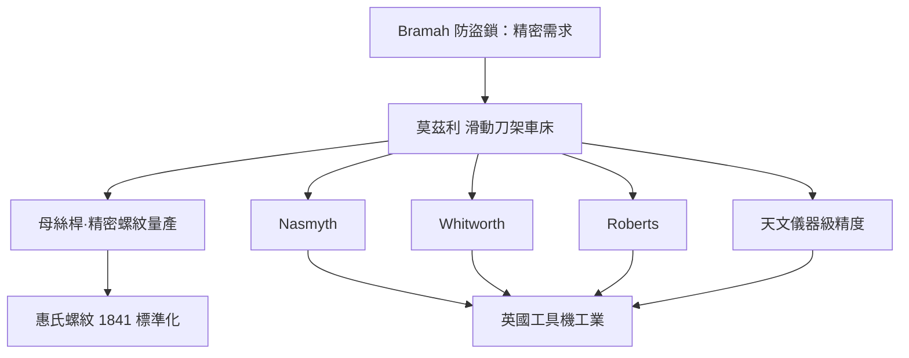

# 節標題：能造機器的機器——莫茲利與滑動刀架

工業革命有兩個層次：造出機器，與造出**能造機器的機器**。第一層屬於瓦特與史蒂芬森，第二層屬於倫敦的一位木匠之子——亨利·莫茲利（Henry Maudslay，1771–1831）。

莫茲利的童年是在伍爾威奇兵工廠的鎚聲裡度過的：父親是兵工廠的木工，少年亨利十二歲便進廠做填彈棒工，轉入金工車間後又做鎖匠，一雙手在人人大呼「不可能」的年代裡磨出來了不可思議的手感。十八歲時他到了約瑟夫·布拉馬（Joseph Bramah）的工坊——布拉馬是當年倫敦頂級的發明家，拿下了防盜鎖的專利，而正是鎖的氾濫逼出了一個新問題：鎖想要機密、鑰匙想要精確，偷鎖者無孔不入，精密加工第一次有了急迫的市場動機。莫茲利在布拉馬手下做了八年，升到工頭，練出了一手車床的絕活。1789 年後他自立門戶，在倫敦開設自己的工場，聲名鵲起。

當時的車床其實已流傳了幾個世紀，但同一個原理一直被使用者心照不宣地受限於兩個限制：刀是用手握著的，尺寸靠工匠的感覺；刀架雖可沿床面移動，進給卻不穩定。莫茲利在 1794 年前後做出的關鍵一步，是把車床用於**切削螺絲**：他為車床加裝一個以螺桿導引的**滑動刀架**（slide rest）——由絲桿傳動，使刀具沿床面作精確而連續的縱向進給，同時可作橫向的定量進退。其結果是革命性的：**車出來的圓柱，圓得出乎意料；螺絲的牙距，可以一次又一次精確複製**。1790 年代末，他又以滑動刀架車床為基礎，參與海軍部大規模索具滑輪塊（pulley blocks）專用機械的製造——為特拉法加時代的皇家海軍一座工廠年產十萬件木製滑車，機床批量生產第一次在英國落實。用後人的話說：他把工匠的手藝，第一次**轉寫**成了機器的幾何。

螺絲是這個故事的靈魂。此前每家工廠都自造自己的螺紋，甲廠的螺栓擰不進乙廠的螺母，機器世界彷彿積木絕不相容的方言。莫茲利以滑動刀架加母絲桿（lead screw），車出了一致的螺紋，並以他嚴格的標準準確而一致地量產了上千枚互換的螺絲；他的徒弟約瑟夫·惠特沃斯（Joseph Whitworth）在 1841 年提出「英制惠氏螺紋」標準——規定 55° 牙角、統一每吋牙數——把螺絲變成了**第一位世界的通用語言**。螺絲雖小，其意義卻直追蒸汽機：它使機器第一次可以被拆開、更換、重組、維修，也使「設計圖」真正成為製造的合同，而非工匠腦中的印象。

莫茲利的傳奇還在於他**培養人**。他的倫敦工場在十九世紀上半葉被稱為「工程學院」，門牆下走出了一整個世代的英國機械巨匠：約瑟夫·內史密斯（James Nasmyth，後以蒸汽鎚聞名，早年也曾為史蒂芬森的機車出力）、約瑟夫·惠特沃斯（Whitworth，標準化鬥士）、理查·羅伯茨（Richard Roberts，自動走錠機的發明者）。他們離開師門後，都開辦各自的機械工場，自成一方；正如莫茲利曾為布拉馬的學徒，徒弟又各自開枝散葉——英國的工具機工業，便以這種師徒系譜在半個世紀裡生長成林。內史密斯晚年回憶老師工場裡那台床面被歲月磨得黑亮的巨型車床，說莫茲利教給學徒的第一課是幾何的信念：**直線、平面、圓——先把這三樣做到極致，其餘的機器自會跟著正確**；他常告誡學徒：加工不誠實，機器是會報復的。

機床（machine tools）這個概念，在莫茲利手中第一次明確成形：**機床是母機（mother machines）**——它自己不生產商品，只生產其他機器，因此它的精度就是整個機械工業的精度上限；母機每前進一個數量級，下游的引擎、紡機、機車、槍炮就全面隨之升級。這是一種倒果為因的智慧：不是需求催生了精度，而是精度催生了需求。莫茲利接下的著名訂單正是明證——倫敦與都柏林的天文臺、海軍部的水文測繪部門，源源不絕把經緯儀、望遠鏡座與測深儀器送進他的工場，要求以「萬分之一吋」為單位校核的公差。這條線也把我們帶回一個知識傳統：精密製造的文化，本來就與**天文儀器與度量衡學**血緣相連——法國科學家博爾達（Borda）以秒擺量測與儀器校準聞名，英國的實驗學派則以愈來愈刁鑽的千分尺來「伺候」真值。當莫茲利這樣的工匠把天文臺級的量測耐心搬到商業車間，機器工業才算真正確立了「精度高於手藝」的規則。

1831 年，莫茲利在巡視法國的市場途中感染霍亂而亡，年僅六十。他留下的不只是那台黑沉沉的「老婦人」車床，而是一個到今天仍然有效的鐵律：**誰掌握了母機，誰就掌握了所有機器的命運。**他的徒弟惠特沃斯後來以量規與標準聞名，並發起「標準螺紋」的統一；再往後，精密工具機成為火炮、汽車、飛機興起的前置條件。二十世紀的地緣競爭中，工具機工業始終列為戰略產業——其源頭，正是這一位倫敦木匠的兒子，在 1797 年前後的那一刀。

