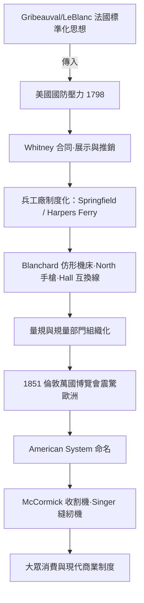

# 節標題：槍管裡的民主——可互換零件與美國製造體系

1794 年，法國工程師葛里博瓦（Jean-Baptiste Vaquette de Gribeauval）的炮兵標準化改革已數度展開，軍械工程師奧諾雷·勒布朗（Honoré Le Blanc）更在各要塞當眾演示：散放一桌的槍機零件，可與任意一支同型槍互換組裝。拿破崙戰爭政局動盪，這套理想卻傳到了大洋彼岸。剛剛立國的美國正被兩件事折磨：它沒有英國那樣的熟練工匠，也害怕再打仗時軍備依賴歐洲。**國家安全**與**勞動力短缺**兩道壓力，迫使美國尋找一條不同的路——這是新大陸的命運，也是動機。

1798 年，康乃狄克的發明家伊萊·惠特尼（Eli Whitney，軋棉機的發明者）向聯邦政府承下一份合同：28 個月內以 13.4 萬美元交付一萬支滑膛燧發槍，並聲稱這些槍的零件皆可互換，壞一件換一件，無須配修。這是當時美國最大的民間軍需合同。但事實是：**惠特尼從未做到完全互換**。他屢屢拖延、延期，1810 年前後仍以手工修配完成交付；真正可靠統一到他手裡的，是市場上的名聲。他的過人之處在於**展示**——1801 年，他在華盛頓當著總統傑佛遜與軍械部官員的面，將十組槍機的零件分放十個袋子，隨意混取組裝，十支槍機逐一擊發無誤，滿座譁然。後世史家已指出，這場表演多半經過安排（零件多經手工精修、逐袋配好），卻仍是一次極成功的推銷：政府相信了「可互換」值得長期投資，資金與訂單源源而來。惠特尼本人曾寫信向友人坦承，槍械生意雖未大賺，卻逼出了他「一個人的個人信用比機器值錢」的洞見——他藉合同學會了融資、工廠管理與公關。 synonyms 話說：**概念的先行者，往往不是技術的完成者。**

真正把互換製造做出來的是另一些人。康乃狄克河谷的**托馬斯·布蘭查德**（Thomas Blanchard）以鏤铣機床聞名——他發明了**輪廓仿形車床**（profile lathe），以一個樣品輪坯與另一轉動主軸上緣檔梢導引，機床自動刀削出不規則三維形面：1850 年代的一台機器每天可車出十數個步槍管口。他並未拿這台機器去演示總統——他拿它去打官司：這是美國史上第一批以專利訴訟維生、一生持有二十餘件專利的發明家型企業家。同地在 **Springfield 兵工廠**與西維吉尼亞的 **Harpers Ferry 兵工廠**，機械師如約翰·霍爾（John H. Hall）以 M1819 後膛槍建立起真正意義上的互換生產線；康乃狄克的機械師**西緬·諾思**（Simeon North）則在同一時期以近似的方法造出手槍，被後世視為互換製造的先行者。兩座兵工廠多番比試、互相抄習，軍械部並設立制度化的檢驗：由督察以規（gauge）抽檢，不合格者整批退回。軍方作為**唯一大而且是回頭的顧客**，其驗收標準倒逼出了整個產業的規範。

「規」與「規量部門」（gauge department）的專業化，是這套體系的靜默基礎。要互換，就得先定義「一萬分之一吋」是什麼：標準規具由中央部門統一製作、分發，各 provost 工場不能自造規具、自訂公差；量規的檢定、磨損換新、登記造冊，形成了最早的品質管理體系。這套「以規治廠」的制度網絡——設計、工具、檢驗、計量在組織上分部而設——後來成為全世界現代工廠的範本。先在兵工廠成形，再擴散到民間：1851 年倫敦 **萬國博覽會**（Great Exhibition）上，美國展位的槍械、麥考密克收割機模型與科爾特手槍讓歐洲工程師大為驚異。《倫敦時報》與工程師學會接連撰文，正式創造了一個名詞：**美國製造體系**（American System of Manufactures）——不靠ื้น熟練工匠的手藝，而靠標準化零件、專用機床與量規制度，讓半熟練勞動者也能製造出精密產品。

這套體系為民間大眾消費而生也只是時間問題。1850 年代起，芝加哥的**麥考密克**（McCormick）收割機以可互換零件量產，西部大農場終於能在收穫季搶時間；1860 年代起紐約的**勝家**（Singer）縫紉機把同一邏輯搬進家庭，零件互換使它敢於在全球開設幾百家經銷店，承諾「零件壞了寄一枚即可修」——維修→經銷→分期付款的現代商業鏈，皆由此而生。可互換零件不只是技術，它是一整套**制度破局**：它使機器第一次可以被拆開、更換、重組、維修，使「設計圖」真正成為製造的合同，使品質從工匠的天賦轉為組織的紀律。而它的源頭，出自新國家最深的不安——怕後勤跟不上戰時、怕工匠不夠、怕列強封鎖。美國的民主制度選擇了以**制度性的標準**代替**個人的手藝**，這既是技術的路徑，也是文化的選擇：這條路後來通向福特汽車、通向豐田、通向今天所有以零件組成的世界。

