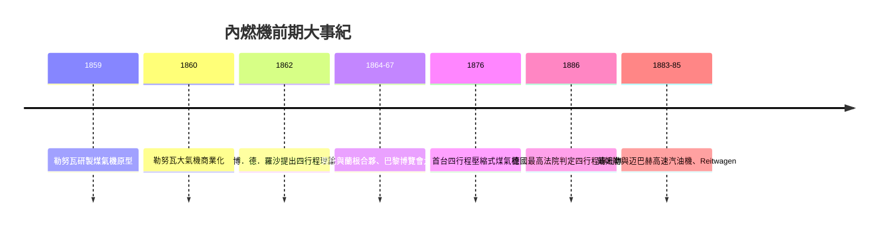

# 奧圖四行程循環：更輕盈高效的動力

十九世紀中葉，蒸汽機仍是動力的霸主，但它笨重、需要鍋爐、生火要數小時，對小型工場根本不合用。工程師們早已知道一個道理：若是讓燃料直接在氣缸內燃燒，就不必透過鍋爐與蒸汽這個「中間人」損失熱量。問題是——怎麼做才划算？

## 勒努瓦：第一台能賣的內燃機

1860 年，比利時裔法國人艾蒂安．勒努瓦（Étienne Lenoir）製成第一台商業化的煤氣內燃機。他在巴黎開過瓷器店、做過電鍍生意，動手能力極強。他的「大氣機」結構近乎直白：活塞在氣缸裡往復，煤氣與空氣在半個行程處以電火花點火，爆發的氣體推動活塞，靠齒條與飛輪把往復變成旋轉。它不需要鍋爐，點火即動，立刻吸引了印刷廠、小型工場的訂單，高峰期在巴黎賣出了數百台。

但勒努瓦機的效率低得驚人——熱效率只有百分之三、四上下。因為它沒有壓縮：混合氣在常壓下進入氣缸，爆發前的壓力低，做功自然有限。煤氣燒掉一大半，換來的只是唧筒般的動作。它可以「用」，卻稱不上「好」。歷史在此擺出一道難題：內燃的原則已被證明可行，缺的是一套讓它效率倍增的工作循環。

## 奧圖與蘭根：巴黎博覽會上的「噗噗聲」

在德國科隆，跑過雜貨與貿易生意的尼古勞斯．奧托（Nikolaus Otto）自學熱力學，反覆研製壓縮式煤氣機而屢屢失敗。1864 年他遇見了改變他一生的人：尤根．蘭根（Eugen Langen），製糖商人之子、受過工程教育的發明家。蘭根看出奧托的想法有商業價值，兩人合夥，次年成立「奧托公司」（後來發展為科隆的 Deutz 蒸煤氣機廠，Gasmotoren-Fabrik Deutz）。

1867 年，兩人帶著一台怪異的機器前往巴黎世界博覽會：一台「自由活塞」大氣機。它沒有曲軸直接連著活塞——活塞像一枚巨型插銷，煤氣爆發把它向上彈射，靠自身重量與大氣壓力回落做功，每次都發出突兀的「噗、噗」聲，遠聽像在敲打地毯。評審起初嫌它吵，一量油耗卻大吃一驚：同樣的馬力，它燒的煤氣只有勒努瓦機的一半不到。這台裝置拿下了博覽會大獎，訂單隨之而來。勤奮而固執的奧托在此展現了他的人格特質：不追逐炫技，只痴迷於一件事——榨出每一份燃料的全力。

## 1876：四行程循環問世

自由活塞的成功是過渡而非終點。奧托念念不忘的，是他在 1860 年代便構想過、卻被早期失敗嚇退的方案：**先壓縮，後點火**。壓縮使混合氣的初溫初壓升高，爆發才有足夠的膨脹比可以做功。這正是熱力學的鐵律。理想氣體循環的效率為

$$\eta = 1 - \frac{1}{r^{\gamma-1}}$$

其中 $r$ 是壓縮比，$\gamma$ 是氣體的絕熱指數。壓縮比越大，效率越高——這一句數學，抵得上數百項專利。值得注意的是，早在 1862 年，法國工程師阿方斯．博．德．羅沙（Alphonse Beau de Rochas）便已在論文中提出過四行程的理論，卻從未造出機器。付诸實踐的，是奧托。

1876 年，奧托製成第一台四行程煤氣機：**進氣、壓縮、點火做功、排氣**，四個行程構成一個循環，靠飛輪貯能持續運轉。這台「靜音式」引擎熱效率躍升至百分之十以上，功率密度遠勝勒努瓦機，煤氣機從此成為大小工場的標準動力。Deutz 工廠急速擴張，二十年內賣出數萬台，波蘭、俄國、美洲的工場都在它的噠噠聲中運轉。

## 專利崩塌，產業爆炸

創新者的悲喜劇隨之登場。1886 年，德國最高法院裁定奧托的核心專利無效，理由正是博．德．羅沙的先行理論，加上此前有其他人做過預壓縮實驗。奧托在十九世紀最後的歲月裡，從「柴電煤氣機之王」跌回被質疑的發明人。但專利的倒塌沒有毀滅產業——恰恰相反。建造四行程機的門檻一旦被推平，德國、法國、英國、美國的機械廠蜂擁而入，煤氣機、汽油機的品種呈爆炸式增長。有人在店鋪後院就能造出一台小引擎，裝上輪子，就成了一部車。

## 德勤與邁巴赫：脫離母體的新世代

在 Deutz 的工程部門裡，兩位年輕工程師正醞釀著下一步：戈特利布．戴姆勒（Gottlieb Daimler）與威廉．邁巴赫（Wilhelm Maybach）。他們研判：煤氣機體積龐大，是因為煤氣管拖住了它；若改用液體燃料——汽油——並把轉速提高誰也沒試過的層級（每分鐘數百甚至上千轉），引擎就能小得可以裝上車。1882 年二人相繼離開 Deutz，在斯圖加特郊外的索嫩霍夫別墅花園車庫自建工場。1883 年製出高轉速熱管點火汽油機，1885 年裝上木架自行車，即是史上第一部摩托車 Reitwagen。

奧托給了內燃機骨骼與節律，戴姆勒與邁巴赫則給了它翅膀——效率、壓縮比、高轉速這三個關鍵詞，把動力從固定的工場地基上解脫出來，往整個二十世紀的路上奔去。
