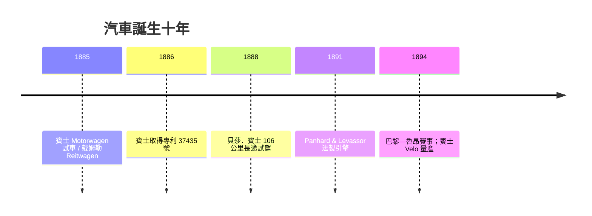

# 賓士與戴姆勒：汽油機車輛的誕生

1876 年的奧托四行程機是固定式的：它安坐在工場水泥地上，靠皮帶向機床供力。要把動力裝上輪子、載著人奔跑，需要更輕、更快、更自動化的引擎——以及一群相信「無馬的馬車」不是笑話的人。

## 卡爾．賓士：孤僻工程師的三輪奇蹟

卡爾．賓士（Karl Benz）1844 年生於卡爾斯魯厄，父親是火車機車司機，在他兩歲時死於事故。寡母省吃儉用供他就讀卡爾斯魯厄理工學院，師從「德國鐵路之父」雷杜騰巴赫，受的是最正統的機械工程訓練。畢業後他輾轉於鋼鐵廠與工具廠當領薪工程師，生性內向、固執、不擅與人合作，一心想做自己的事業。1871 年他與合夥人在曼海姆開設鑄鐵與機器工場，婚姻上則得到了命中貴人：妻子貝莎．賓士（Bertha Benz）出資贖回不合夥人的股份，成為他事業的實質後盾。

1883 年他成立賓士公司（Benz & Cie.），以出售固定式煤氣機牟利，私下則在廠房後方秘密研製汽車。他的路線是「整體設計」：不是把引擎塞進馬車，而是圍繞引擎繪出一整部機器的圖紙。1885 年冬，Benz Patent-Motorwagen 試車成功：單缸四行程汽油機，約 0.75 匹馬力、轉速令人驚訝地達每分鐘四百轉；用高壓線圈與火花塞點火（當時的先驅設計）；管狀鋼車架、鋼條輻條輪、以及——極具卓見的——**差速器**，解決了轉彎時兩輪轉速不均的問題。1886 年 1 月 29 日，德國帝國專利局頒給他第 37435 號專利，這份文件被後世稱為「汽車的出生證明」。

## 戴姆勒與邁巴赫：高轉速的布道者

同時在斯圖加特郊外的花園工場裡，戴姆勒與邁巴赫走的是另一條路：先做小而快的引擎，再想裝在哪裡。1885 年他們把一台小型汽油機裝上木質自行車——Reitwagen，摩托車之祖；1886 年把更強的引擎裝入一輛英製馬車，造出四輪汽車；1889 年邁巴赫設計鋼輪鋼架的快速車型，在巴黎博覽會上震動了法國工程界。兩人 1890 年成立戴姆勒汽車公司（Daimler-Motoren-Gesellschaft），但戴姆勒強硬的性格與董事會屢生衝突，一度被迫離開自己創立的公司，1900 年前後才在埃米爾．耶利內克（Émile Jelinek）的資本運作下重返，並以耶利內克之女的名字——「梅賽德斯」——命名新一代車型。

## 貝莎的「廣告之旅」

1888 年 8 月，賓士的車造出來了，卻賣不動——公眾嫌它稀奇而不可靠，夫婦爭執不斷。貝莎做了史上最著名的一次行銷：帶著兩個兒子，不聲不響地把車推出門，從曼海姆開往一百公里外娘家所在的普福爾茨海姆。途中燃料用盡，她到威斯洛赫的藥房買了**石油醚**（Ligroin，當時藥房出售的清潔溶劑）——世界上第一次的「加油站」竟是藥房；剎車皮磨壞，她請鞋匠釘上皮革；爬坡無力，她靈機一動叫兩個兒子下車推——並因此說服丈夫加裝**低速檔**。這次 106 公里的旅程證明汽車可以日用，賓士的收入與名聲自此起飛。她後來說：「他敢想，我敢做。」

## 法國的賽場催化劑

真正把汽車從奇觀推向產業的，是法國人。1891 年起，標緻（Peugeot）、潘哈德—勒瓦索（Panhard & Levassor）向戴姆勒購買引擎執照製車，隨後自建引擎——法國成為早期汽車產量最大的國家。1894 年 7 月，巴黎《小日報》（Le Petit Journal）主辦巴黎—魯昂可靠性競賽，上百公里的路線上人們夾道，「汽車」一詞自此風行全歐。賽事的刺激催生了引擎、變速箱與輪胎的急速改良：邁巴赫的蜂巢式散熱器、噴霧式化油器相繼問世；1888 年鄧祿普（John Boyd Dunlop）復活的充氣輪胎，讓車速與舒適一齊躍升。

## 從手工到量產

賓士則重歸他的紀律路線：1894 年推出 Velo，成為世界上第一款量產汽車，售價相對親民，數千輛駛向歐洲與美洲。賓士與戴姆勒終生相隔數十公里、未曾謀面（1926 年兩家公司合併為 Mercedes-Benz，此時兩位創辦人皆已辭世），卻共同把德國推上了汽車工程的神壇。內燃機、油料供應、金融與賽事文化在此交錯——汽車不只是一台機器，而是一整套即將改造街道、城郊與時間感的社會技術系統。
