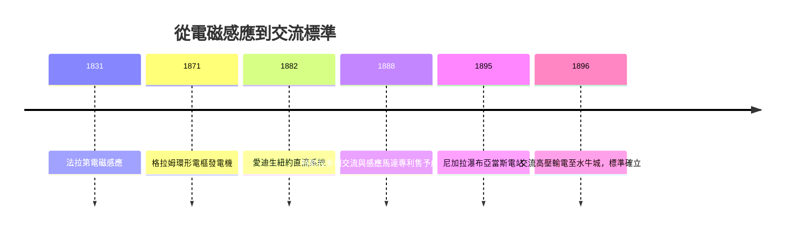

# 法拉第與特斯拉：交流電讓工廠擺脫主軸

十九世紀中葉之前，工廠的心臟是蒸汽機。一部巨大的往復式的機器深藏在廠房地下或角落，它的動力靠一根根架在半空的主軸（line shaft）與皮帶，傳送到全廠每一台車床、紡機與鑽床。這就是「群傳動」時代：動力分配的成敗完全取決於皮帶的鬆緊、軸承的摩擦與廠房的結構限制。整座工廠像一具被抽打著的木偶，機器必須圍繞主軸排列，而不是圍繞製程排列。煙塵瀰漫、皮帶嘶吼、油垢堆積，是那個時代工廠的共同記憶。

## 從法拉第的圓盤到格拉姆的電樞

1831 年，麥可．法拉第（Michael Faraday）在倫敦皇家研究所做出電磁感應實驗：一個磁鐵在線圈中移動，導線中便出現電流。他造出了最早的「法拉第圓盤」——一具粗糙但意義重大的發電機。法拉第是鐵匠之子，自學成才，一生視「自然規律的可理解性」為最大的虔誠；他不屑名利，拒絕爵士封號，這種實驗家的高潔品格，成為後世科學家的道德標竿。

但從實驗到工業，還隔著半個世紀的工程學。關鍵的一步是比利時裔的季諾比．格拉姆（Zénobe Gramme）：1871 年前後，他以環形電樞（Gramme ring）造出幾乎平穩輸出的發電機，讓「發電」第一次在經濟上站得住腳。格拉姆是個謙和的砌磚匠出身的技師，在巴黎的展覽上默默堅持自己的設計，最終他的發電機點亮了街道、驅動了電鍍廠。直流電初步商業化的舞台，卻被湯瑪斯．愛迪生搶了先：1882 年，他在紐約珍珠街建立直流供電系統，電燈從此進入市場。

## 愛迪生與特esla的「電流戰爭」

愛迪生系統的致命傷在於電壓：直流低壓輸電，距離一遠，銅線損耗就以平方比吞掉功率。喬治．威斯汀豪斯（George Westinghouse）看清了這一點。這位以火車氣軔起家的匹茲堡企業家，不是發明家型人物，而是深思熟慮的系統整合者——他買下了高盧（Gaulard）與吉布斯變壓器的美國專利，並在 1888 年看中了一位年輕塞爾維亞移民。

尼古拉．特斯拉（Nikola Tesla）此刻正窮困潦倒，靠挖溝渠度日。他剛在腦海中完整演算出一套多相交流系統——尤其是一具革命性的感應馬達：定子通入多相電流產生旋轉磁場，轉子根本不需要接線，電流由電磁感應在轉子導條中「感應」而出。沒有線圈接觸點、沒有碳刷與電火花，簡單、堅固、幾乎免維護。1888 年 5 月，特斯拉在 AIEE 發表演說，威斯汀豪斯當場買下全部專利。

於是「電流戰爭」展開。愛迪生堅持直流既安全又正統，不惜採取不光彩的手段：推動以交流電執行死刑——1890 年紐約州第一張電椅便以交流電處決囚犯，愛迪生陣營更派員示範以交流電電死流浪動物；1903 年著名的一場公關活動中，在紐約康尼島公開電死大象「托普西」（Topsy），用以恐嚇輿論。愛迪生是精明的發明企業家，卻在這場論戰裡把工程問題變成了宣傳戰；而特斯拉與威斯汀豪斯以事實取勝。

## 尼加拉瀑布：標準的誕生

1895 年，利用尼加拉瀑布水力的亞當斯電站建成，採用特斯拉的兩相交流系統、2400 伏特輸電上溯水牛城的工廠與街燈。1896 年 11 月，水牛城開關合上，瀑布的巨能化為都市燈火。這一戰確立了交流高壓輸電的世界標準，特斯拉成了報紙上的「電流戰爭英雄」，威斯汀豪斯則 anguish 於財務壓力اما最終贏得市場。辯論的道德底線也值得記取：電流戰爭不只是誰的公式正確，更是「科學說服」與「恐嚇行銷」的正面交鋒——最後，良性的工程理性獲勝。

## 工廠的第二次革命

交流電真正衝擊的是**工廠內部**。感應馬達可以做得小而便宜，於是「群傳動」迎來終結：每台機器自帶一具電動機，此即「機組傳動」（unit drive）。其後果遠超技術本身：

- **佈局自由**：機器按流程排列，而非按主軸排列；單層開放式廠房取代笨重的多層木造廠房，因為樓板再也不必承載主軸的巨大轉矩。
- **彈性生產**：不用哪台機器，關掉哪台馬達即可；不再整廠皮帶空轉白耗能。
- **環境**：皮帶與主軸的嘶吼消失，照明由電燈接手，工廠第一次明亮、整潔、安靜——這直接改善了機械加工的品質與工人的勞動條件。

電動機更進一步催生了「機床」概念的更新：動力來源與機器融為一體，為日後液壓傳動、數控技術提供了乾淨、可控、可精密調速的基礎。特斯拉 1943 年孤獨地死於紐約一家旅館，一生的專利成為現代電力系統的骨架。每一次我們按下電動機的開關，都是這段「從瀑布到馬達」歷史的迴響——動力不再集中於一軸，而解放到每一台機器的手中。
