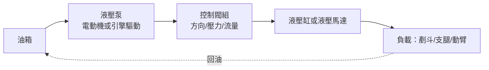
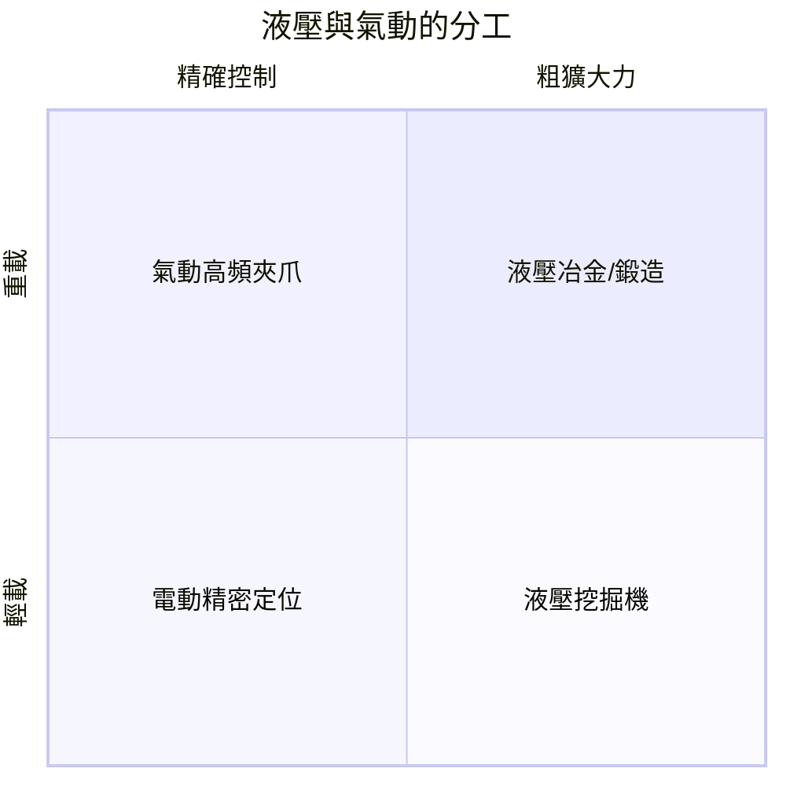

# 液壓與氣動傳動：重型機械的大推力

電動機解決了「旋轉」的問題，但工程上還有一類需求是馬達不擅長的：**極大推力、極短行程、需要無級變速與過載自保**的直線運動。挖土機剷斗的剛猛、飛機起落架的收放、起重機的懸吊調平——這些場合的主角，是液壓與氣動。它們的理論根據，可以追溯到十七世紀的一位數學家。

## 帕斯卡原理：壓力的槓桿

1653 年前後，布萊茲．帕斯卡（Blaise Pascal）在研究流體時提出：密閉流體任一點的壓強向各方向同等傳遞。寫成公式即

$$P = \frac{F}{A} \quad \Rightarrow \quad F_1 \cdot A_2 = F_2 \cdot A_1$$

在小活塞上施加小力 $F_1$、小面積 $A_1$，大活塞上便得到大得多的力 $F_2$——面積之比就是力的放大比。這是「液體槓桿」。帕斯卡是數學神童與宗教思想家，晚年身患重病仍在《論液體的平衡》中留下此原理；他不曾親見它的工業化，但每一部千斤頂都是他的定理的化身。

第一個商業化應用來自英國工程師約瑟夫．布拉馬（Joseph Bramah）：1795 年他取得**液壓機**專利，以手泵將水壓入大缸，產生數百噸壓力，用以壓打包、擠壓金屬與鍛造。布拉馬同時也是生活裡的小發明家——沖水馬桶的改良者；他的工坊日後培養出研製車床的名匠亨利．莫茲利，一行業的匠脈就此相連。

## 倫敦液壓動力網：把壓力「賣」給全城

十九世紀的倫敦，出現了一個今天聽來仍然前衛的制度設計：**液壓動力管網**。城市中心設立泵站，把高壓水（約 60～100 bar）打入埋設在地下的總管；工廠、碼頭、電梯、劇院幕布、保險庫大門，只要付費接上一支支管，便可隨時取用「液壓動力」——就像後來的電網。1877 年起，倫敦中央液壓動力公司以哈頓花園（Hatton Garden）一帶的泵站與dow總管為核心擴建，用戶以「訂閱」方式買水力，毫不自己備泵。泰晤士河畔的碼頭以液壓起重機吊起貨物，橋樑用液壓開啟（如倫敦塔橋），這是一個「動力即服務」的先聲：技術的普及，依賴的往往不是人人自製機器，而是**基礎設施與計費制度**。它隨電力普及而衰退，最後一個泵站直到 1977 年才關閉。

## 現代液壓系統的三件套

今日一套液壓系統的骨架是：

1. **泵**：由電動機或柴油引擎驅動，產生高壓油流；
2. **控制閥**：換向閥決定油流向哪一腔，溢流閥設定最高壓力（天然過載保護——壓力一高，油從溢流閥洩回油箱，系統不會像齒輪那樣崩齒）；
3. **執行器**：液壓缸輸出直線大力，液壓馬達輸出旋轉。

初期的泵與閥效率低、油路亂，真正的成熟要等到二次大戰前後的航空流體動力學發展。現代飛機的操縱面、起落架、襟翼，全靠數千 psi 的液壓作動器，戰鬥機還要求雙迴路與冗餘——液壓因此成為航空可靠性工程的課堂。

## 福格森：把液壓裝上農民的拖拉機

愛爾蘭工程師哈里．福格森（Harry Ferguson）在 1933 年前後造出配備**三點懸掛**的拖拉機（Black Ferguson 系列原型），並以液壓缸舉升農具：犁在土裡被抬起、拉力自動調節深度，機具與拖拉機由三點連結成一體受力。1938 年他與福特公司合作，1939 年福特 9N 拖拉機將三點懸掛與液壓舉升推向千萬農場。福格森精於談判也更精於制度——他與福特的「握手協定」日後引發跨大西洋訴訟，最終他獲得鉅額和解金，建立自己的 Ferguson 公司，1953 年與馬希（Massey-Harris）合併。這段歷史提醒我們：一桿液壓缸的背後，是專利、契約與跨國資本的長劇。

## 氣動：乾淨、快速、便宜

空氣也可壓縮傳力，即**氣動**（pneumatics）：以壓縮空氣推動氣缸。它推力不如油壓大、行程精度較低，但**乾淨、快、便宜、不漏油污染**，因此成為輕型自動化與食品、製藥、電子裝配線的寵兒。德國費斯托（Festo）自 1925 年創立以來，把氣動閥、氣缸與真空吸附做成模組化產品族，配合可程式控制器，使「抓—夾—送」的循環以毫秒級完成；氣動因此成為生產線上最沉默的多數。

## 制度與教育的餘波

液壓工程師必須掌握的，不只是 $P = F/A$，還有油的黏度—溫度特性、流道阻力、氣穴與波動——這催生了工程科系的「流體動力學」課程與專業認證制度。從帕斯卡的墨水瓶，到布拉馬的鍛壓機、倫敦的地下水管、福格森的拖拉機、費斯托的氣閥，這一條線說明一個樸素道理：**偉大的原理，要等基礎設施與標準件把它變得「人人可買、隨手可用」，才算真正進入歷史**。
