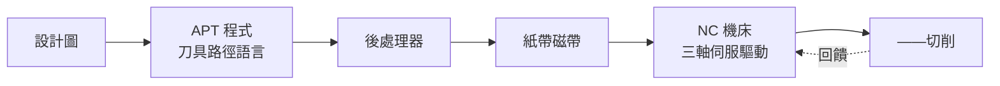
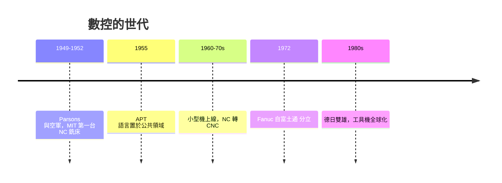

# 一九五〇年代的 MIT 與數控機床

## 一位密西根承包商的執念

約翰．T．帕森斯（John T. Parsons）不是學院派。他是密西根州特拉弗斯城一家小承包公司的經營者，接的是空軍直升機螺旋槳葉片的活。槳葉是一種複雜的三維曲面，靠投影放大圖、手工「描點—放樣—銼削」的傳統方式，既慢又容易誤差累積。Parsons 有一股願意被人當傻瓜的執念：既然他的公司有一台哥倫比亞計算機（以打孔卡為主的服務型計算機），他就把槳葉輪廓各點的座標一個個算出來，然後指令機工以千分錶沿著位置逐點銼削——「數字化的樣板」，這是最原始的 NC（Numerical Control，數值控制）思想。1949 年美國空軍委託 Parsons 試驗這種方法，Parsons 誠實承認自己規模太小，於是空軍改建議：把項目交給麻省理工。

## MIT 的伺服機構實驗室

主導工作的是 MIT 的**伺服機構實驗室**（Servomechanisms Laboratory），主持人是哥倫比亞背景的電機工程師戈登．布朗（Gordon S. Brown）年輕的門徒群中，包括後來寫《機器的終結》的哲學家艾倫．懷特利等許多工程師。1952 年春，MIT 製造出第一台 NC 銑床：以一架辛辛那提液壓銑床改裝，用**紙帶**輸入一連串脈衝，驅動三軸的液壓—電子伺服機構，在鋁件上銑出複雜曲面。這台機器的意義超過機器本身：**「切什麼」第一次由抽象數字決定，而不是由工人手的經驗決定**。工業時代的知識權力，悄悄從車間轉移到編程室。

## chance 與 APT：把數學變成車間語言

Parsons 的方法其實只在二維輪廓。要銑出真正的三維曲面，必須有人在機床旁替它寫出軌跡。MIT 於是有計畫地發展 **APT**（Automatically Programmed Tool，自動程式化刀具）語言：工程師以近似英文的語句描述「刀具沿某面往某某點走、保持接觸」，計算機則算出刀具中心路徑並生成控制紙帶。APT 1955 年首次運作，由 MIT、航空工業聯合會、波音、IBM 與美國國家標準局（今 NIST 前身）共同推進，其後成為二十年的事實標準——今天 CAM 軟體的後處理思想仍是 APT 的血脈。這也是**大型軍事投資成就民用工業標準**的經典案例：沒有空軍的錢與需求（核彈頭工裝、飛機零件），粒子必然停在好奇心階段。

## 接著來的是工業：日本 Fanuc 與德國 DMG

1960 至 70 年代，小型計算機（minicomputer）登場，控制器從「硬體邏輯＋紙帶」升級為「電腦讀程式」，即 **CNC**（Computer Numerical Control）。這一跳的灣區是日本：1972 年，富士通的機床控制部門分立為 **Fanuc**（法那科），創辦人稻葉清右衛門以軍事化紀律與垂直整合，把伺服馬達、控制器、機床做成一條價值鏈，三十年內成為世界 CNC 佔有率之王，甚至在 1980 年代接管了美國若干機床公司。稻葉以嚴苛著稱，也堅信「機床是工業之母」。同時期，日本 **Makino**（牧野）與二戰後重建的德國機床業（DECKEL、Maho、Gildemeister，後整合為 DMG 家族）深耕精密工具機，形成德系「米制精度—工藝傳承」與日系「系統化供應」的雙雄格局；日本山崎馬扎克（Yamazaki Mazak）在 1980 年代更推出最早的人機協作加工中心。工具機從此有了「加工的語言」，也有了跨國的產業版圖。

## 「工程師文化」的一段下場

NC 並非一夜成功。1950 年代末，美國機床業懷疑軍方「用 MIT 的電子套件毀掉手工藝傳統」；《商業週刊》等媒體質疑這是「沒有車手的車」。然而一段令人動容的插曲是：Dayton 的帕森斯為證明自己，親自跑遍西海岸向波音與空軍展示他靠計算切鋁葉片的良率，被 G&E 評為「國防生產關鍵人物」，獲獎時他這位曾綴學的密西根工人都快哭了——「我只是不甘心讓好點子死在行業偏見之下」。這是一段真實的 humbling：一個不服輸的承包商，一群不會問「到底誰要做這個」的學院工程師，一段共買的美國國防經濟，最終對事實都保持謙卑。技術史給我們的教訓常是：**新技術最初都得向傳統手工藝致敬，然後不受它擺布。**

One day，當我們按下 CNC 的「啟動」鍵，其實是按下 1952 年那台銑床的迴響：數字、語言、伺服、軍方資金與一位密西根人的執念，共同把「切削」從手藝變成了學科。
