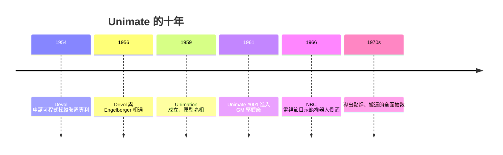

# 德沃爾與恩格爾伯格：Unimate 走進通用汽車

## 一個「想點子」的人

喬治．德沃爾（George Devol, 1912–2011）是個典型的美國發明家：他開過唱片複製公司、做過防空雷達的火控技術，二戰後乾脆自稱「職業發明家」，經常一邊吃飯一邊在餐巾紙上畫機構圖。1954 年，他申請了一個 patents：一具**可程式化的操縱裝置**——「Universal Automation」，即 Unimate 的由來。它有三個關鍵概念：以**磁鼓儲存步驟**（programmable memory）、以**伺服機構控制**各關節、**位置可由示教重現**（teach-and-repeat）。德沃爾動手能力有限，也做過磁記錄（他早年持有近似磁性記錄的專利，與日後的錄音工業頗有淵源），但他真正的天賦是**把點子網路化**：找錢的人、找應用的人，他認識一長串名單。1956 年他遇上了約瑟夫．恩格爾伯格。

## 一個「賣未來」的經理

約瑟夫．恩格爾伯格（Joseph Engelberger, 1925–2015）是哥倫比亞大學物理出身的工程經理，當時在曼寧—麥克斯韋（Manning, Maxwell & Moore）管航空部門。讀到德沃爾的專利時，他正在公司走廊聽同事閒聊阿西莫夫的小說，當下閃出一個事業的形狀：**「機器人 + 工廠」的創業**。兩人的配合近乎完美：德沃爾是坐得住的發明腦，恩格爾伯格是站得住的推銷腦——他不放過任何一場商會演講，逢人便講「自動化不是威脅，是客場援軍」。1958 年前後，曼寧—麥克斯韋被併購，恩格爾伯格借機帶著專利與德沃爾自立門戶，1959 年正式成立 **Unimation**（與康乃迪克州的州界企業集團一起）。Unimate 原型機在 1959 年公開亮相——一台液壓驅動、二千多磅的龐然大物，卻能以千分之一英吋的精度重複一連串動作。

## 1961：機器人第一次上班

1961 年秋天，**Unimate #001** 被送到紐澤西州 Ewing Township 的通用汽車壓鑄廠。它的任務是從炙熱的壓鑄機模裡把滾燙的鋼件「拉」出來、冷卻、堆疊——這正是壓鑄工人最苦、最燙、最易事故的崗位。工廠經理時代初見這具鐵臂的評價是：「它沒脾氣，不罷工，也不怕燙。」Unimate 一共在壓鑄車間工作了數十年；後續 Fender（警報）引來福特的坦特激光（GM後續工廠四十餘家此配置）。這一年，恩格爾伯格的名言已寫進企業文化：「**機器人的職責不是取代人，而是接管人類不想做的事**。」

## 從科幻到商業：R.U.R. 與三定律

「Robot」一詞，來自捷克作家卡雷爾．恰佩克（Karel Čapek）1920 年的戲劇 **R.U.R.**（羅素大學的通用機器人）；它源自斯拉夫語 **robota**——「強制勞役」。恩格爾伯格精於借用這個文學詞彙的商業感染力，甚至把公司資料袋印上同行嗤之以鼻的科幻氣息。艾薩克．阿西莫夫 1942 年短篇〈Runaround〉（轉環）提出**機器人三定律**，於是「機器人該如何與人相處」的思想框架先於工程而存在。有趣的是：德沃爾與恩格爾伯格都不是科幻浪漫主義者，他們自認「常識派工程師」——**機器人不需要有眼睛、有大腦，只需要在固定的工位上無限重複一次有用的動作**。這種「去科幻化」的策略，正是工業機器人得以上線的關鍵。

## 勞工的反應與制度的回應

機器人一上班，工會就上桌。勞聯—產聯（AFL-CIO）自動化委員會在 1960 年代屢次警告「自動化造成失業」，汽車工人工會（UAW）主席華爾特．魯瑟（Walter Reuther）雖是技術支持者，也在 1964 年向總統約翰遜提出著名的警告電報：「**自動化是一場技術革命，必須有相應的制度配套**。」國會於 1962 年設立「自動化與人力」的調查委員會；一時間，「人—機」的問題轉化為**教育—社保—轉職**的制度問題。事實上早期機器人接手的多是壓鑄、噴焊等極其危險或毒性的崗位，短期內並非「取代人力」而是「替人去擋」。但這場辯論，把美國汽車工業此後數十年產業關係的基本議題一次擺上了台面。

## 為什麼是美國？為什麼是壓鑄？

回頭看，Unimate 誕生於美國的工業與文化土壤絕非偶然：通用汽車有最肥的加工訂單與最強的 **方法工程**（methods engineering）傳統，也有泰勒以來「把工作拆成可測量步驟」的思想傳承——而這正是機器人可直接繼承的語言。冷戰時期的國防經濟提供了資本耐心；西部科幻文化提供了詞彙與想像；勞工運動提供了必須回答的問題。1961 年秋天，紐澤西清晨的壓鑄車間裡，一具鐵臂第一次伸出，夾住一塊跟我們同頻率發燙的金屬——人類工業的敘事，自此分出了兩個時代。
