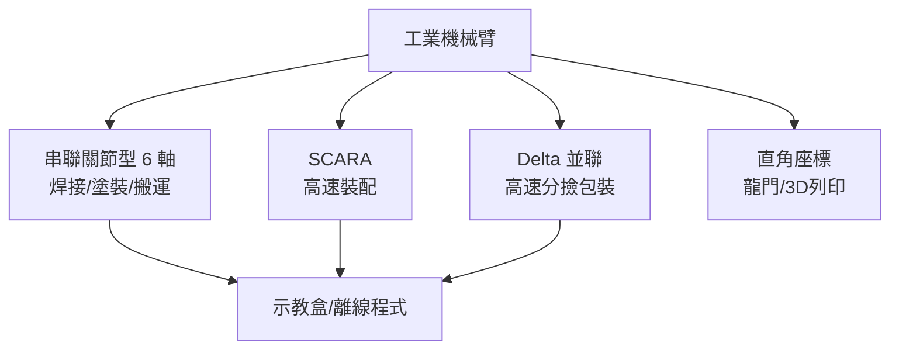
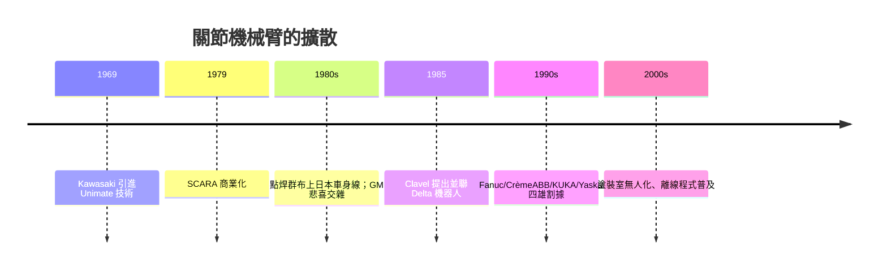

# 多關節機械手臂：焊接、塗裝與搬運

## 形態學：機器人像什麼？

Unimate 之後，工業機械臂逐漸分化出幾種「體型」。理解它們最好的入手點，是**自由度（DOF）與形態**：

- **直角座標型**：三軸正交，如三軸龍門，剛簡單但占地大；
- **圓柱座標型**：如 Versatran，適合上下料；
- **關節型（articulated）**：像人臂，4 至 **6 軸**可自由到達工件各方位，是今日主流；
- **SCARA 型**（Selective Compliance Assembly Robot Arm，選擇性柔性裝配機械手）：水平臂非常剛，垂直方向柔軟——為插零件而生；
- **Delta 並聯機器人**：以三條輕併聯臂驅動一個平台，動作快如蜻蜓。

## SCARA：誕生於日本裝配線的聰明妥協

1979 年前後，日本山梨大學牧野洋教授與神鋼—神戶把這一構想推入商業化：**SCARA** 刻意放棄了「六軸萬能」的浪漫——它只用水平兩軸加垂直舉升與旋轉腕，剛性極佳、循環時間極短，在「把一枚電阻插進印刷電路板」這件事上完勝重型關節臂。SCARA 是**「刻意變笨以換得快」**的絕佳範例，也反映出日本電子產業以輕型高頻裝配為中心的需求。1980 年代，牧野（Makino）、安川電機 Yaskawa 的 Motoman 系列、法那科 Fanuc 的 R 系列，把日本推上「機器人王國」的寶座。

## Delta：一個父親的靈感

1985 年前後，瑞士洛桑聯邦理工學院（EPFL）的工程教授雷蒙．克萊沃（Reymond Clavel）在指導學生與巧克力製造業合作時思考：如何以最輕的機器搬動最輕的東西？他的答案是把馬達全部「固定」在頂架上，只用輕量化 分子臂驅動動平台——**Delta 機器人**，以並聯運動學實現每秒數百次的抓放。Clavel 是個語速溫和的教授，他常說「動的應該是工件路徑，不是手臂的質量」，並主張機構應該被教得誠實——「如果你的數學說這機構沒有奇點，你就要睡得著覺」。Delta 今天是食品與藥廠包裝線的當紅明星。

## 焊接與塗裝：日本與美國的兩條路

1970 年代的能源危機與日元升值，逼使日本車廠從「多人工生產線」轉向「少人多機器」：豐田與川崎重工（Kawasaki，1969 年取得 Unimate 技術許可）率先把**點焊機器人**（spot welding）成群布上車身線，一台機器人在兩側門框的焊接節拍被壓到秒級；豐田生產方式（TPS）以看板與自働化（Jidoka）把機器人嵌入了**「一遇異常即停線」**的文化，因此機器人不是替代品，而是**生產哲學的新職員**。美國通用汽車則在 1980 年代以大手筆投資機器人（著名的關節臂車身線），卻一度因維護與故障率問題踩到坑——「農耕機器人」式的宏大願景（把種牛馬耕作改成機器耕作等用法一度被炒作），最終被「**機器要可靠、備件要常備、工程師要現場駐守**」的教訓取代。這段對比說明：**自動化的成敗不在機器，在工廠制度。**

## 四雄與塗裝室

1980 到 1990 年代，產業形成所謂四、五大機器人集團：日本 **Fanuc**、**Yaskawa**、**川崎**、**安川**；瑞士—瑞典 **ABB**（1988 併 ASEA/ABB 的機器人部）、德國 **KUKA**（1973 年推出的 FAMULUS 是世界首台六軸關節臂之一）、日本安川——把「機器人 + 控制器 + 客製化終端」打包成系統解決方案。塗裝（paint）是出了名的嚴峻考場：噴漆室必須防爆（ATEX 區域），手臂要在「即溶漆霧」環境裡連續甩腕，一台機器人常配備軌道行走在兩車夾縫之間。塗裝機器人的成熟，把汽車工廠裡甲苯最濃、最傷身的崗位整建得幾乎無人化——**這是機器人最無爭議的一項貢獻**。

## 從_POINT_到_swarm_：搬運、Palletizing 與群體

抓放與**堆疊（palletizing）**是機器世界第一的大量練習：把三百件箱子碼成一層托板、再上叉車——規律、重量、節拍分明。直角座標龍門、關節臂與 Delta 在這裡形成階梯分工。更前衛的是**群體機器人**（swarm robotics）：近年亞馬遜倉中的數千輛 AGV 依演算法自行分流，已是「史前社會式」的群體智能在工業應用。我們可以想像工廠像一個動態生態系：大臂做重活、小臂做快活、AGV 送件、視覺系統派工。

## 人與機器的再分工

多關節機械臂最深刻的影響，或許在**崗位的結構性變化**：焊接工、噴漆工退居為機器人的**示教員、程式員、維護工**——這是技能的升級而非簡單的失業，但升級不是自動的：日本以「企業內訓練所」承接，美國則在工會協議下以轉職基金過渡，德國以雙軌制（Duales System）把機器人納入技職教育。機器的每一代升級，最後都比的是**一個社會怎麼組織學校與工廠**。這是機器臂故事的總結，也是下一章自動化大腦的序言。
