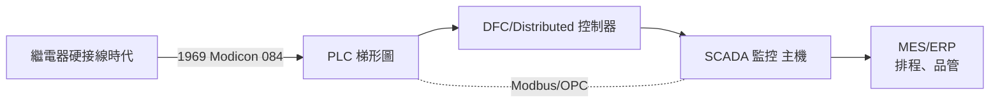
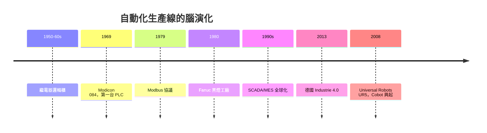

# 無人工廠與 PLC：自動化生產線的大腦

## 一句話的問題：繼電器櫃太笨重

1969 年之前，汽車廠與加工廠的邏輯控制，是掛在牆上的一整面**繼電器櫃**：成百上千只繼電器，用硬接線織成「若 A 則 B、若 C 停 D」的控制邏輯。想改一個流程？只好回到機櫃前拆線、重新接線、層層檢查——動輒停產數日，工程師在後面像閉關的僧人。貝德福德分公司（Bedford, Mass.）的 Modicon 團隊於 1969 年提出了一個直白的問題：**「如果控制邏輯是一段『程式』，而不是一捆『電線』呢？」**

## 迪克．莫里：工程上的「簡單」執念

迪克．莫里（Dick Morley）是個蹦蹦跳跳的物理學家，愛穿牛仔褲在車庫裡做事，一生有數十項專利。Modicon 一詞即 **MOdular DIgital CONtroller**（模組化數位控制器的合成）。1968 年莫里寫下一份幾乎左右的規格——「那是態度，不是晶片」，他後來回憶。Modicon 084 是第一台**可程式邏輯控制器**（PLC），交給汽車工業之後，它帶來的不只是替換：

- 邏輯存在**記憶體**裡，用程式讀寫，生產換線不再需要拆櫃；
- 介面設計供**電工直觀**：以**梯形圖**（ladder logic）編程——把繼電器常開常開觸點的畫法搬進電腦，原來的電工幾乎不需重學；
- 具備**容錯**；Modbus 協議使 PLC 與其他設備說同一種話，標準化通訊誕生。

## 從 PLC 到 SCADA：自動化的大腦分層

PLC 負責「當場反應」：感測器—閘—閥—馬達的毫秒級迴路。更上一層是**分散式控制系統**（DCS）連續製程中的控制站，而離人最遠決策者的是 **SCADA**——電腦生出現場圖示（HMI）供人監看、記錄、下修訂命令。這種分層結構是自動化 **資料流控制** 的建模：控制權一層層下放，**升序由鐵到訊息**。1980 年代的提煉，標準協議（Modbus、OPC）、HMI 產品的普遍化，使整座工廠變成一部「可編程的大機器」。1990 年代 MES——製造執行系統——的目的，是讓工廠訂單、品管與 ERP、SCADA 形成閉環。

## 日本黑燈工廠：法那科的震懾

1980 年代，法那科（Fanuc）的稻葉清右衛門在山梨縣富士山麓建起了聞名世界的**黑燈工廠**（dark factory）：夜班全無人工；工廠到底是如何同人、同機件、以相機視覺相扣？機器人把自己的伺服馬達組裝起來，零件幾乎不停滯在搬運傳送帶。在接受媒體採訪時，稻葉是出了名的寡言與砍價的談判者，但他堅持一件事：**自動化不是取代人，而是把人積極地上升到更好的崗位**。黑燈工廠迫使社會開始思考「無人工廠的問題」：基建是否願意擔？倘若它繁榮，勞動、教育、城鄉結構該怎麼配合？

1980 年代，日本自動化生產力比美國全面追平；德國則沿「工藝自動化」的方向，1980 年代中期就開始討論「CIM」（Computer Integrated Manufacturing），但日本的速度與紀律成為工業世界的新標竿。

## 工业 4.0：德國在 2013 年造詞

2013 年漢諾威工業博覽會前後，德國工程師學會（VDI）與企業聯盟提出 **Industrie 4.0**：把每一台機器都變成有 IP 位址的「節點」，以物聯網、邊緣運算、數據孿生（digital twin）把工廠連成一張網；橫向以供應鏈、縱向以工廠樓層雙向打通。這個造詞持久有效的原因是**制度層面**：德國工业具有中小企業（Mittelstand）結構與工會合作（Mitbestimmung）傳統，需要的不只是產品升級，而是一個由國家、行業協會、雙軌教育共同出資的升級途徑。「工業 4.0」因此不只是技術口號，更是一種**政黨、教育、資本共用的一份路線圖**；中國的「中國製造 2025」、美國的 Industrial Internet 等，都被強迫放進比較的籠子裡。

## 勞動、凝聚力與 Cobot

無人工廠與 PLC 的世代討論，回歸到兩個問題：

1. **勞動**：自動化造成的是「工位消失」而非「工作消失」。但沒有一社會是自動升學的：需要**訓練型政策**與**工會協商型**的過渡安排；這在德日的制度裡相對順利，在美國 1980 年代的去產業化裡曾最深。
2. **人機協作**（Human–Robot Collaboration）：金屬圍欄的傳統工業機器人不許靠近人，而 2008 年起起義的**協作機器人**（cobots）如丹麥 Universal Robots（2005 成立、2008 年推出 UR5）以低價、輕巧、無需護欄為賣點，機器人和人共享一張工作桌。此乃自動化的社會契約調整，**自動化的分工變成「人提供判斷與彈性，機器提供重複與耐力」**。

## 結語：智慧在於整體

從法拉第的磁線圈到 PLC 的梯形圖，人與機器的歷史一次又一次證明一件事：**技術從不自己決勝負**——技術是好問題與好制度結合的副產品。無人工廠最令人震動的，不是黑夜中依然亮著的機器，而是它暗示的社會問題都在等待回答：誰擁有這些「可編程的工人」？如何培訓一群與機器共事的工人？自動化的真正課題，是讓機器來治理機器，讓人來治理人——每一個工業時代的社會契約，都是一個自動化契約。
