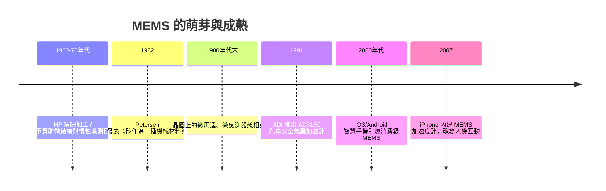

# 節標題：MEMS——矽晶圓上的微型齒輪與加速計

## 從巨大機器到微小機器

二十世紀下半葉，工程師們已經習慣了一個真理：機器的力量來自龐大。渦輪機有樓房高，工廠佔地如城。但就在積體電路把「計算」縮進指甲蓋大小的晶片時，另一群人開始追問一個更激進的問題：既然電晶體可以微縮，為什麼齒輪、槓桿、感測器不行？

早在 1960 年代，HP（惠普）就為印表機與顯示器開發過精細加工技術；冷戰期間，美國空軍資助了一批以矽為材料的微結構研究，因為飛彈導引需要更小、更輕、更穩定的慣性感測元件。矽當時只是用來做晶體管，但有學者注意到：矽的機械性質其實好得驚人——比鋼更硬、幾乎不疲勞、而且可以用半導體的蝕刻技術批量加工。「既然能刻出百萬個電晶體，為什麼不能刻出一個懸樑？」

## Petersen 的宣言：矽是一種機械材料

1982 年，IBM 研究院的庫爾特・彼特森（Kurt Petersen）發表了那篇日後被稱為 MEMS「聖經」的論文《矽作為一種機械材料》（Silicon as a Mechanical Material），系統整理了矽的楊氏模數、屈服強度、各向異性蝕刻特性，並展示了一系列用矽做出來的薄膜、樑、噴嘴與閥門。

這篇論文真正改變的，是工程界的「心智分類」。此前矽歸屬於「電子材料」的抽屜；Petersen 把它搬進「機械材料」的抽屜，並證明半導體製程可以成為一種新的機床。此後，壓力感測器、微流道、矽加速度計的研究迅速繁榮，各大公司與國家實驗室開始用化學蝕刻在晶圓上「雕」出微觀結構。1980 年代末，全美多個團隊相繼展示出在晶片上旋轉的微馬達——直徑只有髮絲的幾分之一。這些微馬達本身並沒有立刻找到殺手級應用，卻是一場公開的技術宣言：機械世界可以被微縮。後來德州儀器以微鏡陣列做成 DLP 投影晶片、IBM 與惠普發展噴墨微流道，證明了這條路的商業潛力。

## 安全氣囊：MEMS 的第一場經濟革命

MEMS 從實驗室走向大規模產業，關鍵絕非炫技的微馬達，而是一個立法驅動的市場。美國在 1970 年代起強化汽車安全法規，氣囊系統需要一個可靠又廉價的「撞擊判定器」：傳統的機電式加速度開關體積大、需逐一校準、還怕長期震動產生金屬疲勞與接點黏滯（工程上要以阻尼墊圈的「隔振」設計去壓住誤觸發風險）。

亞德諾半導體（Analog Devices, ADI）看到機會。1991 年，ADI 推出 ADXL50——史上第一批量產的表面微加工 CMOS 加速度計，把感測質量塊、懸樑、電容檢測電路全部做在同一顆晶片上，誤差極小、免校準、體積只有硬幣珠寶級。博世（Bosch）隨後以自己的表面微加工製程切割市場，摩托羅拉、日系廠商也相繼加入。安全氣囊成為半導體史上第一次「一顆晶片決定人身安全」的場景，MEMS 從此被汽車業以千萬顆的規模消化，學會了車規級的可靠度文化：百萬分之幾的不良率、極端溫度耐受、十年以上壽命。

更重要的是規模經濟的飛輪：晶圓級測試與自動化量產讓單顆價格一路滑落，從數十美元跌破一美元。這一跌，打開了一個誰也沒預料到的市場——消費性電子。

## 從氣囊到指尖：iPhone 的觸媒

2007 年，蘋果第一代 iPhone 內建 MEMS 加速度計。早年手機用它判斷螢幕旋轉，隨後整個生態爆發：赛車遊戲靠它轉向、計步器靠它計步、智慧手錶靠它記錄你每天走了幾步。消費級 MEMS 讓加速度計、陀螺儀、磁力計組成的慣性量測單元（IMU）成為每一支手機的標配，而這些晶片又回頭餵養了兩個產業：無人機的飛控（下一節的主角）與穿戴裝置。

MEMS 的故事有一個反直覺的教訓：讓它成功的第一推力不是技術本身，而是制度——安全法規塑造了第一批顧客，讓研發有飯吃；而量產成本曲線塑造了第二批顧客。當政府訂下「汽車必須更安全」的規則時，沒有人想到二十年後每個孩子的口袋裡都躺著一顆微縮到極致的瑞士鐘錶——不用金屬，用矽；不用齒輪，用靜電;不用鐘錶匠,用光刻。

微型化的哲學於是成形：當尺度和能量降到微小時，靜電取代電磁、分子間力取代重力、可靠度取代馬力。機器的故事，自此同時向兩個方向生長——一是向天空延伸的無人機，二是向人形逼近的機器人。而它們的神經末梢，都埋在這片矽晶圓裡。
