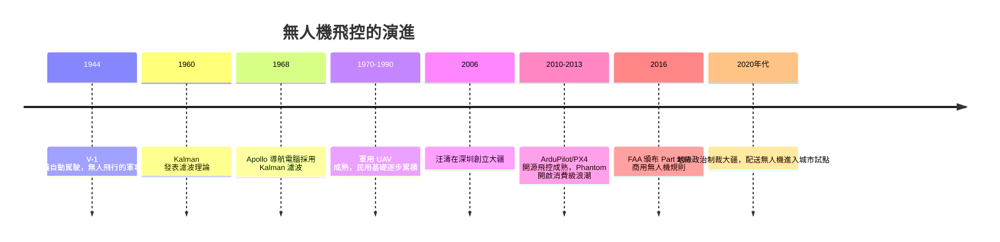

# 節標題：飛控演算法與多旋翼無人機

## 從自殺武器到卡爾曼濾波

無人飛行的故事始於戰爭。二戰末期德國的 V-1 巡航飛彈，用簡單的陀螺儀與氣壓計維持航向，是「自動駕駛儀」最原始也最絕望的形態；同時期美軍把滿載炸藥的舊轟炸機改裝成遙控衝撞的無人機，飛行員在最後一刻跳傘——工程師很快意識到，控制飛機最難的不是引擎，而是那套「知道自己在哪、姿態如何、該往哪飛」的系統。

真正的轉捩點在 1960 年。匈牙利裔數學家魯道夫・卡爾曼（Rudolf Kalman）發表的濾波理論，用遞迴的統計方法把「帶噪音的量測」與「不完美的動力學模型」融合成對狀態的最佳估計。這套演算法隨即被 NASA 嵌入阿波羅任務的導航電腦：飛船在沒有 GPS 的太空裡，靠陀螺儀、加速度計與星體量測反覆修正自己的位置。卡爾曼濾波從此成為所有飛控系統的心臟——無人機「知道自己在哪裡，且知道自己的估計有多不可靠」，這正是自動駕駛的第一原理。

## 四旋翼：失控的時鐘

四旋翼機在 1920 年代就有原型，卻等到晶片夠快才真正起飛，因為它是一台「天生不穩定」的機器。與固定翼靠機翼自穩不同，四旋翼必須由飛控以每秒數百次的頻率不斷推算每顆馬達的推力差來維持平衡。其動力學可以簡約寫成：

$$\ddot{x} = \frac{F}{m}\sin\theta, \qquad \ddot{z} = \frac{F}{m}\cos\theta - g$$

機身傾角 $\theta$ 決定水平加速度：想往東飛，就先向西傾一點再擺回來。飛控要做三件事：用 IMU 與卡爾曼濾波估出姿態、用增益調度（gain scheduling）與串聯 PID 迴路把姿態與位置串接控制、用觀測器補償馬達響應延遲。這是「透過數學在半空鐘錶般的失控體上繫一條看不見的手」。

## 大疆：深圳生態的孩子

2006 年，香港科技大學的研究生汪濤在大疆（DJI，深圳）公司創立時，只想做出能穩定懸停的多旋翼。他押注三件事：用 MEMS 感測器搭配自研飛控演算法，取代笨重且難以穩定懸停的傳統直升機航模方案；鎖定消費市場而非軍用訂單；把公司設在深圳。

深圳給了別人給不了的東西——華強北一小時內配齊馬達、槳葉、飛控板的元器件生態，加上鋰聚合物動力電池與雲台的供應鏈。大疆先靠飛控板與雲台站穩腳步，2013 年 Phantom 一體化機器的問世把航模變成消費品：開箱即飛、三軸穩定的雲台相機、把工程打磨成商品。此後大疆一度占全球消費級無人機市場逾七成，「無人機的中國故事」成為矽谷之外的教科書案例。這也塑造了政治緊張：2020 年起美國以《國防授權法》等把大疆列入制裁清單，聯邦機構禁用其產品；本土替代者如 Skydio 縱有政策護航仍難撼動大疆的成本優勢——地緣政治第一次把「玩具」變成「國安議題」。

## 開源飛控：業餘者的接力

就在大疆攻城略地時，另一支力量在世界各地的車庫與論壇裡活動。ArduPilot 起於 DIY 無人機社群，後來發展成支援固定翼、多旋翼、車、船的完整開源飛控；OpenPilot 與後來的 PX4 延續同樣精神。這些程式的合作方式像科學社群：貼出黑匣子日誌、反覆除錯調參、執行安全相關的飛行測試框架。開源飛控向下滲透到農業植保（在中国，一架八旋翼植保機一天可作業數百畝、效率百倍於人力噴藥）、電力巡線、測繪。AWS 這種開放的心態還輻射到硬體層——Raspberry Pi 等板子成了飛控的輔載腦，並引來 Google Wing、Amazon Air 等物流企業在 2010 年代投入配送試驗。

## 制度：天空的交通規則

技術進步快過法律。2016 年以前，美國所有商用飛行依法都要逐一申請豁免，程序遲緩。2016 年 8 月 FAA 頒布 Part 107 規則，確立重量 55 磅以下無人機的超視距飛行禁止、夜間飛行限制、需持遙控飛行員執照等框架，市場才真正鬆綁。各國接連立法：歐盟 2019 起以風險分級管理，香港、日本、新加坡陸續註冊登記制；中國則要求實名登記與空域申請。反制技術遠端遙測監聽罐（訊號監測、電子圍欄、地理圍欄）也在眾多國家以「安全」、「隱私」、「空域」之名擴張。

2020 年代，物流配送進入城市試點：Google 的 Wing 在澳洲坎培拉、美國各地的門對門配送已經成為日常生活風景中的一段；沃爾瑪、亞馬遜與戰場醫療的推動下，無人機與醫療物流在非洲與美國偏遠地區漸成常态。深圳的天空中，曾經只能看到大疆 Mavic 與植保機，現在還可以看到地方政府訂的外賣吊麓。

## 迴聲

無人機是一場多重因子的合成革命：MEMS 感測器縮小了感官、智慧手機供應鏈降低了成本、卡爾曼濾波與開源社群供應了靈魂、電池與馬達提供了肌肉、法規放與不放決定了天空的寬窄。回到「機器的故事」主題：機器不會自己走進天空，是人類利用制度設計、市場誘因與數學直覺一起，把無人機推上了 z 軸。而當這套飛控與路徑規劃的算法後來移到地面上跑的人形機器人身上時，故事才真正開始碰觸「重量」與「手」。
