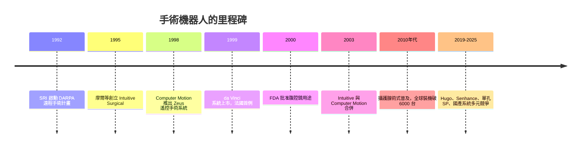

# 節標題：達文奇手術機器人——超越雙手的微創極限

## 遠程手術的軍事起點

1990 年代，美國戰場醫療面臨一個古老難題：士兵在前線受重傷，而外科醫生遠在後方。國防部把希望寄託於「遠程外科」——醫生戴著頭盔與手持操控器，透過高速網路遙距操作千哩之外的機械臂。加州的科學研究國際公司 SRI International 承接了 DARPA 的「遙距手術」（Telepresence Surgery）計畫，1992 年起由一群工程師與創傷外科醫生共同打造原型：兩支機械臂、一副立體顯示器、力回饋試驗。

軍方最終並沒有等到無線頻寬足以支撐戰場遠程手術的那一天，這條技術卻在另一個土壤上開花：微創手術的需求。1990 年代，腹腔鏡（用幾個小孔置入相機與長桿器械動刀）已成主流，但外科醫生苦不堪言——那根長桿支點在體壁上、方向被反轉，握持需要的力量精細到克，鏡頭還會抖動。外科醫生沒有觸覺，是「隔著筷子繡花」。

## 兩家公司的合流

1995 年，SRI 的研發者弗雷德里克・摩爾（Frederic Moll）與同事約翰・弗倫德（John Freund）、羅布・楊（Rob Younge）拿到技術授權，在矽谷創立 Intuitive Surgical Devices（直覺外科）。同一年，另一家以 IBM 托馬斯・沃森研究中心微創機械技術為基底的 Computer Motion 公司，已在推其 AESOP 相機臂與 1998 年 Zeus 遙控手術兩套系統。兩家公司一路專利纏訟到 2003 年才合併，這段時期的競合——各自發展器械、市場與專利布局——可說是把這個產業從概念驗證推向整合。1997 年，Intuitive 在法國完成其系統的第一次臨床膽囊切除（彼時名為 LION 或 Mona）；1999 年正式以「da Vinci」（達文奇）之名上市——以文藝復興巨匠為名，寄望「人文與機械的合一」。2000 年美國 FDA 批准其腹腔鏡手術用途，產品剛好誕生在網路公司泡沫的谷底，卻承載了醫療史上最確定的一個「痛點產品」。

## 7 個自由度，在一公分切口裡的小手腕

達文奇系統的核心創意是機械手腕（EndoWrist）。人手做精細操作時受兩大限制：手腕旋轉的自由度有限、且臨床醫生在深窄骨盆中只能以長器械為支點設計動作。達文奇把醫生在操控台的動作，以定比例細化、濾掉手抖，映射到體腔內一支帶 7 個自由度的前端鎖扣——可以像蛇一樣繞過解剖死角剪、燒、縫。主控台為外科醫生提供 3D 放大十倍的視野，並由攝影機臂承擔「第三隻眼」的穩定。這讓外科從「力氣與手感」走向「眼與腦的延伸」。

當然「機器人手術」容易讓外行誤解為機器自己做手術——其實是醫生全程操作，機器只是放大器的機械臂。臨床證據上，達文奇在攝護腺根除術率先站穩：手術空間狹窄、要保留神經血管叢，器械的靈活與精細帶來出血少、住院短。2000 年代後期，美國攝護腺切除術中超過一半由機器人完成；心臟二尖瓣修補、婦科腫瘤、肺葉切除也成為主力。到 2010 年代末，全球裝機量逾 6,000 台、年手術量破百萬，Intuitive 也成為醫療器械史上最有人均營收的標的之一。

大道至簡，但機器人手術的擴散並非全然平順：

- **成本**：一套系統數百萬美元，耗材（EndoWrist 等一次性器械）年年收費，醫院要靠手術量和「效率提升」財務模型收回投資——這催生了「手術量競賽」與評醫文獻中「是否真的更好」的長期爭論（一些隨機對照試驗顯示腫瘤結局與傳統腹腔鏡相當）。
- **手感缺失**：早期系統力回饋有限，醫生只能「用眼睛感受張力」，學者持續研究觸覺感測與虛擬回饋。
- **學習曲線**：外科醫生須經模擬器訓練與認證制度——後來發展出以手術案例量、模擬分數為門檻的資格認證體系，成為外科訓練時代的新範式。

2000 年代起，模擬器（如 Intuitive 自家的 Simbionix）成為住院醫師課程一部分，機器人手術同時改變了「外科醫生是怎樣教出來的」這個問題。

## 更多機器人來了

Intuitive 的獨占在 2020 年代被打破：

- **美國 Medtronic 的 Hugo RAS**：以模組化架構切入，全球多中心試驗展開；
- **德國克虜伯的 Senhance**（TransEnterix 收購）：主打眼科、力回饋與眼動追蹤對焦；
- **中國的圖邁（Tinavi）、精鋒、康多等**：正以一個個「國產第一」追趕，2020 年代在放量；
- **單孔系統 SP**、支氣管鏡機器人 Ion、科以人（Karl Storz）的專用系統在不斷分流場景。

## 制度、文化與一條新的手臂

達文奇的故事印證了本書的主旋律：一項技術的誕生往往在軍事需求中「催熟」，卻要靠民用市場找到了結構性痛點才能規模化；而它的普及又依賴醫療支付制度（保險願意報銷）、醫院資本決策、訴訟與專利（後來的專利交互授權文化）、以及醫學教育把新工具禮儀化為常規。

 сегодня，達文奇已不只是機器——它是一個生態：器械耗材供應鏈、工程師駐院服務、模擬教學認證、臨床研究社群。人類仍然握著操控台，但對於 21 世紀的外科來說，「手」已經取得了一個新的定義——它是被數學延伸過的、鏡面上的、幾乎不會顫抖的。那條看不見的繩子，正是本書下一章要講的主角的雛形：當機器不只在體內侍奉人手，還要自己站起來到處走，故事就進入了下一樂章。
