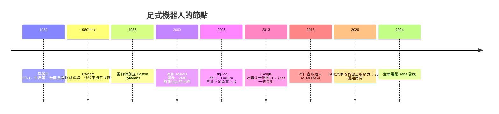

# 節標題：從 ASIMO 到 Boston Dynamics——足式行走的兩種哲學

## 靜態行走的桂冠：ASIMO 與 ZMP

雙足行走是控制領域數十年來最優雅的難題之一。日系機器人選擇了「靜態穩定性」的路線：以零力矩點（ZMP，Zero Moment Point）理論為核心——只要身體重心的地面投影落在腳掌支撐多邊形內，機器人就不會倒。早稻田大學的加藤一郎研究室在 1969 年做出世界第一台雙足步行機 WABOT 之後，日本把人形機器人當成「日本的特長」之一，學界、財閥與國家科研經費長期投入。

1997 年，本田發表 P3，2000 年推出小型化量產展示型機器人 ASIMO（Advanced Step in Innovative MObility）。本田的工程團隊從 1986 年的 E 系雙足機一路迭代近三十年：ASIMO 能以數公里時速行走、上下樓梯、單腳跳、甚至慢跑，身高 130 公分、五十三公斤的白色身影，是整個 2000 年代全球科技展會的巨星，本田更以它各地展演傳遞「機器人共生社會」的企業形象。ASIMO 的行走依靠 ZMP 軌跡預先規劃與全身的高精度位置控制，動作宛如精心編排的舞步——美則美矣，卻有一個致命缺陷：**一旦被推、被絆、踏在不規則地形上，它就無法快速反應**。靜態規劃的計算在 3D 世界的不確定性面前力不從心。2018 年 3 月，本田宣布停止 ASIMO 的開發與展示，轉向「看護、移動」等實用方向——三十年的偶像級項目，最終在實用化與成本的天平上退場。

## 動態平衡：Raibert 的單腿跳躍者

與日系的「不倒」哲學相對，MIT 的馬克・雷伯特（Marc Raibert）選擇讓機器人「先摔，再自己站回來」。1980 年代，他做出著名的單腿跳躍機（one-legged hopper）：液壓推動的彈簧腿以週期性的跳躍前進，機身由簡單的控制律不斷校正——落腳點、身體姿態、推進力。關鍵洞見是：**平衡不需要靜態穩定，可以透過動能與連續調整獲得**，就像人跑步時每一瞬間其實都在「向摔倒的方向追趕」。

1986 年雷伯特創立 Boston Dynamics（波士頓動力），最初是 MIT 的衍生公司，於麻省理工學院與卡內基梅隆的科技土壤中孕育。1990 年代公司為波音、戴姆勒等做大型機器人計畫，1992 年轉到 MIT 外的自主公司運作。2000 年代初，美國 DARPA 為戰場後勤資助「騾馬式」四足負重機器人。2005 年波士頓動力發表 BigDog：一米體長的四足液壓機器，能在冰面打滑、被側踢、在碎石坡上穩定背負重行軍——那段工程師用腳「踹」機器狗的影片，是 YouTube 時代第一波「機器人病毒式傳播」的重要節點。隨後 AlphaDog 攜軍規續航、跳貓 WildCat、以及 2013 年收購波士頓動力的 Google（隸屬 Alphabet）對研發的重金投入，公司進入爆發期：

- **Atlas（2013 首發）**：兩足人形平台，先液壓驅動，2024 年推出全電動新版本，能在崎嶇地形奔跑、後空翻、做木工任務；
- **Spot**：一款真正的機器狗產品，2015 年首發、2020 年開始商用出售（約 74,500 美元起），被新的生命期待用於電廠巡檢、疫情醫院偵測、警察與建築工地；
- **2020 年代的「跑酷」演示**：Atlas 後空翻、跨越障礙、360 度轉體——演算法從傳統的模型預測控制走向更輕的策略層；Boston Dynamics 被 Google 賣給軟銀（2017）、再轉手現代汽車（2020），商用產品線與威嚇氛圍的雙重動力共同維持了公司幾十年的「表演型工程文化」。

## 演算法的分水嶺：MPC 與強化學習

技術哲學的分歧最終以演算法語言體現。日系 ZMP 方法本質上依賴**模型與預先規劃**：以簡化模型（線性倒單擺 LIPM）生成步行模式，關節控制器逐一追蹤。Boston Dynamics 系統的核心更接近**模型預測控制（MPC）**：在每個瞬間，先由狀態估計器融合 IMU、關節編碼器、力感測得知「我在哪、腳接觸了什麼」，再以極短時間窗口（毫秒級）內的非線性最佳化求出接下來的地面反力與關節力矩，一邊走一邊解數學——「平衡是持續求解的 AP練習題，不是先驗編舞」。

2020 年代中期，強化學習（RL）加入：讓機器人在模擬環境中經過數百萬次摔倒學出策略，把「地形適應」從工程寫死變成「學出來」。不過對於精度、使命關鍵的運動控制（高節塑、越野），RL 與 MPC 常以 **RL 給目標動作、MPC 落地保底** 的混合架構出現，這也是目前 Atlas、Unitree、Apptronik 隊伍的普遍選擇。

## 生態的擴散

放眼世界，足式機器人在 2020 年代形成真正的競爭生態：

- **Unitree（宇樹）**（杭州，王興興）：以四足機器狗（Go、B2）為主力、2020 年代後期推出性價比極強的人形平台，把中國電動車供應鏈的關節與電池成本優勢帶入足式機器人；
- **Agility Robotics（美國俄勒岡）**：Cassie 的研究基礎上推出 Digit，與倉儲物流企業簽署商用部署；
- **Apptronik（德州，奧斯汀）**：從 NASA JSC 的 Valkyrie 傳承技術，轉向通用式人形；
- 波士頓動力以外，Tesla 也在跨越而入（下一節的主角）。

從 ASIMO 到 Atlas 再到宇樹，足式機器人的故事說明了兩件事：一是教科書上的「最優解」不一定是最早贏的方法，靜態工程用了三十年仍敗給動態哲學的靈活性；二是軍事的需求眼光（DARPA）再次把前沿技術推向「表演即實驗」的發展路徑——機器狗在 YouTube 上比在倉庫裡更快證明了自身價值。當下一個時代開啟，人形機器人不再只是實驗室的寵物，而開始要面對經濟學的真實問題：它的工資、它的工位、它下 C 專屬的崗位究竟在哪裡。
